# Images de référence par type — doc-prof

> Sélection : une image du dépôt par famille, avec des mots-clés précis. Les originaux restent à leur emplacement ; cette page ne déplace et ne remplace aucun fichier.

Références destinées à comparer les styles et à guider les prochaines générations. Les mots-clés décrivent le sujet et le contexte ; ils peuvent être affinés après contrôle visuel individuel.

## 1. Objet — Taille-crayon

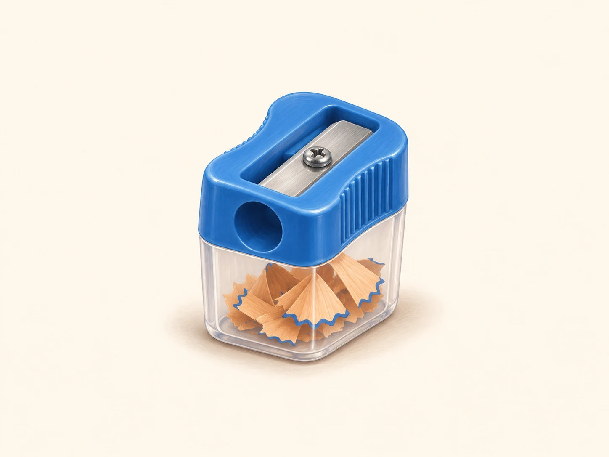

**Image :** `public/lib/images/tcf/catalogue/objets/ecole/taille-crayon.webp`

**Mots-clés :** `taille-crayon` · `fourniture scolaire` · `école` · `crayon` · `objet isolé` · `fond crème` · `matériel`

---

## 2. Lieu et décor (bg) — Salle de cinéma

**Image :** `public/lib/images/tcf/co/bg/cinema.webp`

**Mots-clés :** `cinéma` · `salle de cinéma` · `fauteuils rouges` · `grand écran` · `intérieur` · `décor vide` · `lieu public`

---

## 3. Scénario — Dialogue autour d’un jus d’orange

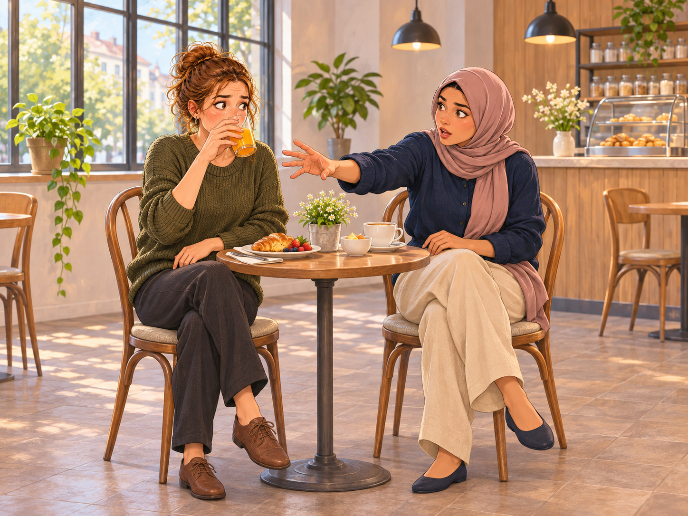

**Image :** `public/lib/images/tcf/co/scenes/reprises/dialogue-jus-orange-personnages-entiers.png`

**Mots-clés :** `dialogue` · `jus d’orange` · `amie` · `restaurant` · `conversation` · `personnages entiers` · `interaction`

---

## 4. Action — Faire cuire à la poêle

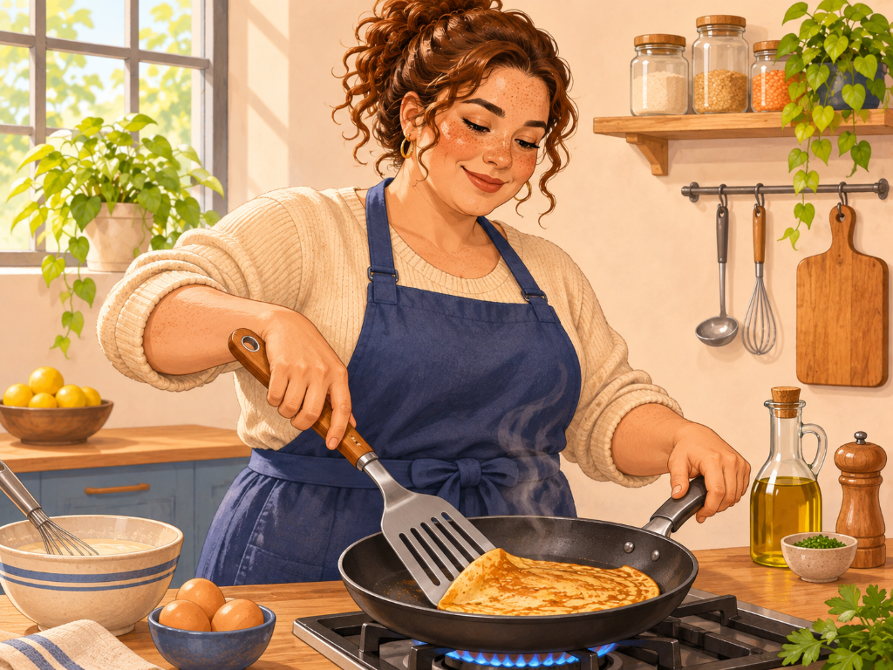

**Image :** `public/lib/images/tcf/catalogue/ajouts-20261117/actions/cuire-a-la-poele.webp`

**Mots-clés :** `cuire` · `poêle` · `spatule` · `cuisiner` · `préparation` · `geste` · `action quotidienne`

---

## 5. Animal — Flamant rose

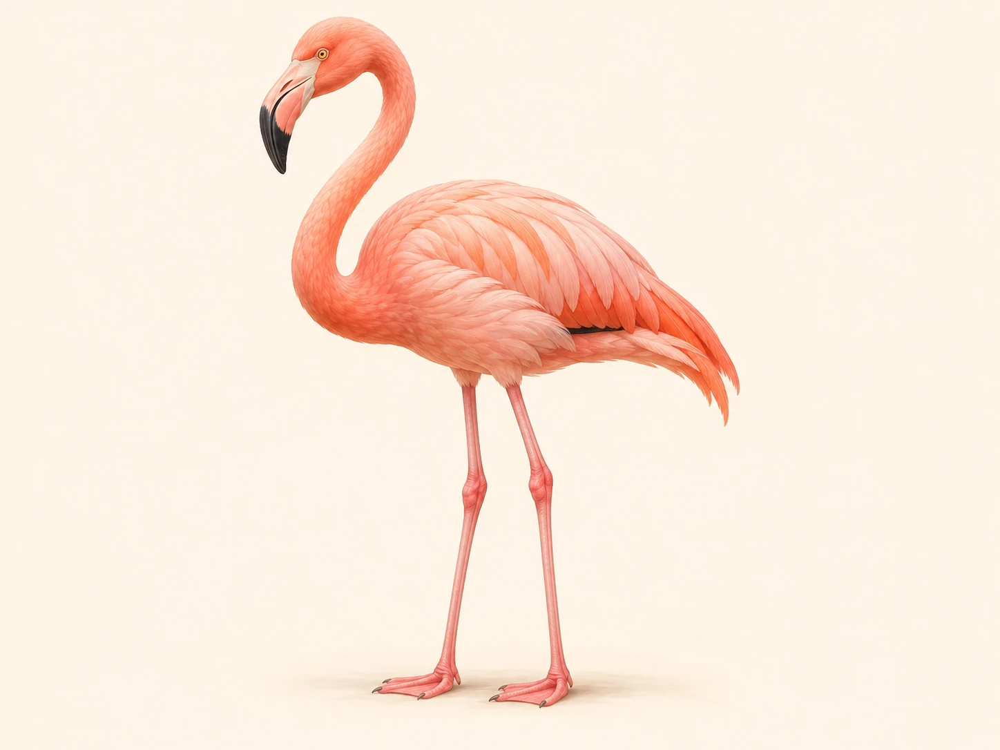

**Image :** `public/lib/images/tcf/catalogue/animaux/flamant-rose.webp`

**Mots-clés :** `flamant rose` · `oiseau` · `animal` · `plumage rose` · `longues pattes` · `nature` · `corps entier`

---

## 6. Fruit — Pomme

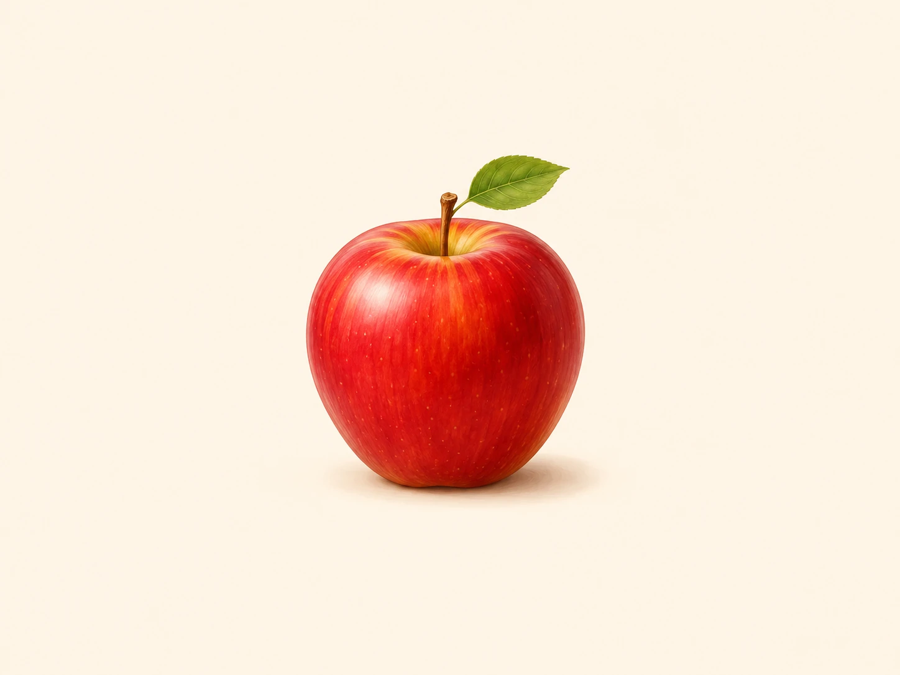

**Image :** `public/lib/images/tcf/qcm-audit/vocab-pomme.webp`

**Mots-clés :** `pomme` · `fruit` · `aliment` · `verger` · `fruit entier` · `vocabulaire`

---

## 7. Légume — Carotte

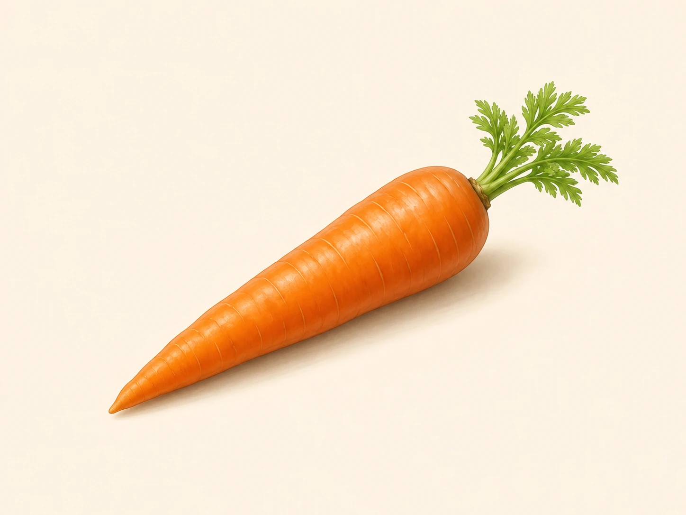

**Image :** `public/lib/images/tcf/qcm-audit/vocab-carotte.webp`

**Mots-clés :** `carotte` · `légume` · `racine` · `aliment` · `potager` · `vocabulaire`

---

## 8. Plat — Pizza

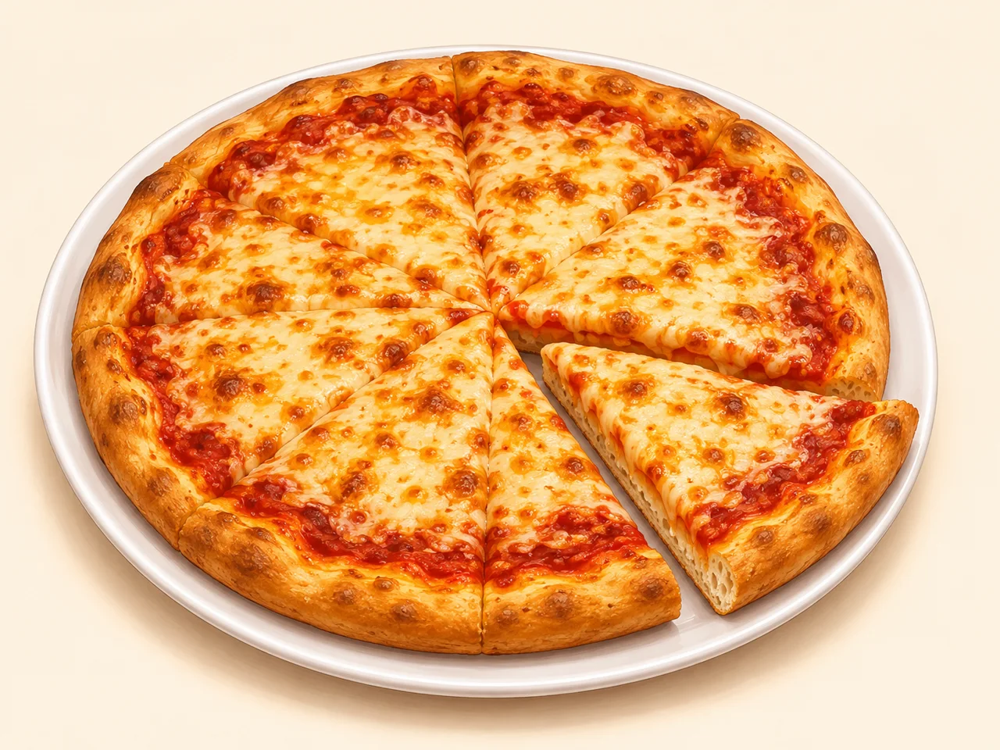

**Image :** `public/lib/images/tcf/qcm-audit/co834-pizza-dessinee.webp`

**Mots-clés :** `pizza` · `plat préparé` · `repas` · `cuisine` · `alimentation` · `pizzeria`

---

## 9. Véhicule — Camion de pompiers

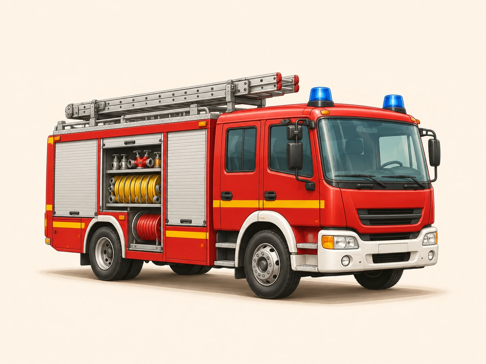

**Image :** `public/lib/images/tcf/catalogue/vehicules/camion-de-pompiers.webp`

**Mots-clés :** `camion de pompiers` · `véhicule` · `secours` · `transport` · `camion` · `roues`

---

## 10. Végétal — Rose (fleur)

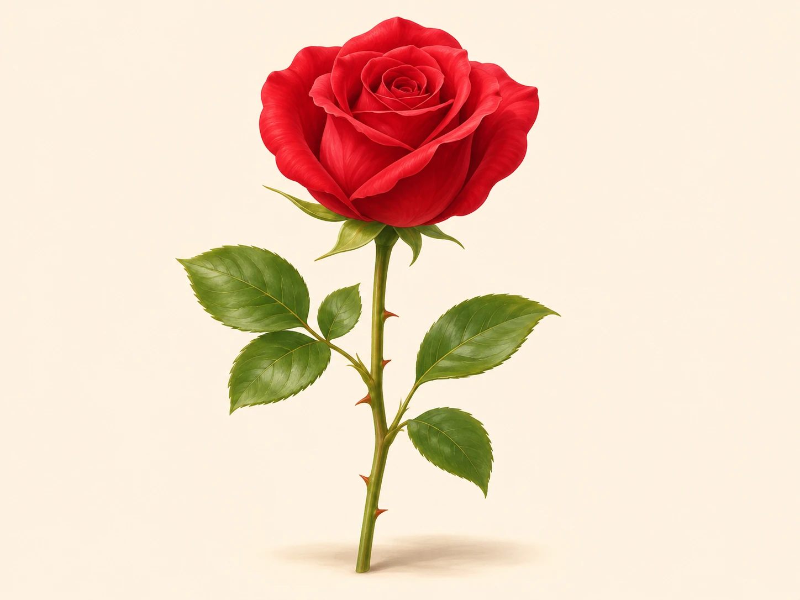

**Image :** `public/lib/images/tcf/catalogue/vegetaux/rose.webp`

**Mots-clés :** `rose` · `fleur` · `plante` · `tige` · `feuilles` · `botanique` · `végétal`

---

## 11. Métier — Maîtresse d’école

**Image :** `public/lib/images/vocabulaire/metiers/maîtresse.webp`

**Mots-clés :** `maîtresse` · `enseignante` · `métier` · `école` · `éducation` · `profession`

---

## 12. Personnage — Pronom « je »

**Image :** `public/lib/images/gattegno/pronom-je.webp`

**Mots-clés :** `personne` · `je` · `pronom personnel` · `se désigner` · `geste` · `personnage` · `grammaire`

---

## 13. Maladie — Grippe

**Image :** `public/lib/images/tcf/catalogue/maladies/grippe.webp`

**Mots-clés :** `grippe` · `santé` · `maladie` · `repos` · `fièvre` · `couverture` · `mouchoirs`

---

## 14. Document — Message de rendez-vous

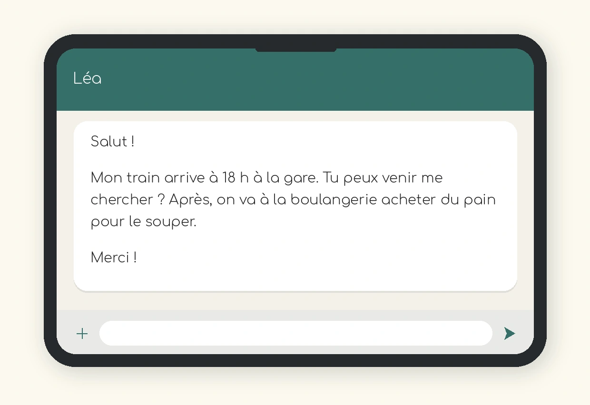

**Image :** `public/lib/images/tcf/ce-art-generated/tcf-a0a1-ce-001.webp`

**Mots-clés :** `message` · `rendez-vous` · `SMS` · `document` · `lecture` · `compréhension écrite` · `texte`

---

## 15. Pays et nationalité — Suisse

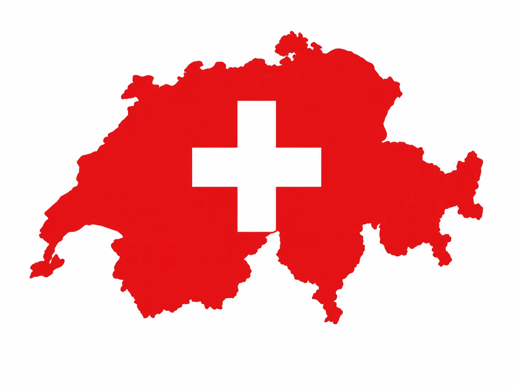

**Image :** `public/lib/images/vocabulaire/pays/suisse.webp`

**Mots-clés :** `Suisse` · `pays` · `géographie` · `nationalité` · `Europe` · `vocabulaire`

---

## 16. Partie du corps — Épaule

**Image :** `public/lib/images/vocabulaire/sante/epaule.webp`

**Mots-clés :** `épaule` · `corps humain` · `anatomie` · `articulation` · `bras` · `santé`

---

## 17. Heure et horloge — Neuf heures trente-cinq

**Image :** `public/lib/images/vocabulaire/heure-horloge/neuf-heures-trente-cinq.webp`

**Mots-clés :** `heure` · `horloge` · `cadran` · `aiguilles` · `09 h 35` · `lire l’heure` · `temps`

---

## 18. Logique — Suite graphique — première image

**Image :** `public/lib/images/logique/suite-graphique/p01-e01/01.webp`

**Mots-clés :** `logique` · `suite graphique` · `observation` · `forme` · `raisonnement` · `suite` · `exercice`

---

## Règles communes

- **Un fichier individuel par image** : pas de planche de scènes à la place de l’illustration source.
- **Mots-clés par image** : nom du sujet, catégorie, éléments visibles, contexte ou usage, sans inventer des éléments absents.
- **Styles distincts** : objet isolé sur fond clair, lieu/décor sans personnage, scénario contextualisé avec personnages, selon les consignes du dépôt.
- **Images originales conservées** : toutes les références ci-dessus sont des liens vers les fichiers existants.

## Lot complémentaire de décors (23 novembre 2026)

Les 100 créations individuelles sont listées dans [le manifeste avec mots-clés](decors-20261123.json). Les 18 références ci-dessus restent inchangées et servent uniquement à comparer les familles d'images ; aucune image de référence n'est écrasée.
