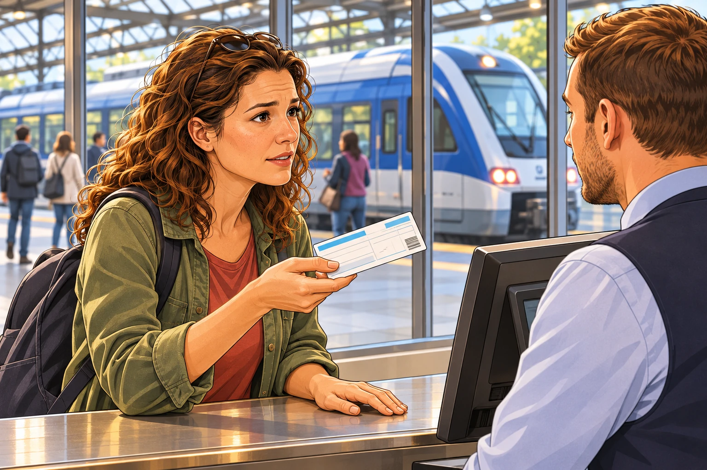
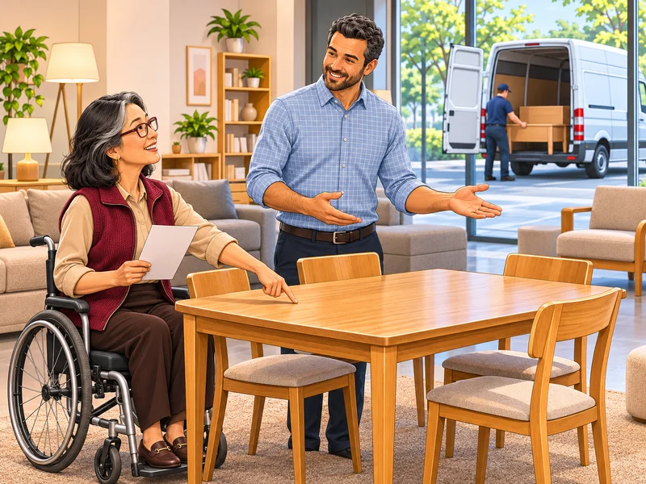
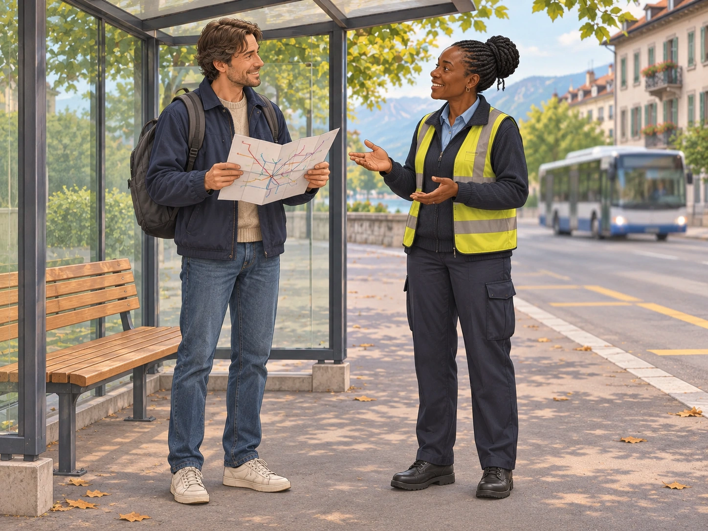
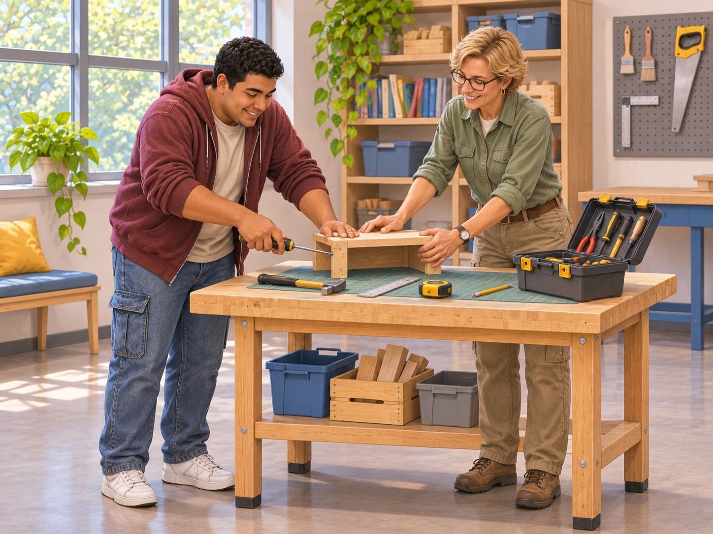
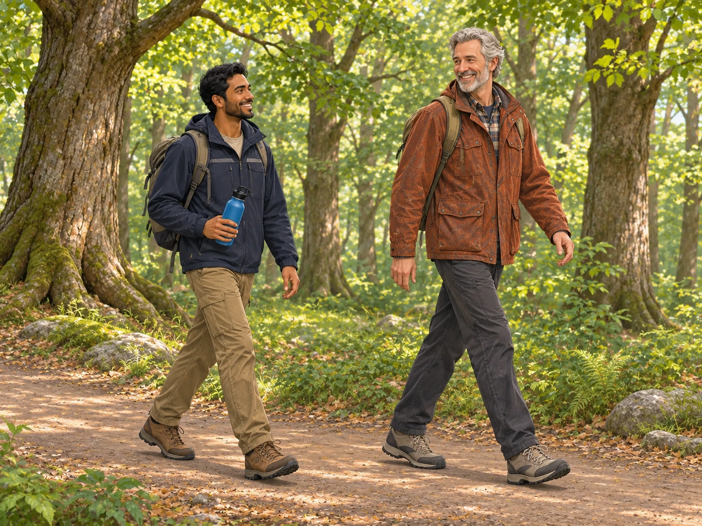
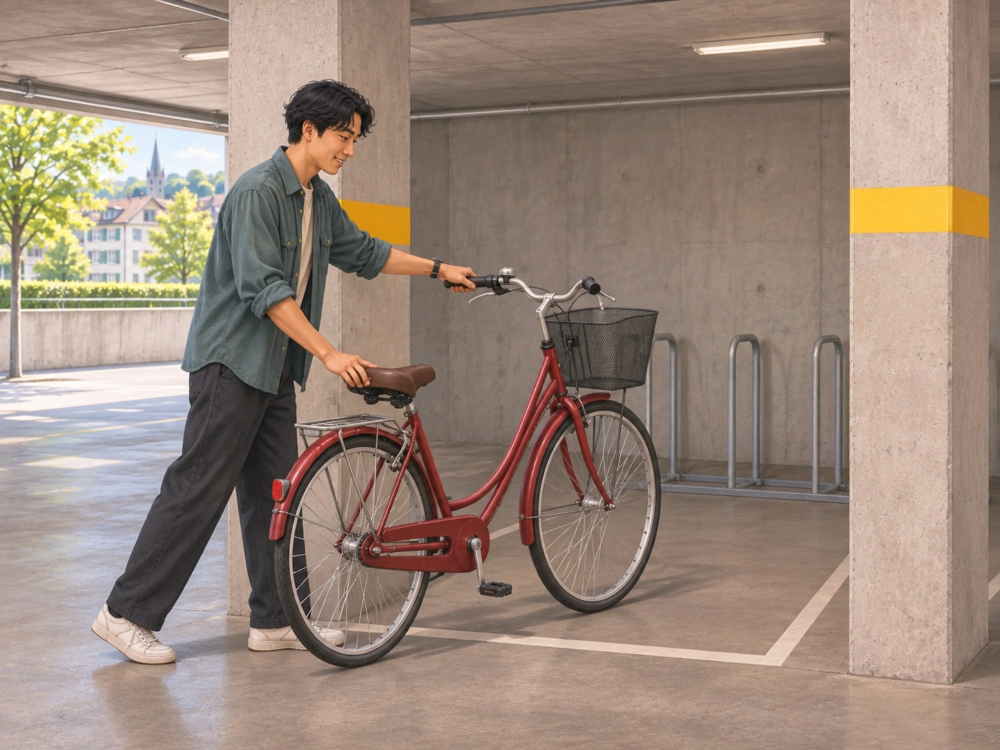

# Fiches de communication illustrées

42 situations illustrées sur les 160 du registre.

Chaque fiche propose un texte à lire, cinq questions, une production écrite et une prise de parole.

Les fiches ci-dessous reprennent les situations de la première banque de communication. Les activités par niveau restent dans le générateur. [Suivi des banques graduées](implementation/README.md)

## Demander une possibilité

### Le billet

**Lire la situation**

Lina est à la gare. Le moment prévu est ce matin. Son objectif est de changer son billet. Le document mentionne un billet de train.

1. Qui est au centre de cette situation ?

   A. Paul · B. Nadia · C. Lina
2. Où se trouve cette personne ?

   A. à la bibliothèque · B. à la gare · C. au cabinet médical
3. Quel est le moment prévu ?

   A. ce matin · B. lundi matin · C. mercredi
4. Quel est son objectif ?

   A. prendre un rendez-vous · B. emprunter un roman · C. changer son billet
5. Quel objet ou élément le document mentionne-t-il ?

   A. une carte de lecteur · B. un billet de train · C. une carte d’assurance

**Écrire** — Lina veut changer son billet : écrivez une phrase utile pour cette situation.

**Dire** — Vous êtes à la place de Lina : dites une phrase utile pour changer son billet.

Corrigé et modèle

1. Lina
2. à la gare
3. ce matin
4. changer son billet
5. un billet de train

Modèle de production — Je voudrais changer mon billet.

### La consultation

**Lire la situation**

Paul est au cabinet médical. Le moment prévu est lundi matin. Son objectif est de prendre un rendez-vous. Le document mentionne une carte d’assurance.

1. Qui est au centre de cette situation ?

   A. Lina · B. Nadia · C. Paul
2. Où se trouve cette personne ?

   A. à la bibliothèque · B. au cabinet médical · C. à la gare
3. Quel est le moment prévu ?

   A. lundi matin · B. ce matin · C. mercredi
4. Quel est son objectif ?

   A. changer son billet · B. emprunter un roman · C. prendre un rendez-vous
5. Quel objet ou élément le document mentionne-t-il ?

   A. une carte de lecteur · B. une carte d’assurance · C. un billet de train

**Écrire** — Paul veut prendre un rendez-vous : écrivez une phrase utile pour cette situation.

**Dire** — Vous êtes à la place de Paul : dites une phrase utile pour prendre un rendez-vous.

Corrigé et modèle

1. Paul
2. au cabinet médical
3. lundi matin
4. prendre un rendez-vous
5. une carte d’assurance

Modèle de production — Je voudrais prendre un rendez-vous.

### Le livre

**Lire la situation**

Nadia est à la bibliothèque. Le moment prévu est mercredi. Son objectif est d’emprunter un roman. Le document mentionne une carte de lecteur.

1. Qui est au centre de cette situation ?

   A. Lina · B. Paul · C. Nadia
2. Où se trouve cette personne ?

   A. au cabinet médical · B. à la bibliothèque · C. à la gare
3. Quel est le moment prévu ?

   A. mercredi · B. ce matin · C. lundi matin
4. Quel est son objectif ?

   A. changer son billet · B. prendre un rendez-vous · C. emprunter un roman
5. Quel objet ou élément le document mentionne-t-il ?

   A. une carte d’assurance · B. une carte de lecteur · C. un billet de train

**Écrire** — Nadia veut emprunter un roman : écrivez une phrase utile pour cette situation.

**Dire** — Vous êtes à la place de Nadia : dites une phrase utile pour emprunter un roman.

Corrigé et modèle

1. Nadia
2. à la bibliothèque
3. mercredi
4. emprunter un roman
5. une carte de lecteur

Modèle de production — Est-ce que je peux emprunter ce roman ?

### La salle

**Lire la situation**

Omar est à la mairie. Le moment prévu est vendredi. Son objectif est de réserver une salle. Le document mentionne un formulaire de réservation.

1. Qui est au centre de cette situation ?

   A. Lina · B. Paul · C. Omar
2. Où se trouve cette personne ?

   A. au cabinet médical · B. à la mairie · C. à la gare
3. Quel est le moment prévu ?

   A. vendredi · B. ce matin · C. lundi matin
4. Quel est son objectif ?

   A. changer son billet · B. prendre un rendez-vous · C. réserver une salle
5. Quel objet ou élément le document mentionne-t-il ?

   A. une carte d’assurance · B. un formulaire de réservation · C. un billet de train

**Écrire** — Omar veut réserver une salle : écrivez une phrase utile pour cette situation.

**Dire** — Vous êtes à la place de Omar : dites une phrase utile pour réserver une salle.

Corrigé et modèle

1. Omar
2. à la mairie
3. vendredi
4. réserver une salle
5. un formulaire de réservation

Modèle de production — Je voudrais réserver une salle.

### Le repas

**Lire la situation**

Sofia est à la cantine. Le moment prévu est à midi. Son objectif est de demander un plat végétarien. Le document mentionne le menu du jour.

1. Qui est au centre de cette situation ?

   A. Lina · B. Paul · C. Sofia
2. Où se trouve cette personne ?

   A. au cabinet médical · B. à la cantine · C. à la gare
3. Quel est le moment prévu ?

   A. à midi · B. ce matin · C. lundi matin
4. Quel est son objectif ?

   A. changer son billet · B. prendre un rendez-vous · C. demander un plat végétarien
5. Quel objet ou élément le document mentionne-t-il ?

   A. une carte d’assurance · B. le menu du jour · C. un billet de train

**Écrire** — Sofia veut demander un plat végétarien : écrivez une phrase utile pour cette situation.

**Dire** — Vous êtes à la place de Sofia : dites une phrase utile pour demander un plat végétarien.

Corrigé et modèle

1. Sofia
2. à la cantine
3. à midi
4. demander un plat végétarien
5. le menu du jour

Modèle de production — Est-ce que je peux avoir un plat végétarien ?

### La formation

**Lire la situation**

Kenji est au centre de formation. Le moment prévu est mardi soir. Son objectif est de suivre un cours de français. Le document mentionne un dossier d’inscription.

1. Qui est au centre de cette situation ?

   A. Lina · B. Paul · C. Kenji
2. Où se trouve cette personne ?

   A. au cabinet médical · B. au centre de formation · C. à la gare
3. Quel est le moment prévu ?

   A. mardi soir · B. ce matin · C. lundi matin
4. Quel est son objectif ?

   A. changer son billet · B. prendre un rendez-vous · C. suivre un cours de français
5. Quel objet ou élément le document mentionne-t-il ?

   A. une carte d’assurance · B. un dossier d’inscription · C. un billet de train

**Écrire** — Kenji veut suivre un cours de français : écrivez une phrase utile pour cette situation.

**Dire** — Vous êtes à la place de Kenji : dites une phrase utile pour suivre un cours de français.

Corrigé et modèle

1. Kenji
2. au centre de formation
3. mardi soir
4. suivre un cours de français
5. un dossier d’inscription

Modèle de production — Je voudrais suivre un cours de français.

### La livraison

**Lire la situation**

Mei est au magasin de meubles. Le moment prévu est samedi. Son objectif est de faire livrer une table. Le document mentionne un bon de commande.

1. Qui est au centre de cette situation ?

   A. Lina · B. Paul · C. Mei
2. Où se trouve cette personne ?

   A. au cabinet médical · B. au magasin de meubles · C. à la gare
3. Quel est le moment prévu ?

   A. samedi · B. ce matin · C. lundi matin
4. Quel est son objectif ?

   A. changer son billet · B. prendre un rendez-vous · C. faire livrer une table
5. Quel objet ou élément le document mentionne-t-il ?

   A. une carte d’assurance · B. un bon de commande · C. un billet de train

**Écrire** — Mei veut faire livrer une table : écrivez une phrase utile pour cette situation.

**Dire** — Vous êtes à la place de Mei : dites une phrase utile pour faire livrer une table.

Corrigé et modèle

1. Mei
2. au magasin de meubles
3. samedi
4. faire livrer une table
5. un bon de commande

Modèle de production — Est-ce que vous pouvez livrer cette table ?

### Le passeport

**Lire la situation**

Karim est au consulat. Le moment prévu est jeudi matin. Son objectif est de renouveler son passeport. Le document mentionne une photo d’identité.

1. Qui est au centre de cette situation ?

   A. Lina · B. Paul · C. Karim
2. Où se trouve cette personne ?

   A. au cabinet médical · B. au consulat · C. à la gare
3. Quel est le moment prévu ?

   A. jeudi matin · B. ce matin · C. lundi matin
4. Quel est son objectif ?

   A. changer son billet · B. prendre un rendez-vous · C. renouveler son passeport
5. Quel objet ou élément le document mentionne-t-il ?

   A. une carte d’assurance · B. une photo d’identité · C. un billet de train

**Écrire** — Karim veut renouveler son passeport : écrivez une phrase utile pour cette situation.

**Dire** — Vous êtes à la place de Karim : dites une phrase utile pour renouveler son passeport.

Corrigé et modèle

1. Karim
2. au consulat
3. jeudi matin
4. renouveler son passeport
5. une photo d’identité

Modèle de production — Je voudrais renouveler mon passeport.

### Le vélo

**Lire la situation**

Emma est à l’atelier de réparation. Le moment prévu est demain. Son objectif est de faire réparer un frein. Le document mentionne un vélo rouge.

1. Qui est au centre de cette situation ?

   A. Lina · B. Paul · C. Emma
2. Où se trouve cette personne ?

   A. au cabinet médical · B. à l’atelier de réparation · C. à la gare
3. Quel est le moment prévu ?

   A. demain · B. ce matin · C. lundi matin
4. Quel est son objectif ?

   A. changer son billet · B. prendre un rendez-vous · C. faire réparer un frein
5. Quel objet ou élément le document mentionne-t-il ?

   A. une carte d’assurance · B. un vélo rouge · C. un billet de train

**Écrire** — Emma veut faire réparer un frein : écrivez une phrase utile pour cette situation.

**Dire** — Vous êtes à la place de Emma : dites une phrase utile pour faire réparer un frein.

Corrigé et modèle

1. Emma
2. à l’atelier de réparation
3. demain
4. faire réparer un frein
5. un vélo rouge

Modèle de production — Est-ce que vous pouvez réparer ce frein ?

### Le congé

**Lire la situation**

Marco est au bureau. Le moment prévu est cet après-midi. Son objectif est de demander un jour de congé. Le document mentionne le planning de travail.

1. Qui est au centre de cette situation ?

   A. Lina · B. Paul · C. Marco
2. Où se trouve cette personne ?

   A. au cabinet médical · B. au bureau · C. à la gare
3. Quel est le moment prévu ?

   A. cet après-midi · B. ce matin · C. lundi matin
4. Quel est son objectif ?

   A. changer son billet · B. prendre un rendez-vous · C. demander un jour de congé
5. Quel objet ou élément le document mentionne-t-il ?

   A. une carte d’assurance · B. le planning de travail · C. un billet de train

**Écrire** — Marco veut demander un jour de congé : écrivez une phrase utile pour cette situation.

**Dire** — Vous êtes à la place de Marco : dites une phrase utile pour demander un jour de congé.

Corrigé et modèle

1. Marco
2. au bureau
3. cet après-midi
4. demander un jour de congé
5. le planning de travail

Modèle de production — Je voudrais prendre un jour de congé.

## Demander une information

### La sortie

**Lire la situation**

Lina est au musée. Le moment prévu est samedi matin. Son objectif est de visiter une exposition. Le document mentionne un billet gratuit.

1. Qui est au centre de cette situation ?

   A. Paul · B. Nadia · C. Lina
2. Où se trouve cette personne ?

   A. au secrétariat · B. au musée · C. à l’arrêt de bus
3. Quel est le moment prévu ?

   A. samedi matin · B. à huit heures · C. lundi
4. Quel est son objectif ?

   A. aller à l’hôpital · B. s’inscrire au cours · C. visiter une exposition
5. Quel objet ou élément le document mentionne-t-il ?

   A. un formulaire papier · B. un billet gratuit · C. le plan du réseau

**Écrire** — Écrivez une question utile à Lina pour cette situation.

**Dire** — Posez une question utile à Lina pour cette situation.

Corrigé et modèle

1. Lina
2. au musée
3. samedi matin
4. visiter une exposition
5. un billet gratuit

Modèle de production — À quelle heure commence la visite ?

### Le bus

**Lire la situation**

Paul est à l’arrêt de bus. Le moment prévu est à huit heures. Son objectif est de aller à l’hôpital. Le document mentionne le plan du réseau.

1. Qui est au centre de cette situation ?

   A. Lina · B. Nadia · C. Paul
2. Où se trouve cette personne ?

   A. au secrétariat · B. à l’arrêt de bus · C. au musée
3. Quel est le moment prévu ?

   A. à huit heures · B. samedi matin · C. lundi
4. Quel est son objectif ?

   A. visiter une exposition · B. s’inscrire au cours · C. aller à l’hôpital
5. Quel objet ou élément le document mentionne-t-il ?

   A. un formulaire papier · B. le plan du réseau · C. un billet gratuit

**Écrire** — Écrivez une question utile à Paul pour cette situation.

**Dire** — Posez une question utile à Paul pour cette situation.

Corrigé et modèle

1. Paul
2. à l’arrêt de bus
3. à huit heures
4. aller à l’hôpital
5. le plan du réseau

Modèle de production — Quel bus va à l’hôpital ?

### Le formulaire

**Lire la situation**

Nadia est au secrétariat. Le moment prévu est lundi. Son objectif est de s’inscrire au cours. Le document mentionne un formulaire papier.

1. Qui est au centre de cette situation ?

   A. Lina · B. Paul · C. Nadia
2. Où se trouve cette personne ?

   A. à l’arrêt de bus · B. au secrétariat · C. au musée
3. Quel est le moment prévu ?

   A. lundi · B. samedi matin · C. à huit heures
4. Quel est son objectif ?

   A. visiter une exposition · B. aller à l’hôpital · C. s’inscrire au cours
5. Quel objet ou élément le document mentionne-t-il ?

   A. le plan du réseau · B. un formulaire papier · C. un billet gratuit

**Écrire** — Écrivez une question utile à Nadia pour cette situation.

**Dire** — Posez une question utile à Nadia pour cette situation.

Corrigé et modèle

1. Nadia
2. au secrétariat
3. lundi
4. s’inscrire au cours
5. un formulaire papier

Modèle de production — Où dois-je déposer le formulaire ?

### La piscine

**Lire la situation**

Omar est à la piscine. Le moment prévu est dimanche. Son objectif est de nager avec ses enfants. Le document mentionne des billets familiaux.

1. Qui est au centre de cette situation ?

   A. Lina · B. Paul · C. Omar
2. Où se trouve cette personne ?

   A. à l’arrêt de bus · B. à la piscine · C. au musée
3. Quel est le moment prévu ?

   A. dimanche · B. samedi matin · C. à huit heures
4. Quel est son objectif ?

   A. visiter une exposition · B. aller à l’hôpital · C. nager avec ses enfants
5. Quel objet ou élément le document mentionne-t-il ?

   A. le plan du réseau · B. des billets familiaux · C. un billet gratuit

**Écrire** — Écrivez une question utile à Omar pour cette situation.

**Dire** — Posez une question utile à Omar pour cette situation.

Corrigé et modèle

1. Omar
2. à la piscine
3. dimanche
4. nager avec ses enfants
5. des billets familiaux

Modèle de production — Quand la piscine ferme-t-elle ?

### Le logement

**Lire la situation**

Sofia est à l’agence immobilière. Le moment prévu est mardi. Son objectif est de visiter un appartement. Le document mentionne une annonce de location.

1. Qui est au centre de cette situation ?

   A. Lina · B. Paul · C. Sofia
2. Où se trouve cette personne ?

   A. à l’arrêt de bus · B. à l’agence immobilière · C. au musée
3. Quel est le moment prévu ?

   A. mardi · B. samedi matin · C. à huit heures
4. Quel est son objectif ?

   A. visiter une exposition · B. aller à l’hôpital · C. visiter un appartement
5. Quel objet ou élément le document mentionne-t-il ?

   A. le plan du réseau · B. une annonce de location · C. un billet gratuit

**Écrire** — Écrivez une question utile à Sofia pour cette situation.

**Dire** — Posez une question utile à Sofia pour cette situation.

Corrigé et modèle

1. Sofia
2. à l’agence immobilière
3. mardi
4. visiter un appartement
5. une annonce de location

Modèle de production — Combien coûte le loyer ?

### La pharmacie

**Lire la situation**

Kenji est à la pharmacie. Le moment prévu est ce soir. Son objectif est de acheter un médicament. Le document mentionne une ordonnance.

1. Qui est au centre de cette situation ?

   A. Lina · B. Paul · C. Kenji
2. Où se trouve cette personne ?

   A. à l’arrêt de bus · B. à la pharmacie · C. au musée
3. Quel est le moment prévu ?

   A. ce soir · B. samedi matin · C. à huit heures
4. Quel est son objectif ?

   A. visiter une exposition · B. aller à l’hôpital · C. acheter un médicament
5. Quel objet ou élément le document mentionne-t-il ?

   A. le plan du réseau · B. une ordonnance · C. un billet gratuit

**Écrire** — Écrivez une question utile à Kenji pour cette situation.

**Dire** — Posez une question utile à Kenji pour cette situation.

Corrigé et modèle

1. Kenji
2. à la pharmacie
3. ce soir
4. acheter un médicament
5. une ordonnance

Modèle de production — Comment dois-je prendre ce médicament ?

### Le marché

**Lire la situation**

Mei est sur la place du village. Le moment prévu est mercredi matin. Son objectif est de acheter des légumes. Le document mentionne un panier.

1. Qui est au centre de cette situation ?

   A. Lina · B. Paul · C. Mei
2. Où se trouve cette personne ?

   A. à l’arrêt de bus · B. sur la place du village · C. au musée
3. Quel est le moment prévu ?

   A. mercredi matin · B. samedi matin · C. à huit heures
4. Quel est son objectif ?

   A. visiter une exposition · B. aller à l’hôpital · C. acheter des légumes
5. Quel objet ou élément le document mentionne-t-il ?

   A. le plan du réseau · B. un panier · C. un billet gratuit

**Écrire** — Écrivez une question utile à Mei pour cette situation.

**Dire** — Posez une question utile à Mei pour cette situation.

Corrigé et modèle

1. Mei
2. sur la place du village
3. mercredi matin
4. acheter des légumes
5. un panier

Modèle de production — Où se trouve le stand de légumes ?

### Le téléphone

**Lire la situation**

Karim est à la boutique de téléphones. Le moment prévu est vendredi. Son objectif est de choisir un abonnement. Le document mentionne une carte SIM.

1. Qui est au centre de cette situation ?

   A. Lina · B. Paul · C. Karim
2. Où se trouve cette personne ?

   A. à l’arrêt de bus · B. à la boutique de téléphones · C. au musée
3. Quel est le moment prévu ?

   A. vendredi · B. samedi matin · C. à huit heures
4. Quel est son objectif ?

   A. visiter une exposition · B. aller à l’hôpital · C. choisir un abonnement
5. Quel objet ou élément le document mentionne-t-il ?

   A. le plan du réseau · B. une carte SIM · C. un billet gratuit

**Écrire** — Écrivez une question utile à Karim pour cette situation.

**Dire** — Posez une question utile à Karim pour cette situation.

Corrigé et modèle

1. Karim
2. à la boutique de téléphones
3. vendredi
4. choisir un abonnement
5. une carte SIM

Modèle de production — Quel abonnement convient à mes besoins ?

### La crèche

**Lire la situation**

Emma est à la crèche. Le moment prévu est jeudi. Son objectif est de rencontrer une éducatrice. Le document mentionne le dossier de son enfant.

1. Qui est au centre de cette situation ?

   A. Lina · B. Paul · C. Emma
2. Où se trouve cette personne ?

   A. à l’arrêt de bus · B. à la crèche · C. au musée
3. Quel est le moment prévu ?

   A. jeudi · B. samedi matin · C. à huit heures
4. Quel est son objectif ?

   A. visiter une exposition · B. aller à l’hôpital · C. rencontrer une éducatrice
5. Quel objet ou élément le document mentionne-t-il ?

   A. le plan du réseau · B. le dossier de son enfant · C. un billet gratuit

**Écrire** — Écrivez une question utile à Emma pour cette situation.

**Dire** — Posez une question utile à Emma pour cette situation.

Corrigé et modèle

1. Emma
2. à la crèche
3. jeudi
4. rencontrer une éducatrice
5. le dossier de son enfant

Modèle de production — Avec qui puis-je parler de l’inscription ?

### Le colis

**Lire la situation**

Marco est à la poste. Le moment prévu est à midi. Son objectif est de retirer un colis. Le document mentionne un avis de passage.

1. Qui est au centre de cette situation ?

   A. Lina · B. Paul · C. Marco
2. Où se trouve cette personne ?

   A. à l’arrêt de bus · B. à la poste · C. au musée
3. Quel est le moment prévu ?

   A. à midi · B. samedi matin · C. à huit heures
4. Quel est son objectif ?

   A. visiter une exposition · B. aller à l’hôpital · C. retirer un colis
5. Quel objet ou élément le document mentionne-t-il ?

   A. le plan du réseau · B. un avis de passage · C. un billet gratuit

**Écrire** — Écrivez une question utile à Marco pour cette situation.

**Dire** — Posez une question utile à Marco pour cette situation.

Corrigé et modèle

1. Marco
2. à la poste
3. à midi
4. retirer un colis
5. un avis de passage

Modèle de production — Quel document dois-je présenter ?

## Proposer une activité

### La promenade

**Lire la situation**

Lina est au bord du lac. Le moment prévu est dimanche. Son objectif est de faire une promenade. Le document mentionne des chaussures de marche.

1. Qui est au centre de cette situation ?

   A. Paul · B. Nadia · C. Lina
2. Où se trouve cette personne ?

   A. au jardin du quartier · B. au bord du lac · C. à la piscine municipale
3. Quel est le moment prévu ?

   A. dimanche · B. mardi soir · C. samedi
4. Quel est son objectif ?

   A. faire de la natation · B. faire du jardinage · C. faire une promenade
5. Quel objet ou élément le document mentionne-t-il ?

   A. un petit arrosoir · B. des chaussures de marche · C. un bonnet de bain

**Écrire** — Lina veut faire une promenade : écrivez une phrase utile pour cette situation.

**Dire** — Vous êtes à la place de Lina : dites une phrase utile pour faire une promenade.

Corrigé et modèle

1. Lina
2. au bord du lac
3. dimanche
4. faire une promenade
5. des chaussures de marche

Modèle de production — Nous faisons une promenade au bord du lac.

### La natation

**Lire la situation**

Paul est à la piscine municipale. Le moment prévu est mardi soir. Son objectif est de faire de la natation. Le document mentionne un bonnet de bain.

1. Qui est au centre de cette situation ?

   A. Lina · B. Nadia · C. Paul
2. Où se trouve cette personne ?

   A. au jardin du quartier · B. à la piscine municipale · C. au bord du lac
3. Quel est le moment prévu ?

   A. mardi soir · B. dimanche · C. samedi
4. Quel est son objectif ?

   A. faire une promenade · B. faire du jardinage · C. faire de la natation
5. Quel objet ou élément le document mentionne-t-il ?

   A. un petit arrosoir · B. un bonnet de bain · C. des chaussures de marche

**Écrire** — Paul veut faire de la natation : écrivez une phrase utile pour cette situation.

**Dire** — Vous êtes à la place de Paul : dites une phrase utile pour faire de la natation.

Corrigé et modèle

1. Paul
2. à la piscine municipale
3. mardi soir
4. faire de la natation
5. un bonnet de bain

Modèle de production — Je fais de la natation le mardi.

### Le jardin partagé

**Lire la situation**

Nadia est au jardin du quartier. Le moment prévu est samedi. Son objectif est de faire du jardinage. Le document mentionne un petit arrosoir.

1. Qui est au centre de cette situation ?

   A. Lina · B. Paul · C. Nadia
2. Où se trouve cette personne ?

   A. à la piscine municipale · B. au jardin du quartier · C. au bord du lac
3. Quel est le moment prévu ?

   A. samedi · B. dimanche · C. mardi soir
4. Quel est son objectif ?

   A. faire une promenade · B. faire de la natation · C. faire du jardinage
5. Quel objet ou élément le document mentionne-t-il ?

   A. un bonnet de bain · B. un petit arrosoir · C. des chaussures de marche

**Écrire** — Nadia veut faire du jardinage : écrivez une phrase utile pour cette situation.

**Dire** — Vous êtes à la place de Nadia : dites une phrase utile pour faire du jardinage.

Corrigé et modèle

1. Nadia
2. au jardin du quartier
3. samedi
4. faire du jardinage
5. un petit arrosoir

Modèle de production — Je fais du jardinage avec les voisins.

### Le bricolage

**Lire la situation**

Omar est à la maison de quartier. Le moment prévu est mercredi. Son objectif est de faire du bricolage. Le document mentionne une boîte à outils.

1. Qui est au centre de cette situation ?

   A. Lina · B. Paul · C. Omar
2. Où se trouve cette personne ?

   A. à la piscine municipale · B. à la maison de quartier · C. au bord du lac
3. Quel est le moment prévu ?

   A. mercredi · B. dimanche · C. mardi soir
4. Quel est son objectif ?

   A. faire une promenade · B. faire de la natation · C. faire du bricolage
5. Quel objet ou élément le document mentionne-t-il ?

   A. un bonnet de bain · B. une boîte à outils · C. des chaussures de marche

**Écrire** — Omar veut faire du bricolage : écrivez une phrase utile pour cette situation.

**Dire** — Vous êtes à la place de Omar : dites une phrase utile pour faire du bricolage.

Corrigé et modèle

1. Omar
2. à la maison de quartier
3. mercredi
4. faire du bricolage
5. une boîte à outils

Modèle de production — Nous faisons du bricolage ensemble.

### Le vélo

**Lire la situation**

Sofia est dans le parc. Le moment prévu est vendredi matin. Son objectif est de faire du vélo. Le document mentionne un casque.

1. Qui est au centre de cette situation ?

   A. Lina · B. Paul · C. Sofia
2. Où se trouve cette personne ?

   A. à la piscine municipale · B. dans le parc · C. au bord du lac
3. Quel est le moment prévu ?

   A. vendredi matin · B. dimanche · C. mardi soir
4. Quel est son objectif ?

   A. faire une promenade · B. faire de la natation · C. faire du vélo
5. Quel objet ou élément le document mentionne-t-il ?

   A. un bonnet de bain · B. un casque · C. des chaussures de marche

**Écrire** — Sofia veut faire du vélo : écrivez une phrase utile pour cette situation.

**Dire** — Vous êtes à la place de Sofia : dites une phrase utile pour faire du vélo.

Corrigé et modèle

1. Sofia
2. dans le parc
3. vendredi matin
4. faire du vélo
5. un casque

Modèle de production — Je fais du vélo dans le parc.

### La danse

**Lire la situation**

Kenji est à la salle des fêtes. Le moment prévu est jeudi soir. Son objectif est de faire de la danse. Le document mentionne des chaussures souples.

1. Qui est au centre de cette situation ?

   A. Lina · B. Paul · C. Kenji
2. Où se trouve cette personne ?

   A. à la piscine municipale · B. à la salle des fêtes · C. au bord du lac
3. Quel est le moment prévu ?

   A. jeudi soir · B. dimanche · C. mardi soir
4. Quel est son objectif ?

   A. faire une promenade · B. faire de la natation · C. faire de la danse
5. Quel objet ou élément le document mentionne-t-il ?

   A. un bonnet de bain · B. des chaussures souples · C. des chaussures de marche

**Écrire** — Kenji veut faire de la danse : écrivez une phrase utile pour cette situation.

**Dire** — Vous êtes à la place de Kenji : dites une phrase utile pour faire de la danse.

Corrigé et modèle

1. Kenji
2. à la salle des fêtes
3. jeudi soir
4. faire de la danse
5. des chaussures souples

Modèle de production — Nous faisons de la danse le jeudi.

### Le dessin

**Lire la situation**

Mei est à l’atelier municipal. Le moment prévu est lundi. Son objectif est de faire des dessins. Le document mentionne un carnet.

1. Qui est au centre de cette situation ?

   A. Lina · B. Paul · C. Mei
2. Où se trouve cette personne ?

   A. à la piscine municipale · B. à l’atelier municipal · C. au bord du lac
3. Quel est le moment prévu ?

   A. lundi · B. dimanche · C. mardi soir
4. Quel est son objectif ?

   A. faire une promenade · B. faire de la natation · C. faire des dessins
5. Quel objet ou élément le document mentionne-t-il ?

   A. un bonnet de bain · B. un carnet · C. des chaussures de marche

**Écrire** — Mei veut faire des dessins : écrivez une phrase utile pour cette situation.

**Dire** — Vous êtes à la place de Mei : dites une phrase utile pour faire des dessins.

Corrigé et modèle

1. Mei
2. à l’atelier municipal
3. lundi
4. faire des dessins
5. un carnet

Modèle de production — Je fais des dessins dans mon carnet.

### La randonnée

**Lire la situation**

Karim est en forêt. Le moment prévu est dimanche matin. Son objectif est de faire de la randonnée. Le document mentionne une gourde.

1. Qui est au centre de cette situation ?

   A. Lina · B. Paul · C. Karim
2. Où se trouve cette personne ?

   A. à la piscine municipale · B. en forêt · C. au bord du lac
3. Quel est le moment prévu ?

   A. dimanche matin · B. dimanche · C. mardi soir
4. Quel est son objectif ?

   A. faire une promenade · B. faire de la natation · C. faire de la randonnée
5. Quel objet ou élément le document mentionne-t-il ?

   A. un bonnet de bain · B. une gourde · C. des chaussures de marche

**Écrire** — Karim veut faire de la randonnée : écrivez une phrase utile pour cette situation.

**Dire** — Vous êtes à la place de Karim : dites une phrase utile pour faire de la randonnée.

Corrigé et modèle

1. Karim
2. en forêt
3. dimanche matin
4. faire de la randonnée
5. une gourde

Modèle de production — Nous faisons de la randonnée en forêt.

### La cuisine

**Lire la situation**

Emma est au centre associatif. Le moment prévu est samedi midi. Son objectif est de faire la cuisine. Le document mentionne un tablier.

1. Qui est au centre de cette situation ?

   A. Lina · B. Paul · C. Emma
2. Où se trouve cette personne ?

   A. à la piscine municipale · B. au centre associatif · C. au bord du lac
3. Quel est le moment prévu ?

   A. samedi midi · B. dimanche · C. mardi soir
4. Quel est son objectif ?

   A. faire une promenade · B. faire de la natation · C. faire la cuisine
5. Quel objet ou élément le document mentionne-t-il ?

   A. un bonnet de bain · B. un tablier · C. des chaussures de marche

**Écrire** — Emma veut faire la cuisine : écrivez une phrase utile pour cette situation.

**Dire** — Vous êtes à la place de Emma : dites une phrase utile pour faire la cuisine.

Corrigé et modèle

1. Emma
2. au centre associatif
3. samedi midi
4. faire la cuisine
5. un tablier

Modèle de production — Je fais la cuisine avec le groupe.

### Le yoga

**Lire la situation**

Marco est au centre sportif. Le moment prévu est mercredi soir. Son objectif est de faire du yoga. Le document mentionne un tapis.

1. Qui est au centre de cette situation ?

   A. Lina · B. Paul · C. Marco
2. Où se trouve cette personne ?

   A. à la piscine municipale · B. au centre sportif · C. au bord du lac
3. Quel est le moment prévu ?

   A. mercredi soir · B. dimanche · C. mardi soir
4. Quel est son objectif ?

   A. faire une promenade · B. faire de la natation · C. faire du yoga
5. Quel objet ou élément le document mentionne-t-il ?

   A. un bonnet de bain · B. un tapis · C. des chaussures de marche

**Écrire** — Marco veut faire du yoga : écrivez une phrase utile pour cette situation.

**Dire** — Vous êtes à la place de Marco : dites une phrase utile pour faire du yoga.

Corrigé et modèle

1. Marco
2. au centre sportif
3. mercredi soir
4. faire du yoga
5. un tapis

Modèle de production — Je fais du yoga pour me détendre.

## Indiquer un lieu

### Les clés

**Lire la situation**

Lina est dans l’entrée. Le moment prévu est ce matin. Son objectif est de retrouver ses clés. Le document mentionne le tiroir sous le miroir.

1. Qui est au centre de cette situation ?

   A. Paul · B. Nadia · C. Lina
2. Où se trouve cette personne ?

   A. au centre de formation · B. dans l’entrée · C. à la gare
3. Quel est le moment prévu ?

   A. ce matin · B. à neuf heures · C. lundi
4. Quel est son objectif ?

   A. acheter un billet · B. trouver sa salle · C. retrouver ses clés
5. Quel objet ou élément le document mentionne-t-il ?

   A. la salle devant l’escalier · B. le tiroir sous le miroir · C. le guichet à côté de la sortie

**Écrire** — Lina veut retrouver ses clés : écrivez une phrase utile pour cette situation.

**Dire** — Vous êtes à la place de Lina : dites une phrase utile pour retrouver ses clés.

Corrigé et modèle

1. Lina
2. dans l’entrée
3. ce matin
4. retrouver ses clés
5. le tiroir sous le miroir

Modèle de production — Les clés sont dans le tiroir sous le miroir.

### Le guichet

**Lire la situation**

Paul est à la gare. Le moment prévu est à neuf heures. Son objectif est de acheter un billet. Le document mentionne le guichet à côté de la sortie.

1. Qui est au centre de cette situation ?

   A. Lina · B. Nadia · C. Paul
2. Où se trouve cette personne ?

   A. au centre de formation · B. à la gare · C. dans l’entrée
3. Quel est le moment prévu ?

   A. à neuf heures · B. ce matin · C. lundi
4. Quel est son objectif ?

   A. retrouver ses clés · B. trouver sa salle · C. acheter un billet
5. Quel objet ou élément le document mentionne-t-il ?

   A. la salle devant l’escalier · B. le guichet à côté de la sortie · C. le tiroir sous le miroir

**Écrire** — Paul veut acheter un billet : écrivez une phrase utile pour cette situation.

**Dire** — Vous êtes à la place de Paul : dites une phrase utile pour acheter un billet.

Corrigé et modèle

1. Paul
2. à la gare
3. à neuf heures
4. acheter un billet
5. le guichet à côté de la sortie

Modèle de production — Le guichet est à côté de la sortie.

### La salle de cours

**Lire la situation**

Nadia est au centre de formation. Le moment prévu est lundi. Son objectif est de trouver sa salle. Le document mentionne la salle devant l’escalier.

1. Qui est au centre de cette situation ?

   A. Lina · B. Paul · C. Nadia
2. Où se trouve cette personne ?

   A. à la gare · B. au centre de formation · C. dans l’entrée
3. Quel est le moment prévu ?

   A. lundi · B. ce matin · C. à neuf heures
4. Quel est son objectif ?

   A. retrouver ses clés · B. acheter un billet · C. trouver sa salle
5. Quel objet ou élément le document mentionne-t-il ?

   A. le guichet à côté de la sortie · B. la salle devant l’escalier · C. le tiroir sous le miroir

**Écrire** — Nadia veut trouver sa salle : écrivez une phrase utile pour cette situation.

**Dire** — Vous êtes à la place de Nadia : dites une phrase utile pour trouver sa salle.

Corrigé et modèle

1. Nadia
2. au centre de formation
3. lundi
4. trouver sa salle
5. la salle devant l’escalier

Modèle de production — La salle est devant l’escalier.

### Le colis

**Lire la situation**

Omar est à la réception. Le moment prévu est à midi. Son objectif est de récupérer un colis. Le document mentionne le paquet derrière le comptoir.

1. Qui est au centre de cette situation ?

   A. Lina · B. Paul · C. Omar
2. Où se trouve cette personne ?

   A. à la gare · B. à la réception · C. dans l’entrée
3. Quel est le moment prévu ?

   A. à midi · B. ce matin · C. à neuf heures
4. Quel est son objectif ?

   A. retrouver ses clés · B. acheter un billet · C. récupérer un colis
5. Quel objet ou élément le document mentionne-t-il ?

   A. le guichet à côté de la sortie · B. le paquet derrière le comptoir · C. le tiroir sous le miroir

**Écrire** — Omar veut récupérer un colis : écrivez une phrase utile pour cette situation.

**Dire** — Vous êtes à la place de Omar : dites une phrase utile pour récupérer un colis.

Corrigé et modèle

1. Omar
2. à la réception
3. à midi
4. récupérer un colis
5. le paquet derrière le comptoir

Modèle de production — Le paquet est derrière le comptoir.

### La pharmacie

**Lire la situation**

Sofia est dans le quartier. Le moment prévu est cet après-midi. Son objectif est de chercher une pharmacie. Le document mentionne la pharmacie en face de la banque.

1. Qui est au centre de cette situation ?

   A. Lina · B. Paul · C. Sofia
2. Où se trouve cette personne ?

   A. à la gare · B. dans le quartier · C. dans l’entrée
3. Quel est le moment prévu ?

   A. cet après-midi · B. ce matin · C. à neuf heures
4. Quel est son objectif ?

   A. retrouver ses clés · B. acheter un billet · C. chercher une pharmacie
5. Quel objet ou élément le document mentionne-t-il ?

   A. le guichet à côté de la sortie · B. la pharmacie en face de la banque · C. le tiroir sous le miroir

**Écrire** — Sofia veut chercher une pharmacie : écrivez une phrase utile pour cette situation.

**Dire** — Vous êtes à la place de Sofia : dites une phrase utile pour chercher une pharmacie.

Corrigé et modèle

1. Sofia
2. dans le quartier
3. cet après-midi
4. chercher une pharmacie
5. la pharmacie en face de la banque

Modèle de production — La pharmacie est en face de la banque.

### Le vélo

**Lire la situation**

Kenji est dans le parking. Le moment prévu est ce soir. Son objectif est de garer son vélo. Le document mentionne la place entre les deux piliers.

1. Qui est au centre de cette situation ?

   A. Lina · B. Paul · C. Kenji
2. Où se trouve cette personne ?

   A. à la gare · B. dans le parking · C. dans l’entrée
3. Quel est le moment prévu ?

   A. ce soir · B. ce matin · C. à neuf heures
4. Quel est son objectif ?

   A. retrouver ses clés · B. acheter un billet · C. garer son vélo
5. Quel objet ou élément le document mentionne-t-il ?

   A. le guichet à côté de la sortie · B. la place entre les deux piliers · C. le tiroir sous le miroir

**Écrire** — Kenji veut garer son vélo : écrivez une phrase utile pour cette situation.

**Dire** — Vous êtes à la place de Kenji : dites une phrase utile pour garer son vélo.

Corrigé et modèle

1. Kenji
2. dans le parking
3. ce soir
4. garer son vélo
5. la place entre les deux piliers

Modèle de production — La place est entre les deux piliers.

### Le livre

**Lire la situation**

Mei est à la bibliothèque. Le moment prévu est mercredi. Son objectif est de ranger un dictionnaire. Le document mentionne l’étagère au-dessus du bureau.

1. Qui est au centre de cette situation ?

   A. Lina · B. Paul · C. Mei
2. Où se trouve cette personne ?

   A. à la gare · B. à la bibliothèque · C. dans l’entrée
3. Quel est le moment prévu ?

   A. mercredi · B. ce matin · C. à neuf heures
4. Quel est son objectif ?

   A. retrouver ses clés · B. acheter un billet · C. ranger un dictionnaire
5. Quel objet ou élément le document mentionne-t-il ?

   A. le guichet à côté de la sortie · B. l’étagère au-dessus du bureau · C. le tiroir sous le miroir

**Écrire** — Mei veut ranger un dictionnaire : écrivez une phrase utile pour cette situation.

**Dire** — Vous êtes à la place de Mei : dites une phrase utile pour ranger un dictionnaire.

Corrigé et modèle

1. Mei
2. à la bibliothèque
3. mercredi
4. ranger un dictionnaire
5. l’étagère au-dessus du bureau

Modèle de production — Le dictionnaire est sur l’étagère au-dessus du bureau.

### Le rendez-vous

**Lire la situation**

Karim est à l’hôpital. Le moment prévu est jeudi matin. Son objectif est de aller au service d’accueil. Le document mentionne le bureau près de l’ascenseur.

1. Qui est au centre de cette situation ?

   A. Lina · B. Paul · C. Karim
2. Où se trouve cette personne ?

   A. à la gare · B. à l’hôpital · C. dans l’entrée
3. Quel est le moment prévu ?

   A. jeudi matin · B. ce matin · C. à neuf heures
4. Quel est son objectif ?

   A. retrouver ses clés · B. acheter un billet · C. aller au service d’accueil
5. Quel objet ou élément le document mentionne-t-il ?

   A. le guichet à côté de la sortie · B. le bureau près de l’ascenseur · C. le tiroir sous le miroir

**Écrire** — Karim veut aller au service d’accueil : écrivez une phrase utile pour cette situation.

**Dire** — Vous êtes à la place de Karim : dites une phrase utile pour aller au service d’accueil.

Corrigé et modèle

1. Karim
2. à l’hôpital
3. jeudi matin
4. aller au service d’accueil
5. le bureau près de l’ascenseur

Modèle de production — Le bureau est près de l’ascenseur.

### Le sac

**Lire la situation**

Emma est dans la salle d’attente. Le moment prévu est vendredi. Son objectif est de retrouver son sac. Le document mentionne le sac sous la chaise.

1. Qui est au centre de cette situation ?

   A. Lina · B. Paul · C. Emma
2. Où se trouve cette personne ?

   A. à la gare · B. dans la salle d’attente · C. dans l’entrée
3. Quel est le moment prévu ?

   A. vendredi · B. ce matin · C. à neuf heures
4. Quel est son objectif ?

   A. retrouver ses clés · B. acheter un billet · C. retrouver son sac
5. Quel objet ou élément le document mentionne-t-il ?

   A. le guichet à côté de la sortie · B. le sac sous la chaise · C. le tiroir sous le miroir

**Écrire** — Emma veut retrouver son sac : écrivez une phrase utile pour cette situation.

**Dire** — Vous êtes à la place de Emma : dites une phrase utile pour retrouver son sac.

Corrigé et modèle

1. Emma
2. dans la salle d’attente
3. vendredi
4. retrouver son sac
5. le sac sous la chaise

Modèle de production — Le sac est sous la chaise.

### La fontaine

**Lire la situation**

Marco est dans le parc. Le moment prévu est dimanche. Son objectif est de remplir sa gourde. Le document mentionne la fontaine à gauche du kiosque.

1. Qui est au centre de cette situation ?

   A. Lina · B. Paul · C. Marco
2. Où se trouve cette personne ?

   A. à la gare · B. dans le parc · C. dans l’entrée
3. Quel est le moment prévu ?

   A. dimanche · B. ce matin · C. à neuf heures
4. Quel est son objectif ?

   A. retrouver ses clés · B. acheter un billet · C. remplir sa gourde
5. Quel objet ou élément le document mentionne-t-il ?

   A. le guichet à côté de la sortie · B. la fontaine à gauche du kiosque · C. le tiroir sous le miroir

**Écrire** — Marco veut remplir sa gourde : écrivez une phrase utile pour cette situation.

**Dire** — Vous êtes à la place de Marco : dites une phrase utile pour remplir sa gourde.

Corrigé et modèle

1. Marco
2. dans le parc
3. dimanche
4. remplir sa gourde
5. la fontaine à gauche du kiosque

Modèle de production — La fontaine est à gauche du kiosque.

## Raconter un événement

### Le déménagement

**Lire la situation**

Omar est dans son nouvel appartement. Le moment prévu est le mois dernier. Son objectif est de raconter son déménagement. Le document mentionne des cartons.

1. Qui est au centre de cette situation ?

   A. Lina · B. Paul · C. Omar
2. Où se trouve cette personne ?

   A. à la bibliothèque · B. dans son nouvel appartement · C. sur la route du travail
3. Quel est le moment prévu ?

   A. le mois dernier · B. hier matin · C. samedi
4. Quel est son objectif ?

   A. raconter une panne · B. raconter une rencontre · C. raconter son déménagement
5. Quel objet ou élément le document mentionne-t-il ?

   A. un ancien collègue · B. des cartons · C. un bus en panne

**Écrire** — Omar veut raconter son déménagement : écrivez une phrase utile pour cette situation.

**Dire** — Vous êtes à la place de Omar : dites une phrase utile pour raconter son déménagement.

Corrigé et modèle

1. Omar
2. dans son nouvel appartement
3. le mois dernier
4. raconter son déménagement
5. des cartons

Modèle de production — Le mois dernier, j’ai déménagé.

## Annoncer un projet

### La randonnée

**Lire la situation**

Kenji est en montagne. Le moment prévu est ce week-end. Son objectif est de faire une randonnée. Le document mentionne un sac à dos.

1. Qui est au centre de cette situation ?

   A. Lina · B. Paul · C. Kenji
2. Où se trouve cette personne ?

   A. au centre de langues · B. en montagne · C. dans son nouvel immeuble
3. Quel est le moment prévu ?

   A. ce week-end · B. samedi · C. lundi
4. Quel est son objectif ?

   A. déménager · B. commencer un cours · C. faire une randonnée
5. Quel objet ou élément le document mentionne-t-il ?

   A. un cahier · B. un sac à dos · C. des cartons

**Écrire** — À la place de Kenji, écrivez une phrase au futur proche pour annoncer le projet.

**Dire** — À la place de Kenji, annoncez le projet en une phrase au futur proche.

Corrigé et modèle

1. Kenji
2. en montagne
3. ce week-end
4. faire une randonnée
5. un sac à dos

Modèle de production — Je vais faire une randonnée ce week-end.

