# Fiches de communication illustrées

160 situations illustrées sur les 160 du registre.

Chaque fiche propose un texte à lire, cinq questions, une production écrite et une prise de parole.

Les fiches ci-dessous reprennent les situations de la première banque de communication. Les activités par niveau restent dans le générateur. [Suivi des banques graduées](implementation/README.md)

## Demander une possibilité

### Le billet

**Lire la situation**

Lina est à la gare. Le moment prévu est ce matin. Son objectif est de changer son billet. Le document mentionne un billet de train.

1. Qui est au centre de cette situation ?

   A. Paul · B. Nadia · C. Lina
2. Où se trouve cette personne ?

   A. à la bibliothèque · B. à la gare · C. au cabinet médical
3. Quel est le moment prévu ?

   A. ce matin · B. lundi matin · C. mercredi
4. Quel est son objectif ?

   A. prendre un rendez-vous · B. emprunter un roman · C. changer son billet
5. Quel objet ou élément le document mentionne-t-il ?

   A. une carte de lecteur · B. un billet de train · C. une carte d’assurance

**Écrire** — Lina veut changer son billet : écrivez une phrase utile pour cette situation.

**Dire** — Vous êtes à la place de Lina : dites une phrase utile pour changer son billet.

Corrigé et modèle

1. Lina
2. à la gare
3. ce matin
4. changer son billet
5. un billet de train

Modèle de production — Je voudrais changer mon billet.

### La consultation

**Lire la situation**

Paul est au cabinet médical. Le moment prévu est lundi matin. Son objectif est de prendre un rendez-vous. Le document mentionne une carte d’assurance.

1. Qui est au centre de cette situation ?

   A. Lina · B. Nadia · C. Paul
2. Où se trouve cette personne ?

   A. à la bibliothèque · B. au cabinet médical · C. à la gare
3. Quel est le moment prévu ?

   A. lundi matin · B. ce matin · C. mercredi
4. Quel est son objectif ?

   A. changer son billet · B. emprunter un roman · C. prendre un rendez-vous
5. Quel objet ou élément le document mentionne-t-il ?

   A. une carte de lecteur · B. une carte d’assurance · C. un billet de train

**Écrire** — Paul veut prendre un rendez-vous : écrivez une phrase utile pour cette situation.

**Dire** — Vous êtes à la place de Paul : dites une phrase utile pour prendre un rendez-vous.

Corrigé et modèle

1. Paul
2. au cabinet médical
3. lundi matin
4. prendre un rendez-vous
5. une carte d’assurance

Modèle de production — Je voudrais prendre un rendez-vous.

### Le livre

**Lire la situation**

Nadia est à la bibliothèque. Le moment prévu est mercredi. Son objectif est d’emprunter un roman. Le document mentionne une carte de lecteur.

1. Qui est au centre de cette situation ?

   A. Lina · B. Paul · C. Nadia
2. Où se trouve cette personne ?

   A. au cabinet médical · B. à la bibliothèque · C. à la gare
3. Quel est le moment prévu ?

   A. mercredi · B. ce matin · C. lundi matin
4. Quel est son objectif ?

   A. changer son billet · B. prendre un rendez-vous · C. emprunter un roman
5. Quel objet ou élément le document mentionne-t-il ?

   A. une carte d’assurance · B. une carte de lecteur · C. un billet de train

**Écrire** — Nadia veut emprunter un roman : écrivez une phrase utile pour cette situation.

**Dire** — Vous êtes à la place de Nadia : dites une phrase utile pour emprunter un roman.

Corrigé et modèle

1. Nadia
2. à la bibliothèque
3. mercredi
4. emprunter un roman
5. une carte de lecteur

Modèle de production — Est-ce que je peux emprunter ce roman ?

### La salle

**Lire la situation**

Omar est à la mairie. Le moment prévu est vendredi. Son objectif est de réserver une salle. Le document mentionne un formulaire de réservation.

1. Qui est au centre de cette situation ?

   A. Lina · B. Paul · C. Omar
2. Où se trouve cette personne ?

   A. au cabinet médical · B. à la mairie · C. à la gare
3. Quel est le moment prévu ?

   A. vendredi · B. ce matin · C. lundi matin
4. Quel est son objectif ?

   A. changer son billet · B. prendre un rendez-vous · C. réserver une salle
5. Quel objet ou élément le document mentionne-t-il ?

   A. une carte d’assurance · B. un formulaire de réservation · C. un billet de train

**Écrire** — Omar veut réserver une salle : écrivez une phrase utile pour cette situation.

**Dire** — Vous êtes à la place de Omar : dites une phrase utile pour réserver une salle.

Corrigé et modèle

1. Omar
2. à la mairie
3. vendredi
4. réserver une salle
5. un formulaire de réservation

Modèle de production — Je voudrais réserver une salle.

### Le repas

**Lire la situation**

Sofia est à la cantine. Le moment prévu est à midi. Son objectif est de demander un plat végétarien. Le document mentionne le menu du jour.

1. Qui est au centre de cette situation ?

   A. Lina · B. Paul · C. Sofia
2. Où se trouve cette personne ?

   A. au cabinet médical · B. à la cantine · C. à la gare
3. Quel est le moment prévu ?

   A. à midi · B. ce matin · C. lundi matin
4. Quel est son objectif ?

   A. changer son billet · B. prendre un rendez-vous · C. demander un plat végétarien
5. Quel objet ou élément le document mentionne-t-il ?

   A. une carte d’assurance · B. le menu du jour · C. un billet de train

**Écrire** — Sofia veut demander un plat végétarien : écrivez une phrase utile pour cette situation.

**Dire** — Vous êtes à la place de Sofia : dites une phrase utile pour demander un plat végétarien.

Corrigé et modèle

1. Sofia
2. à la cantine
3. à midi
4. demander un plat végétarien
5. le menu du jour

Modèle de production — Est-ce que je peux avoir un plat végétarien ?

### La formation

**Lire la situation**

Kenji est au centre de formation. Le moment prévu est mardi soir. Son objectif est de suivre un cours de français. Le document mentionne un dossier d’inscription.

1. Qui est au centre de cette situation ?

   A. Lina · B. Paul · C. Kenji
2. Où se trouve cette personne ?

   A. au cabinet médical · B. au centre de formation · C. à la gare
3. Quel est le moment prévu ?

   A. mardi soir · B. ce matin · C. lundi matin
4. Quel est son objectif ?

   A. changer son billet · B. prendre un rendez-vous · C. suivre un cours de français
5. Quel objet ou élément le document mentionne-t-il ?

   A. une carte d’assurance · B. un dossier d’inscription · C. un billet de train

**Écrire** — Kenji veut suivre un cours de français : écrivez une phrase utile pour cette situation.

**Dire** — Vous êtes à la place de Kenji : dites une phrase utile pour suivre un cours de français.

Corrigé et modèle

1. Kenji
2. au centre de formation
3. mardi soir
4. suivre un cours de français
5. un dossier d’inscription

Modèle de production — Je voudrais suivre un cours de français.

### La livraison

**Lire la situation**

Mei est au magasin de meubles. Le moment prévu est samedi. Son objectif est de faire livrer une table. Le document mentionne un bon de commande.

1. Qui est au centre de cette situation ?

   A. Lina · B. Paul · C. Mei
2. Où se trouve cette personne ?

   A. au cabinet médical · B. au magasin de meubles · C. à la gare
3. Quel est le moment prévu ?

   A. samedi · B. ce matin · C. lundi matin
4. Quel est son objectif ?

   A. changer son billet · B. prendre un rendez-vous · C. faire livrer une table
5. Quel objet ou élément le document mentionne-t-il ?

   A. une carte d’assurance · B. un bon de commande · C. un billet de train

**Écrire** — Mei veut faire livrer une table : écrivez une phrase utile pour cette situation.

**Dire** — Vous êtes à la place de Mei : dites une phrase utile pour faire livrer une table.

Corrigé et modèle

1. Mei
2. au magasin de meubles
3. samedi
4. faire livrer une table
5. un bon de commande

Modèle de production — Est-ce que vous pouvez livrer cette table ?

### Le passeport

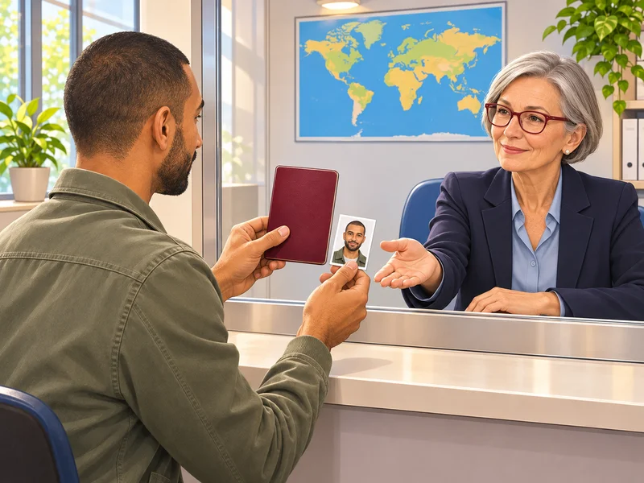

**Lire la situation**

Karim est au consulat. Le moment prévu est jeudi matin. Son objectif est de renouveler son passeport. Le document mentionne une photo d’identité.

1. Qui est au centre de cette situation ?

   A. Lina · B. Paul · C. Karim
2. Où se trouve cette personne ?

   A. au cabinet médical · B. au consulat · C. à la gare
3. Quel est le moment prévu ?

   A. jeudi matin · B. ce matin · C. lundi matin
4. Quel est son objectif ?

   A. changer son billet · B. prendre un rendez-vous · C. renouveler son passeport
5. Quel objet ou élément le document mentionne-t-il ?

   A. une carte d’assurance · B. une photo d’identité · C. un billet de train

**Écrire** — Karim veut renouveler son passeport : écrivez une phrase utile pour cette situation.

**Dire** — Vous êtes à la place de Karim : dites une phrase utile pour renouveler son passeport.

Corrigé et modèle

1. Karim
2. au consulat
3. jeudi matin
4. renouveler son passeport
5. une photo d’identité

Modèle de production — Je voudrais renouveler mon passeport.

### Le vélo

**Lire la situation**

Emma est à l’atelier de réparation. Le moment prévu est demain. Son objectif est de faire réparer un frein. Le document mentionne un vélo rouge.

1. Qui est au centre de cette situation ?

   A. Lina · B. Paul · C. Emma
2. Où se trouve cette personne ?

   A. au cabinet médical · B. à l’atelier de réparation · C. à la gare
3. Quel est le moment prévu ?

   A. demain · B. ce matin · C. lundi matin
4. Quel est son objectif ?

   A. changer son billet · B. prendre un rendez-vous · C. faire réparer un frein
5. Quel objet ou élément le document mentionne-t-il ?

   A. une carte d’assurance · B. un vélo rouge · C. un billet de train

**Écrire** — Emma veut faire réparer un frein : écrivez une phrase utile pour cette situation.

**Dire** — Vous êtes à la place de Emma : dites une phrase utile pour faire réparer un frein.

Corrigé et modèle

1. Emma
2. à l’atelier de réparation
3. demain
4. faire réparer un frein
5. un vélo rouge

Modèle de production — Est-ce que vous pouvez réparer ce frein ?

### Le congé

**Lire la situation**

Marco est au bureau. Le moment prévu est cet après-midi. Son objectif est de demander un jour de congé. Le document mentionne le planning de travail.

1. Qui est au centre de cette situation ?

   A. Lina · B. Paul · C. Marco
2. Où se trouve cette personne ?

   A. au cabinet médical · B. au bureau · C. à la gare
3. Quel est le moment prévu ?

   A. cet après-midi · B. ce matin · C. lundi matin
4. Quel est son objectif ?

   A. changer son billet · B. prendre un rendez-vous · C. demander un jour de congé
5. Quel objet ou élément le document mentionne-t-il ?

   A. une carte d’assurance · B. le planning de travail · C. un billet de train

**Écrire** — Marco veut demander un jour de congé : écrivez une phrase utile pour cette situation.

**Dire** — Vous êtes à la place de Marco : dites une phrase utile pour demander un jour de congé.

Corrigé et modèle

1. Marco
2. au bureau
3. cet après-midi
4. demander un jour de congé
5. le planning de travail

Modèle de production — Je voudrais prendre un jour de congé.

## Demander une information

### La sortie

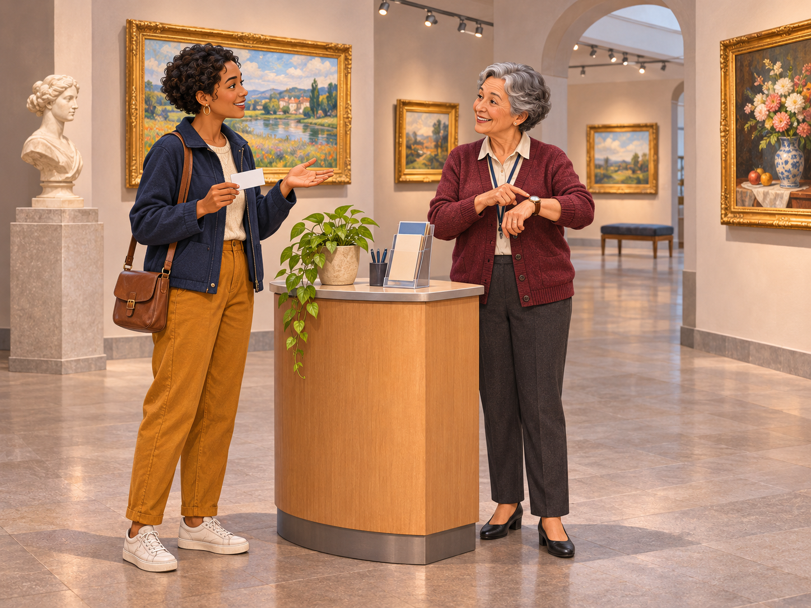

**Lire la situation**

Lina est au musée. Le moment prévu est samedi matin. Son objectif est de visiter une exposition. Le document mentionne un billet gratuit.

1. Qui est au centre de cette situation ?

   A. Paul · B. Nadia · C. Lina
2. Où se trouve cette personne ?

   A. au secrétariat · B. au musée · C. à l’arrêt de bus
3. Quel est le moment prévu ?

   A. samedi matin · B. à huit heures · C. lundi
4. Quel est son objectif ?

   A. aller à l’hôpital · B. s’inscrire au cours · C. visiter une exposition
5. Quel objet ou élément le document mentionne-t-il ?

   A. un formulaire papier · B. un billet gratuit · C. le plan du réseau

**Écrire** — Écrivez une question utile à Lina pour cette situation.

**Dire** — Posez une question utile à Lina pour cette situation.

Corrigé et modèle

1. Lina
2. au musée
3. samedi matin
4. visiter une exposition
5. un billet gratuit

Modèle de production — À quelle heure commence la visite ?

### Le bus

**Lire la situation**

Paul est à l’arrêt de bus. Le moment prévu est à huit heures. Son objectif est de aller à l’hôpital. Le document mentionne le plan du réseau.

1. Qui est au centre de cette situation ?

   A. Lina · B. Nadia · C. Paul
2. Où se trouve cette personne ?

   A. au secrétariat · B. à l’arrêt de bus · C. au musée
3. Quel est le moment prévu ?

   A. à huit heures · B. samedi matin · C. lundi
4. Quel est son objectif ?

   A. visiter une exposition · B. s’inscrire au cours · C. aller à l’hôpital
5. Quel objet ou élément le document mentionne-t-il ?

   A. un formulaire papier · B. le plan du réseau · C. un billet gratuit

**Écrire** — Écrivez une question utile à Paul pour cette situation.

**Dire** — Posez une question utile à Paul pour cette situation.

Corrigé et modèle

1. Paul
2. à l’arrêt de bus
3. à huit heures
4. aller à l’hôpital
5. le plan du réseau

Modèle de production — Quel bus va à l’hôpital ?

### Le formulaire

**Lire la situation**

Nadia est au secrétariat. Le moment prévu est lundi. Son objectif est de s’inscrire au cours. Le document mentionne un formulaire papier.

1. Qui est au centre de cette situation ?

   A. Lina · B. Paul · C. Nadia
2. Où se trouve cette personne ?

   A. à l’arrêt de bus · B. au secrétariat · C. au musée
3. Quel est le moment prévu ?

   A. lundi · B. samedi matin · C. à huit heures
4. Quel est son objectif ?

   A. visiter une exposition · B. aller à l’hôpital · C. s’inscrire au cours
5. Quel objet ou élément le document mentionne-t-il ?

   A. le plan du réseau · B. un formulaire papier · C. un billet gratuit

**Écrire** — Écrivez une question utile à Nadia pour cette situation.

**Dire** — Posez une question utile à Nadia pour cette situation.

Corrigé et modèle

1. Nadia
2. au secrétariat
3. lundi
4. s’inscrire au cours
5. un formulaire papier

Modèle de production — Où dois-je déposer le formulaire ?

### La piscine

**Lire la situation**

Omar est à la piscine. Le moment prévu est dimanche. Son objectif est de nager avec ses enfants. Le document mentionne des billets familiaux.

1. Qui est au centre de cette situation ?

   A. Lina · B. Paul · C. Omar
2. Où se trouve cette personne ?

   A. à l’arrêt de bus · B. à la piscine · C. au musée
3. Quel est le moment prévu ?

   A. dimanche · B. samedi matin · C. à huit heures
4. Quel est son objectif ?

   A. visiter une exposition · B. aller à l’hôpital · C. nager avec ses enfants
5. Quel objet ou élément le document mentionne-t-il ?

   A. le plan du réseau · B. des billets familiaux · C. un billet gratuit

**Écrire** — Écrivez une question utile à Omar pour cette situation.

**Dire** — Posez une question utile à Omar pour cette situation.

Corrigé et modèle

1. Omar
2. à la piscine
3. dimanche
4. nager avec ses enfants
5. des billets familiaux

Modèle de production — Quand la piscine ferme-t-elle ?

### Le logement

**Lire la situation**

Sofia est à l’agence immobilière. Le moment prévu est mardi. Son objectif est de visiter un appartement. Le document mentionne une annonce de location.

1. Qui est au centre de cette situation ?

   A. Lina · B. Paul · C. Sofia
2. Où se trouve cette personne ?

   A. à l’arrêt de bus · B. à l’agence immobilière · C. au musée
3. Quel est le moment prévu ?

   A. mardi · B. samedi matin · C. à huit heures
4. Quel est son objectif ?

   A. visiter une exposition · B. aller à l’hôpital · C. visiter un appartement
5. Quel objet ou élément le document mentionne-t-il ?

   A. le plan du réseau · B. une annonce de location · C. un billet gratuit

**Écrire** — Écrivez une question utile à Sofia pour cette situation.

**Dire** — Posez une question utile à Sofia pour cette situation.

Corrigé et modèle

1. Sofia
2. à l’agence immobilière
3. mardi
4. visiter un appartement
5. une annonce de location

Modèle de production — Combien coûte le loyer ?

### La pharmacie

**Lire la situation**

Kenji est à la pharmacie. Le moment prévu est ce soir. Son objectif est de acheter un médicament. Le document mentionne une ordonnance.

1. Qui est au centre de cette situation ?

   A. Lina · B. Paul · C. Kenji
2. Où se trouve cette personne ?

   A. à l’arrêt de bus · B. à la pharmacie · C. au musée
3. Quel est le moment prévu ?

   A. ce soir · B. samedi matin · C. à huit heures
4. Quel est son objectif ?

   A. visiter une exposition · B. aller à l’hôpital · C. acheter un médicament
5. Quel objet ou élément le document mentionne-t-il ?

   A. le plan du réseau · B. une ordonnance · C. un billet gratuit

**Écrire** — Écrivez une question utile à Kenji pour cette situation.

**Dire** — Posez une question utile à Kenji pour cette situation.

Corrigé et modèle

1. Kenji
2. à la pharmacie
3. ce soir
4. acheter un médicament
5. une ordonnance

Modèle de production — Comment dois-je prendre ce médicament ?

### Le marché

**Lire la situation**

Mei est sur la place du village. Le moment prévu est mercredi matin. Son objectif est de acheter des légumes. Le document mentionne un panier.

1. Qui est au centre de cette situation ?

   A. Lina · B. Paul · C. Mei
2. Où se trouve cette personne ?

   A. à l’arrêt de bus · B. sur la place du village · C. au musée
3. Quel est le moment prévu ?

   A. mercredi matin · B. samedi matin · C. à huit heures
4. Quel est son objectif ?

   A. visiter une exposition · B. aller à l’hôpital · C. acheter des légumes
5. Quel objet ou élément le document mentionne-t-il ?

   A. le plan du réseau · B. un panier · C. un billet gratuit

**Écrire** — Écrivez une question utile à Mei pour cette situation.

**Dire** — Posez une question utile à Mei pour cette situation.

Corrigé et modèle

1. Mei
2. sur la place du village
3. mercredi matin
4. acheter des légumes
5. un panier

Modèle de production — Où se trouve le stand de légumes ?

### Le téléphone

**Lire la situation**

Karim est à la boutique de téléphones. Le moment prévu est vendredi. Son objectif est de choisir un abonnement. Le document mentionne une carte SIM.

1. Qui est au centre de cette situation ?

   A. Lina · B. Paul · C. Karim
2. Où se trouve cette personne ?

   A. à l’arrêt de bus · B. à la boutique de téléphones · C. au musée
3. Quel est le moment prévu ?

   A. vendredi · B. samedi matin · C. à huit heures
4. Quel est son objectif ?

   A. visiter une exposition · B. aller à l’hôpital · C. choisir un abonnement
5. Quel objet ou élément le document mentionne-t-il ?

   A. le plan du réseau · B. une carte SIM · C. un billet gratuit

**Écrire** — Écrivez une question utile à Karim pour cette situation.

**Dire** — Posez une question utile à Karim pour cette situation.

Corrigé et modèle

1. Karim
2. à la boutique de téléphones
3. vendredi
4. choisir un abonnement
5. une carte SIM

Modèle de production — Quel abonnement convient à mes besoins ?

### La crèche

**Lire la situation**

Emma est à la crèche. Le moment prévu est jeudi. Son objectif est de rencontrer une éducatrice. Le document mentionne le dossier de son enfant.

1. Qui est au centre de cette situation ?

   A. Lina · B. Paul · C. Emma
2. Où se trouve cette personne ?

   A. à l’arrêt de bus · B. à la crèche · C. au musée
3. Quel est le moment prévu ?

   A. jeudi · B. samedi matin · C. à huit heures
4. Quel est son objectif ?

   A. visiter une exposition · B. aller à l’hôpital · C. rencontrer une éducatrice
5. Quel objet ou élément le document mentionne-t-il ?

   A. le plan du réseau · B. le dossier de son enfant · C. un billet gratuit

**Écrire** — Écrivez une question utile à Emma pour cette situation.

**Dire** — Posez une question utile à Emma pour cette situation.

Corrigé et modèle

1. Emma
2. à la crèche
3. jeudi
4. rencontrer une éducatrice
5. le dossier de son enfant

Modèle de production — Avec qui puis-je parler de l’inscription ?

### Le colis

**Lire la situation**

Marco est à la poste. Le moment prévu est à midi. Son objectif est de retirer un colis. Le document mentionne un avis de passage.

1. Qui est au centre de cette situation ?

   A. Lina · B. Paul · C. Marco
2. Où se trouve cette personne ?

   A. à l’arrêt de bus · B. à la poste · C. au musée
3. Quel est le moment prévu ?

   A. à midi · B. samedi matin · C. à huit heures
4. Quel est son objectif ?

   A. visiter une exposition · B. aller à l’hôpital · C. retirer un colis
5. Quel objet ou élément le document mentionne-t-il ?

   A. le plan du réseau · B. un avis de passage · C. un billet gratuit

**Écrire** — Écrivez une question utile à Marco pour cette situation.

**Dire** — Posez une question utile à Marco pour cette situation.

Corrigé et modèle

1. Marco
2. à la poste
3. à midi
4. retirer un colis
5. un avis de passage

Modèle de production — Quel document dois-je présenter ?

## Proposer une activité

### La promenade

**Lire la situation**

Lina est au bord du lac. Le moment prévu est dimanche. Son objectif est de faire une promenade. Le document mentionne des chaussures de marche.

1. Qui est au centre de cette situation ?

   A. Paul · B. Nadia · C. Lina
2. Où se trouve cette personne ?

   A. au jardin du quartier · B. au bord du lac · C. à la piscine municipale
3. Quel est le moment prévu ?

   A. dimanche · B. mardi soir · C. samedi
4. Quel est son objectif ?

   A. faire de la natation · B. faire du jardinage · C. faire une promenade
5. Quel objet ou élément le document mentionne-t-il ?

   A. un petit arrosoir · B. des chaussures de marche · C. un bonnet de bain

**Écrire** — Lina veut faire une promenade : écrivez une phrase utile pour cette situation.

**Dire** — Vous êtes à la place de Lina : dites une phrase utile pour faire une promenade.

Corrigé et modèle

1. Lina
2. au bord du lac
3. dimanche
4. faire une promenade
5. des chaussures de marche

Modèle de production — Nous faisons une promenade au bord du lac.

### La natation

**Lire la situation**

Paul est à la piscine municipale. Le moment prévu est mardi soir. Son objectif est de faire de la natation. Le document mentionne un bonnet de bain.

1. Qui est au centre de cette situation ?

   A. Lina · B. Nadia · C. Paul
2. Où se trouve cette personne ?

   A. au jardin du quartier · B. à la piscine municipale · C. au bord du lac
3. Quel est le moment prévu ?

   A. mardi soir · B. dimanche · C. samedi
4. Quel est son objectif ?

   A. faire une promenade · B. faire du jardinage · C. faire de la natation
5. Quel objet ou élément le document mentionne-t-il ?

   A. un petit arrosoir · B. un bonnet de bain · C. des chaussures de marche

**Écrire** — Paul veut faire de la natation : écrivez une phrase utile pour cette situation.

**Dire** — Vous êtes à la place de Paul : dites une phrase utile pour faire de la natation.

Corrigé et modèle

1. Paul
2. à la piscine municipale
3. mardi soir
4. faire de la natation
5. un bonnet de bain

Modèle de production — Je fais de la natation le mardi.

### Le jardin partagé

**Lire la situation**

Nadia est au jardin du quartier. Le moment prévu est samedi. Son objectif est de faire du jardinage. Le document mentionne un petit arrosoir.

1. Qui est au centre de cette situation ?

   A. Lina · B. Paul · C. Nadia
2. Où se trouve cette personne ?

   A. à la piscine municipale · B. au jardin du quartier · C. au bord du lac
3. Quel est le moment prévu ?

   A. samedi · B. dimanche · C. mardi soir
4. Quel est son objectif ?

   A. faire une promenade · B. faire de la natation · C. faire du jardinage
5. Quel objet ou élément le document mentionne-t-il ?

   A. un bonnet de bain · B. un petit arrosoir · C. des chaussures de marche

**Écrire** — Nadia veut faire du jardinage : écrivez une phrase utile pour cette situation.

**Dire** — Vous êtes à la place de Nadia : dites une phrase utile pour faire du jardinage.

Corrigé et modèle

1. Nadia
2. au jardin du quartier
3. samedi
4. faire du jardinage
5. un petit arrosoir

Modèle de production — Je fais du jardinage avec les voisins.

### Le bricolage

**Lire la situation**

Omar est à la maison de quartier. Le moment prévu est mercredi. Son objectif est de faire du bricolage. Le document mentionne une boîte à outils.

1. Qui est au centre de cette situation ?

   A. Lina · B. Paul · C. Omar
2. Où se trouve cette personne ?

   A. à la piscine municipale · B. à la maison de quartier · C. au bord du lac
3. Quel est le moment prévu ?

   A. mercredi · B. dimanche · C. mardi soir
4. Quel est son objectif ?

   A. faire une promenade · B. faire de la natation · C. faire du bricolage
5. Quel objet ou élément le document mentionne-t-il ?

   A. un bonnet de bain · B. une boîte à outils · C. des chaussures de marche

**Écrire** — Omar veut faire du bricolage : écrivez une phrase utile pour cette situation.

**Dire** — Vous êtes à la place de Omar : dites une phrase utile pour faire du bricolage.

Corrigé et modèle

1. Omar
2. à la maison de quartier
3. mercredi
4. faire du bricolage
5. une boîte à outils

Modèle de production — Nous faisons du bricolage ensemble.

### Le vélo

**Lire la situation**

Sofia est dans le parc. Le moment prévu est vendredi matin. Son objectif est de faire du vélo. Le document mentionne un casque.

1. Qui est au centre de cette situation ?

   A. Lina · B. Paul · C. Sofia
2. Où se trouve cette personne ?

   A. à la piscine municipale · B. dans le parc · C. au bord du lac
3. Quel est le moment prévu ?

   A. vendredi matin · B. dimanche · C. mardi soir
4. Quel est son objectif ?

   A. faire une promenade · B. faire de la natation · C. faire du vélo
5. Quel objet ou élément le document mentionne-t-il ?

   A. un bonnet de bain · B. un casque · C. des chaussures de marche

**Écrire** — Sofia veut faire du vélo : écrivez une phrase utile pour cette situation.

**Dire** — Vous êtes à la place de Sofia : dites une phrase utile pour faire du vélo.

Corrigé et modèle

1. Sofia
2. dans le parc
3. vendredi matin
4. faire du vélo
5. un casque

Modèle de production — Je fais du vélo dans le parc.

### La danse

**Lire la situation**

Kenji est à la salle des fêtes. Le moment prévu est jeudi soir. Son objectif est de faire de la danse. Le document mentionne des chaussures souples.

1. Qui est au centre de cette situation ?

   A. Lina · B. Paul · C. Kenji
2. Où se trouve cette personne ?

   A. à la piscine municipale · B. à la salle des fêtes · C. au bord du lac
3. Quel est le moment prévu ?

   A. jeudi soir · B. dimanche · C. mardi soir
4. Quel est son objectif ?

   A. faire une promenade · B. faire de la natation · C. faire de la danse
5. Quel objet ou élément le document mentionne-t-il ?

   A. un bonnet de bain · B. des chaussures souples · C. des chaussures de marche

**Écrire** — Kenji veut faire de la danse : écrivez une phrase utile pour cette situation.

**Dire** — Vous êtes à la place de Kenji : dites une phrase utile pour faire de la danse.

Corrigé et modèle

1. Kenji
2. à la salle des fêtes
3. jeudi soir
4. faire de la danse
5. des chaussures souples

Modèle de production — Nous faisons de la danse le jeudi.

### Le dessin

**Lire la situation**

Mei est à l’atelier municipal. Le moment prévu est lundi. Son objectif est de faire des dessins. Le document mentionne un carnet.

1. Qui est au centre de cette situation ?

   A. Lina · B. Paul · C. Mei
2. Où se trouve cette personne ?

   A. à la piscine municipale · B. à l’atelier municipal · C. au bord du lac
3. Quel est le moment prévu ?

   A. lundi · B. dimanche · C. mardi soir
4. Quel est son objectif ?

   A. faire une promenade · B. faire de la natation · C. faire des dessins
5. Quel objet ou élément le document mentionne-t-il ?

   A. un bonnet de bain · B. un carnet · C. des chaussures de marche

**Écrire** — Mei veut faire des dessins : écrivez une phrase utile pour cette situation.

**Dire** — Vous êtes à la place de Mei : dites une phrase utile pour faire des dessins.

Corrigé et modèle

1. Mei
2. à l’atelier municipal
3. lundi
4. faire des dessins
5. un carnet

Modèle de production — Je fais des dessins dans mon carnet.

### La randonnée

**Lire la situation**

Karim est en forêt. Le moment prévu est dimanche matin. Son objectif est de faire de la randonnée. Le document mentionne une gourde.

1. Qui est au centre de cette situation ?

   A. Lina · B. Paul · C. Karim
2. Où se trouve cette personne ?

   A. à la piscine municipale · B. en forêt · C. au bord du lac
3. Quel est le moment prévu ?

   A. dimanche matin · B. dimanche · C. mardi soir
4. Quel est son objectif ?

   A. faire une promenade · B. faire de la natation · C. faire de la randonnée
5. Quel objet ou élément le document mentionne-t-il ?

   A. un bonnet de bain · B. une gourde · C. des chaussures de marche

**Écrire** — Karim veut faire de la randonnée : écrivez une phrase utile pour cette situation.

**Dire** — Vous êtes à la place de Karim : dites une phrase utile pour faire de la randonnée.

Corrigé et modèle

1. Karim
2. en forêt
3. dimanche matin
4. faire de la randonnée
5. une gourde

Modèle de production — Nous faisons de la randonnée en forêt.

### La cuisine

**Lire la situation**

Emma est au centre associatif. Le moment prévu est samedi midi. Son objectif est de faire la cuisine. Le document mentionne un tablier.

1. Qui est au centre de cette situation ?

   A. Lina · B. Paul · C. Emma
2. Où se trouve cette personne ?

   A. à la piscine municipale · B. au centre associatif · C. au bord du lac
3. Quel est le moment prévu ?

   A. samedi midi · B. dimanche · C. mardi soir
4. Quel est son objectif ?

   A. faire une promenade · B. faire de la natation · C. faire la cuisine
5. Quel objet ou élément le document mentionne-t-il ?

   A. un bonnet de bain · B. un tablier · C. des chaussures de marche

**Écrire** — Emma veut faire la cuisine : écrivez une phrase utile pour cette situation.

**Dire** — Vous êtes à la place de Emma : dites une phrase utile pour faire la cuisine.

Corrigé et modèle

1. Emma
2. au centre associatif
3. samedi midi
4. faire la cuisine
5. un tablier

Modèle de production — Je fais la cuisine avec le groupe.

### Le yoga

**Lire la situation**

Marco est au centre sportif. Le moment prévu est mercredi soir. Son objectif est de faire du yoga. Le document mentionne un tapis.

1. Qui est au centre de cette situation ?

   A. Lina · B. Paul · C. Marco
2. Où se trouve cette personne ?

   A. à la piscine municipale · B. au centre sportif · C. au bord du lac
3. Quel est le moment prévu ?

   A. mercredi soir · B. dimanche · C. mardi soir
4. Quel est son objectif ?

   A. faire une promenade · B. faire de la natation · C. faire du yoga
5. Quel objet ou élément le document mentionne-t-il ?

   A. un bonnet de bain · B. un tapis · C. des chaussures de marche

**Écrire** — Marco veut faire du yoga : écrivez une phrase utile pour cette situation.

**Dire** — Vous êtes à la place de Marco : dites une phrase utile pour faire du yoga.

Corrigé et modèle

1. Marco
2. au centre sportif
3. mercredi soir
4. faire du yoga
5. un tapis

Modèle de production — Je fais du yoga pour me détendre.

## Indiquer un lieu

### Les clés

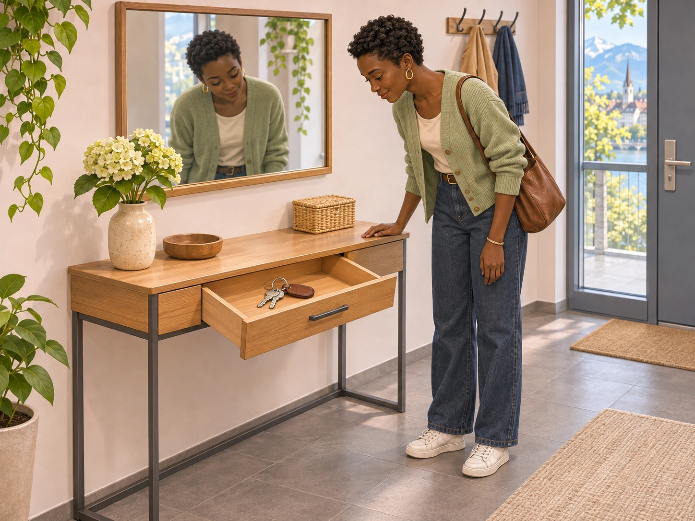

**Lire la situation**

Lina est dans l’entrée. Le moment prévu est ce matin. Son objectif est de retrouver ses clés. Le document mentionne le tiroir sous le miroir.

1. Qui est au centre de cette situation ?

   A. Paul · B. Nadia · C. Lina
2. Où se trouve cette personne ?

   A. au centre de formation · B. dans l’entrée · C. à la gare
3. Quel est le moment prévu ?

   A. ce matin · B. à neuf heures · C. lundi
4. Quel est son objectif ?

   A. acheter un billet · B. trouver sa salle · C. retrouver ses clés
5. Quel objet ou élément le document mentionne-t-il ?

   A. la salle devant l’escalier · B. le tiroir sous le miroir · C. le guichet à côté de la sortie

**Écrire** — Lina veut retrouver ses clés : écrivez une phrase utile pour cette situation.

**Dire** — Vous êtes à la place de Lina : dites une phrase utile pour retrouver ses clés.

Corrigé et modèle

1. Lina
2. dans l’entrée
3. ce matin
4. retrouver ses clés
5. le tiroir sous le miroir

Modèle de production — Les clés sont dans le tiroir sous le miroir.

### Le guichet

**Lire la situation**

Paul est à la gare. Le moment prévu est à neuf heures. Son objectif est de acheter un billet. Le document mentionne le guichet à côté de la sortie.

1. Qui est au centre de cette situation ?

   A. Lina · B. Nadia · C. Paul
2. Où se trouve cette personne ?

   A. au centre de formation · B. à la gare · C. dans l’entrée
3. Quel est le moment prévu ?

   A. à neuf heures · B. ce matin · C. lundi
4. Quel est son objectif ?

   A. retrouver ses clés · B. trouver sa salle · C. acheter un billet
5. Quel objet ou élément le document mentionne-t-il ?

   A. la salle devant l’escalier · B. le guichet à côté de la sortie · C. le tiroir sous le miroir

**Écrire** — Paul veut acheter un billet : écrivez une phrase utile pour cette situation.

**Dire** — Vous êtes à la place de Paul : dites une phrase utile pour acheter un billet.

Corrigé et modèle

1. Paul
2. à la gare
3. à neuf heures
4. acheter un billet
5. le guichet à côté de la sortie

Modèle de production — Le guichet est à côté de la sortie.

### La salle de cours

**Lire la situation**

Nadia est au centre de formation. Le moment prévu est lundi. Son objectif est de trouver sa salle. Le document mentionne la salle devant l’escalier.

1. Qui est au centre de cette situation ?

   A. Lina · B. Paul · C. Nadia
2. Où se trouve cette personne ?

   A. à la gare · B. au centre de formation · C. dans l’entrée
3. Quel est le moment prévu ?

   A. lundi · B. ce matin · C. à neuf heures
4. Quel est son objectif ?

   A. retrouver ses clés · B. acheter un billet · C. trouver sa salle
5. Quel objet ou élément le document mentionne-t-il ?

   A. le guichet à côté de la sortie · B. la salle devant l’escalier · C. le tiroir sous le miroir

**Écrire** — Nadia veut trouver sa salle : écrivez une phrase utile pour cette situation.

**Dire** — Vous êtes à la place de Nadia : dites une phrase utile pour trouver sa salle.

Corrigé et modèle

1. Nadia
2. au centre de formation
3. lundi
4. trouver sa salle
5. la salle devant l’escalier

Modèle de production — La salle est devant l’escalier.

### Le colis

**Lire la situation**

Omar est à la réception. Le moment prévu est à midi. Son objectif est de récupérer un colis. Le document mentionne le paquet derrière le comptoir.

1. Qui est au centre de cette situation ?

   A. Lina · B. Paul · C. Omar
2. Où se trouve cette personne ?

   A. à la gare · B. à la réception · C. dans l’entrée
3. Quel est le moment prévu ?

   A. à midi · B. ce matin · C. à neuf heures
4. Quel est son objectif ?

   A. retrouver ses clés · B. acheter un billet · C. récupérer un colis
5. Quel objet ou élément le document mentionne-t-il ?

   A. le guichet à côté de la sortie · B. le paquet derrière le comptoir · C. le tiroir sous le miroir

**Écrire** — Omar veut récupérer un colis : écrivez une phrase utile pour cette situation.

**Dire** — Vous êtes à la place de Omar : dites une phrase utile pour récupérer un colis.

Corrigé et modèle

1. Omar
2. à la réception
3. à midi
4. récupérer un colis
5. le paquet derrière le comptoir

Modèle de production — Le paquet est derrière le comptoir.

### La pharmacie

**Lire la situation**

Sofia est dans le quartier. Le moment prévu est cet après-midi. Son objectif est de chercher une pharmacie. Le document mentionne la pharmacie en face de la banque.

1. Qui est au centre de cette situation ?

   A. Lina · B. Paul · C. Sofia
2. Où se trouve cette personne ?

   A. à la gare · B. dans le quartier · C. dans l’entrée
3. Quel est le moment prévu ?

   A. cet après-midi · B. ce matin · C. à neuf heures
4. Quel est son objectif ?

   A. retrouver ses clés · B. acheter un billet · C. chercher une pharmacie
5. Quel objet ou élément le document mentionne-t-il ?

   A. le guichet à côté de la sortie · B. la pharmacie en face de la banque · C. le tiroir sous le miroir

**Écrire** — Sofia veut chercher une pharmacie : écrivez une phrase utile pour cette situation.

**Dire** — Vous êtes à la place de Sofia : dites une phrase utile pour chercher une pharmacie.

Corrigé et modèle

1. Sofia
2. dans le quartier
3. cet après-midi
4. chercher une pharmacie
5. la pharmacie en face de la banque

Modèle de production — La pharmacie est en face de la banque.

### Le vélo

**Lire la situation**

Kenji est dans le parking. Le moment prévu est ce soir. Son objectif est de garer son vélo. Le document mentionne la place entre les deux piliers.

1. Qui est au centre de cette situation ?

   A. Lina · B. Paul · C. Kenji
2. Où se trouve cette personne ?

   A. à la gare · B. dans le parking · C. dans l’entrée
3. Quel est le moment prévu ?

   A. ce soir · B. ce matin · C. à neuf heures
4. Quel est son objectif ?

   A. retrouver ses clés · B. acheter un billet · C. garer son vélo
5. Quel objet ou élément le document mentionne-t-il ?

   A. le guichet à côté de la sortie · B. la place entre les deux piliers · C. le tiroir sous le miroir

**Écrire** — Kenji veut garer son vélo : écrivez une phrase utile pour cette situation.

**Dire** — Vous êtes à la place de Kenji : dites une phrase utile pour garer son vélo.

Corrigé et modèle

1. Kenji
2. dans le parking
3. ce soir
4. garer son vélo
5. la place entre les deux piliers

Modèle de production — La place est entre les deux piliers.

### Le livre

**Lire la situation**

Mei est à la bibliothèque. Le moment prévu est mercredi. Son objectif est de ranger un dictionnaire. Le document mentionne l’étagère au-dessus du bureau.

1. Qui est au centre de cette situation ?

   A. Lina · B. Paul · C. Mei
2. Où se trouve cette personne ?

   A. à la gare · B. à la bibliothèque · C. dans l’entrée
3. Quel est le moment prévu ?

   A. mercredi · B. ce matin · C. à neuf heures
4. Quel est son objectif ?

   A. retrouver ses clés · B. acheter un billet · C. ranger un dictionnaire
5. Quel objet ou élément le document mentionne-t-il ?

   A. le guichet à côté de la sortie · B. l’étagère au-dessus du bureau · C. le tiroir sous le miroir

**Écrire** — Mei veut ranger un dictionnaire : écrivez une phrase utile pour cette situation.

**Dire** — Vous êtes à la place de Mei : dites une phrase utile pour ranger un dictionnaire.

Corrigé et modèle

1. Mei
2. à la bibliothèque
3. mercredi
4. ranger un dictionnaire
5. l’étagère au-dessus du bureau

Modèle de production — Le dictionnaire est sur l’étagère au-dessus du bureau.

### Le rendez-vous

**Lire la situation**

Karim est à l’hôpital. Le moment prévu est jeudi matin. Son objectif est de aller au service d’accueil. Le document mentionne le bureau près de l’ascenseur.

1. Qui est au centre de cette situation ?

   A. Lina · B. Paul · C. Karim
2. Où se trouve cette personne ?

   A. à la gare · B. à l’hôpital · C. dans l’entrée
3. Quel est le moment prévu ?

   A. jeudi matin · B. ce matin · C. à neuf heures
4. Quel est son objectif ?

   A. retrouver ses clés · B. acheter un billet · C. aller au service d’accueil
5. Quel objet ou élément le document mentionne-t-il ?

   A. le guichet à côté de la sortie · B. le bureau près de l’ascenseur · C. le tiroir sous le miroir

**Écrire** — Karim veut aller au service d’accueil : écrivez une phrase utile pour cette situation.

**Dire** — Vous êtes à la place de Karim : dites une phrase utile pour aller au service d’accueil.

Corrigé et modèle

1. Karim
2. à l’hôpital
3. jeudi matin
4. aller au service d’accueil
5. le bureau près de l’ascenseur

Modèle de production — Le bureau est près de l’ascenseur.

### Le sac

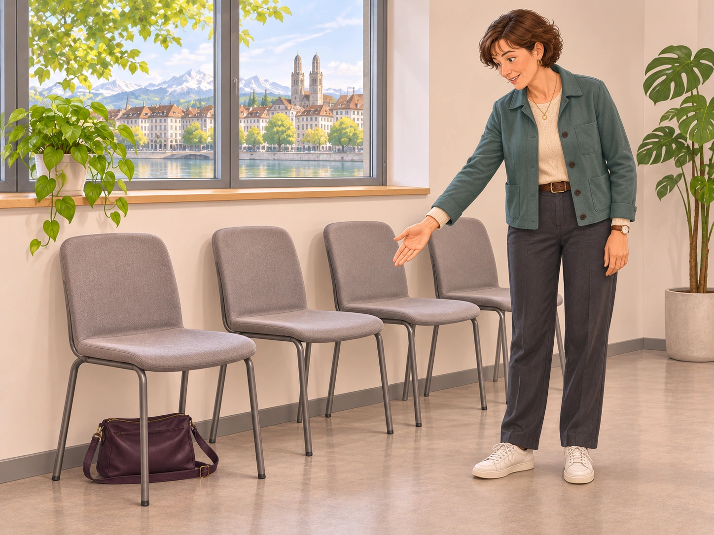

**Lire la situation**

Emma est dans la salle d’attente. Le moment prévu est vendredi. Son objectif est de retrouver son sac. Le document mentionne le sac sous la chaise.

1. Qui est au centre de cette situation ?

   A. Lina · B. Paul · C. Emma
2. Où se trouve cette personne ?

   A. à la gare · B. dans la salle d’attente · C. dans l’entrée
3. Quel est le moment prévu ?

   A. vendredi · B. ce matin · C. à neuf heures
4. Quel est son objectif ?

   A. retrouver ses clés · B. acheter un billet · C. retrouver son sac
5. Quel objet ou élément le document mentionne-t-il ?

   A. le guichet à côté de la sortie · B. le sac sous la chaise · C. le tiroir sous le miroir

**Écrire** — Emma veut retrouver son sac : écrivez une phrase utile pour cette situation.

**Dire** — Vous êtes à la place de Emma : dites une phrase utile pour retrouver son sac.

Corrigé et modèle

1. Emma
2. dans la salle d’attente
3. vendredi
4. retrouver son sac
5. le sac sous la chaise

Modèle de production — Le sac est sous la chaise.

### La fontaine

**Lire la situation**

Marco est dans le parc. Le moment prévu est dimanche. Son objectif est de remplir sa gourde. Le document mentionne la fontaine à gauche du kiosque.

1. Qui est au centre de cette situation ?

   A. Lina · B. Paul · C. Marco
2. Où se trouve cette personne ?

   A. à la gare · B. dans le parc · C. dans l’entrée
3. Quel est le moment prévu ?

   A. dimanche · B. ce matin · C. à neuf heures
4. Quel est son objectif ?

   A. retrouver ses clés · B. acheter un billet · C. remplir sa gourde
5. Quel objet ou élément le document mentionne-t-il ?

   A. le guichet à côté de la sortie · B. la fontaine à gauche du kiosque · C. le tiroir sous le miroir

**Écrire** — Marco veut remplir sa gourde : écrivez une phrase utile pour cette situation.

**Dire** — Vous êtes à la place de Marco : dites une phrase utile pour remplir sa gourde.

Corrigé et modèle

1. Marco
2. dans le parc
3. dimanche
4. remplir sa gourde
5. la fontaine à gauche du kiosque

Modèle de production — La fontaine est à gauche du kiosque.

## Fixer un moment

### Le dentiste

**Lire la situation**

Lina est au cabinet dentaire. Le moment prévu est lundi à neuf heures. Son objectif est de faire contrôler ses dents. Le document mentionne une carte de rendez-vous.

1. Qui est au centre de cette situation ?

   A. Paul · B. Nadia · C. Lina
2. Où se trouve cette personne ?

   A. à l’école de langues · B. au cabinet dentaire · C. à la maison de quartier
3. Quel est le moment prévu ?

   A. lundi à neuf heures · B. samedi à midi · C. mardi à dix-huit heures
4. Quel est son objectif ?

   A. rencontrer ses voisins · B. commencer son cours · C. faire contrôler ses dents
5. Quel objet ou élément le document mentionne-t-il ?

   A. un emploi du temps · B. une carte de rendez-vous · C. une invitation

**Écrire** — Lina veut faire contrôler ses dents : écrivez une phrase utile pour cette situation.

**Dire** — Vous êtes à la place de Lina : dites une phrase utile pour faire contrôler ses dents.

Corrigé et modèle

1. Lina
2. au cabinet dentaire
3. lundi à neuf heures
4. faire contrôler ses dents
5. une carte de rendez-vous

Modèle de production — Mon rendez-vous est lundi à neuf heures.

### Le repas partagé

**Lire la situation**

Paul est à la maison de quartier. Le moment prévu est samedi à midi. Son objectif est de rencontrer ses voisins. Le document mentionne une invitation.

1. Qui est au centre de cette situation ?

   A. Lina · B. Nadia · C. Paul
2. Où se trouve cette personne ?

   A. à l’école de langues · B. à la maison de quartier · C. au cabinet dentaire
3. Quel est le moment prévu ?

   A. samedi à midi · B. lundi à neuf heures · C. mardi à dix-huit heures
4. Quel est son objectif ?

   A. faire contrôler ses dents · B. commencer son cours · C. rencontrer ses voisins
5. Quel objet ou élément le document mentionne-t-il ?

   A. un emploi du temps · B. une invitation · C. une carte de rendez-vous

**Écrire** — Paul veut rencontrer ses voisins : écrivez une phrase utile pour cette situation.

**Dire** — Vous êtes à la place de Paul : dites une phrase utile pour rencontrer ses voisins.

Corrigé et modèle

1. Paul
2. à la maison de quartier
3. samedi à midi
4. rencontrer ses voisins
5. une invitation

Modèle de production — Le repas commence samedi à midi.

### Le cours du soir

**Lire la situation**

Nadia est à l’école de langues. Le moment prévu est mardi à dix-huit heures. Son objectif est de commencer son cours. Le document mentionne un emploi du temps.

1. Qui est au centre de cette situation ?

   A. Lina · B. Paul · C. Nadia
2. Où se trouve cette personne ?

   A. à la maison de quartier · B. à l’école de langues · C. au cabinet dentaire
3. Quel est le moment prévu ?

   A. mardi à dix-huit heures · B. lundi à neuf heures · C. samedi à midi
4. Quel est son objectif ?

   A. faire contrôler ses dents · B. rencontrer ses voisins · C. commencer son cours
5. Quel objet ou élément le document mentionne-t-il ?

   A. une invitation · B. un emploi du temps · C. une carte de rendez-vous

**Écrire** — Nadia veut commencer son cours : écrivez une phrase utile pour cette situation.

**Dire** — Vous êtes à la place de Nadia : dites une phrase utile pour commencer son cours.

Corrigé et modèle

1. Nadia
2. à l’école de langues
3. mardi à dix-huit heures
4. commencer son cours
5. un emploi du temps

Modèle de production — Le cours commence mardi à dix-huit heures.

### La visite

**Lire la situation**

Omar est au musée. Le moment prévu est dimanche après-midi. Son objectif est de suivre une visite guidée. Le document mentionne un billet réservé.

1. Qui est au centre de cette situation ?

   A. Lina · B. Paul · C. Omar
2. Où se trouve cette personne ?

   A. à la maison de quartier · B. au musée · C. au cabinet dentaire
3. Quel est le moment prévu ?

   A. dimanche après-midi · B. lundi à neuf heures · C. samedi à midi
4. Quel est son objectif ?

   A. faire contrôler ses dents · B. rencontrer ses voisins · C. suivre une visite guidée
5. Quel objet ou élément le document mentionne-t-il ?

   A. une invitation · B. un billet réservé · C. une carte de rendez-vous

**Écrire** — Omar veut suivre une visite guidée : écrivez une phrase utile pour cette situation.

**Dire** — Vous êtes à la place de Omar : dites une phrase utile pour suivre une visite guidée.

Corrigé et modèle

1. Omar
2. au musée
3. dimanche après-midi
4. suivre une visite guidée
5. un billet réservé

Modèle de production — La visite a lieu dimanche après-midi.

### Le chantier

**Lire la situation**

Sofia est dans son immeuble. Le moment prévu est en septembre. Son objectif est de laisser entrer les ouvriers. Le document mentionne un avis de travaux.

1. Qui est au centre de cette situation ?

   A. Lina · B. Paul · C. Sofia
2. Où se trouve cette personne ?

   A. à la maison de quartier · B. dans son immeuble · C. au cabinet dentaire
3. Quel est le moment prévu ?

   A. en septembre · B. lundi à neuf heures · C. samedi à midi
4. Quel est son objectif ?

   A. faire contrôler ses dents · B. rencontrer ses voisins · C. laisser entrer les ouvriers
5. Quel objet ou élément le document mentionne-t-il ?

   A. une invitation · B. un avis de travaux · C. une carte de rendez-vous

**Écrire** — Sofia veut laisser entrer les ouvriers : écrivez une phrase utile pour cette situation.

**Dire** — Vous êtes à la place de Sofia : dites une phrase utile pour laisser entrer les ouvriers.

Corrigé et modèle

1. Sofia
2. dans son immeuble
3. en septembre
4. laisser entrer les ouvriers
5. un avis de travaux

Modèle de production — Les travaux commencent en septembre.

### Le marché

**Lire la situation**

Kenji est sur la place centrale. Le moment prévu est le mercredi matin. Son objectif est de acheter des fruits. Le document mentionne une liste de courses.

1. Qui est au centre de cette situation ?

   A. Lina · B. Paul · C. Kenji
2. Où se trouve cette personne ?

   A. à la maison de quartier · B. sur la place centrale · C. au cabinet dentaire
3. Quel est le moment prévu ?

   A. le mercredi matin · B. lundi à neuf heures · C. samedi à midi
4. Quel est son objectif ?

   A. faire contrôler ses dents · B. rencontrer ses voisins · C. acheter des fruits
5. Quel objet ou élément le document mentionne-t-il ?

   A. une invitation · B. une liste de courses · C. une carte de rendez-vous

**Écrire** — Kenji veut acheter des fruits : écrivez une phrase utile pour cette situation.

**Dire** — Vous êtes à la place de Kenji : dites une phrase utile pour acheter des fruits.

Corrigé et modèle

1. Kenji
2. sur la place centrale
3. le mercredi matin
4. acheter des fruits
5. une liste de courses

Modèle de production — Le marché a lieu le mercredi matin.

### La randonnée

**Lire la situation**

Mei est au départ du sentier. Le moment prévu est au printemps. Son objectif est de découvrir la montagne. Le document mentionne le programme du club.

1. Qui est au centre de cette situation ?

   A. Lina · B. Paul · C. Mei
2. Où se trouve cette personne ?

   A. à la maison de quartier · B. au départ du sentier · C. au cabinet dentaire
3. Quel est le moment prévu ?

   A. au printemps · B. lundi à neuf heures · C. samedi à midi
4. Quel est son objectif ?

   A. faire contrôler ses dents · B. rencontrer ses voisins · C. découvrir la montagne
5. Quel objet ou élément le document mentionne-t-il ?

   A. une invitation · B. le programme du club · C. une carte de rendez-vous

**Écrire** — Mei veut découvrir la montagne : écrivez une phrase utile pour cette situation.

**Dire** — Vous êtes à la place de Mei : dites une phrase utile pour découvrir la montagne.

Corrigé et modèle

1. Mei
2. au départ du sentier
3. au printemps
4. découvrir la montagne
5. le programme du club

Modèle de production — La randonnée est prévue au printemps.

### Le train

**Lire la situation**

Karim est à la gare centrale. Le moment prévu est à huit heures et demie. Son objectif est de prendre le train. Le document mentionne un billet de transport.

1. Qui est au centre de cette situation ?

   A. Lina · B. Paul · C. Karim
2. Où se trouve cette personne ?

   A. à la maison de quartier · B. à la gare centrale · C. au cabinet dentaire
3. Quel est le moment prévu ?

   A. à huit heures et demie · B. lundi à neuf heures · C. samedi à midi
4. Quel est son objectif ?

   A. faire contrôler ses dents · B. rencontrer ses voisins · C. prendre le train
5. Quel objet ou élément le document mentionne-t-il ?

   A. une invitation · B. un billet de transport · C. une carte de rendez-vous

**Écrire** — Karim veut prendre le train : écrivez une phrase utile pour cette situation.

**Dire** — Vous êtes à la place de Karim : dites une phrase utile pour prendre le train.

Corrigé et modèle

1. Karim
2. à la gare centrale
3. à huit heures et demie
4. prendre le train
5. un billet de transport

Modèle de production — Mon train part à huit heures et demie.

### Les vacances

**Lire la situation**

Emma est à l’agence de voyages. Le moment prévu est en juillet. Son objectif est de préparer son séjour. Le document mentionne une brochure.

1. Qui est au centre de cette situation ?

   A. Lina · B. Paul · C. Emma
2. Où se trouve cette personne ?

   A. à la maison de quartier · B. à l’agence de voyages · C. au cabinet dentaire
3. Quel est le moment prévu ?

   A. en juillet · B. lundi à neuf heures · C. samedi à midi
4. Quel est son objectif ?

   A. faire contrôler ses dents · B. rencontrer ses voisins · C. préparer son séjour
5. Quel objet ou élément le document mentionne-t-il ?

   A. une invitation · B. une brochure · C. une carte de rendez-vous

**Écrire** — Emma veut préparer son séjour : écrivez une phrase utile pour cette situation.

**Dire** — Vous êtes à la place de Emma : dites une phrase utile pour préparer son séjour.

Corrigé et modèle

1. Emma
2. à l’agence de voyages
3. en juillet
4. préparer son séjour
5. une brochure

Modèle de production — Nous partons en vacances en juillet.

### La permanence

**Lire la situation**

Marco est au centre social. Le moment prévu est le vendredi soir. Son objectif est de rencontrer un conseiller. Le document mentionne une affiche.

1. Qui est au centre de cette situation ?

   A. Lina · B. Paul · C. Marco
2. Où se trouve cette personne ?

   A. à la maison de quartier · B. au centre social · C. au cabinet dentaire
3. Quel est le moment prévu ?

   A. le vendredi soir · B. lundi à neuf heures · C. samedi à midi
4. Quel est son objectif ?

   A. faire contrôler ses dents · B. rencontrer ses voisins · C. rencontrer un conseiller
5. Quel objet ou élément le document mentionne-t-il ?

   A. une invitation · B. une affiche · C. une carte de rendez-vous

**Écrire** — Marco veut rencontrer un conseiller : écrivez une phrase utile pour cette situation.

**Dire** — Vous êtes à la place de Marco : dites une phrase utile pour rencontrer un conseiller.

Corrigé et modèle

1. Marco
2. au centre social
3. le vendredi soir
4. rencontrer un conseiller
5. une affiche

Modèle de production — La permanence est ouverte le vendredi soir.

## Répondre à une proposition

### Le café

**Lire la situation**

Lina est à la cafétéria. Le moment prévu est pendant la pause. Son objectif est d’accepter un café. Le document mentionne une tasse.

1. Qui est au centre de cette situation ?

   A. Paul · B. Nadia · C. Lina
2. Où se trouve cette personne ?

   A. chez sa voisine · B. à la cafétéria · C. devant le cinéma
3. Quel est le moment prévu ?

   A. pendant la pause · B. samedi soir · C. dimanche midi
4. Quel est son objectif ?

   A. refuser une invitation · B. accepter une invitation à déjeuner · C. accepter un café
5. Quel objet ou élément le document mentionne-t-il ?

   A. une invitation · B. une tasse · C. une affiche de film

**Écrire** — Lina veut accepter un café : écrivez une phrase utile pour cette situation.

**Dire** — Vous êtes à la place de Lina : dites une phrase utile pour accepter un café.

Corrigé et modèle

1. Lina
2. à la cafétéria
3. pendant la pause
4. accepter un café
5. une tasse

Modèle de production — Oui, un café avec plaisir.

### Le cinéma

**Lire la situation**

Paul est devant le cinéma. Le moment prévu est samedi soir. Son objectif est de refuser une invitation. Le document mentionne une affiche de film.

1. Qui est au centre de cette situation ?

   A. Lina · B. Nadia · C. Paul
2. Où se trouve cette personne ?

   A. chez sa voisine · B. devant le cinéma · C. à la cafétéria
3. Quel est le moment prévu ?

   A. samedi soir · B. pendant la pause · C. dimanche midi
4. Quel est son objectif ?

   A. accepter un café · B. accepter une invitation à déjeuner · C. refuser une invitation
5. Quel objet ou élément le document mentionne-t-il ?

   A. une invitation · B. une affiche de film · C. une tasse

**Écrire** — Paul veut refuser une invitation : écrivez une phrase utile pour cette situation.

**Dire** — Vous êtes à la place de Paul : dites une phrase utile pour refuser une invitation.

Corrigé et modèle

1. Paul
2. devant le cinéma
3. samedi soir
4. refuser une invitation
5. une affiche de film

Modèle de production — Merci, mais je ne suis pas disponible samedi.

### Le repas

**Lire la situation**

Nadia est chez sa voisine. Le moment prévu est dimanche midi. Son objectif est d’accepter une invitation à déjeuner. Le document mentionne une invitation.

1. Qui est au centre de cette situation ?

   A. Lina · B. Paul · C. Nadia
2. Où se trouve cette personne ?

   A. devant le cinéma · B. chez sa voisine · C. à la cafétéria
3. Quel est le moment prévu ?

   A. dimanche midi · B. pendant la pause · C. samedi soir
4. Quel est son objectif ?

   A. accepter un café · B. refuser une invitation · C. accepter une invitation à déjeuner
5. Quel objet ou élément le document mentionne-t-il ?

   A. une affiche de film · B. une invitation · C. une tasse

**Écrire** — Nadia veut accepter une invitation à déjeuner : écrivez une phrase utile pour cette situation.

**Dire** — Vous êtes à la place de Nadia : dites une phrase utile pour accepter une invitation à déjeuner.

Corrigé et modèle

1. Nadia
2. chez sa voisine
3. dimanche midi
4. accepter une invitation à déjeuner
5. une invitation

Modèle de production — Merci, je viendrai avec plaisir.

### La sortie

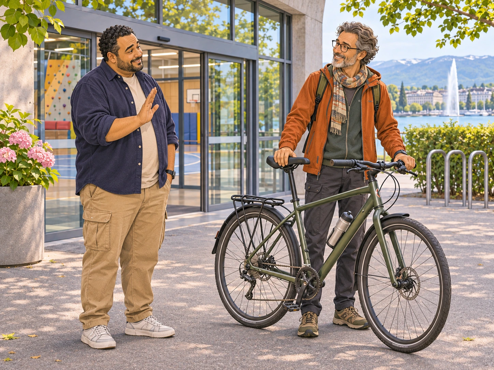

**Lire la situation**

Omar est au centre sportif. Le moment prévu est mercredi. Son objectif est de refuser une sortie à vélo. Le document mentionne un vélo.

1. Qui est au centre de cette situation ?

   A. Lina · B. Paul · C. Omar
2. Où se trouve cette personne ?

   A. devant le cinéma · B. au centre sportif · C. à la cafétéria
3. Quel est le moment prévu ?

   A. mercredi · B. pendant la pause · C. samedi soir
4. Quel est son objectif ?

   A. accepter un café · B. refuser une invitation · C. refuser une sortie à vélo
5. Quel objet ou élément le document mentionne-t-il ?

   A. une affiche de film · B. un vélo · C. une tasse

**Écrire** — Omar veut refuser une sortie à vélo : écrivez une phrase utile pour cette situation.

**Dire** — Vous êtes à la place de Omar : dites une phrase utile pour refuser une sortie à vélo.

Corrigé et modèle

1. Omar
2. au centre sportif
3. mercredi
4. refuser une sortie à vélo
5. un vélo

Modèle de production — Merci, mais je préfère me reposer.

### Le dessert

**Lire la situation**

Sofia est au restaurant. Le moment prévu est à la fin du repas. Son objectif est de refuser un dessert. Le document mentionne la carte des desserts.

1. Qui est au centre de cette situation ?

   A. Lina · B. Paul · C. Sofia
2. Où se trouve cette personne ?

   A. devant le cinéma · B. au restaurant · C. à la cafétéria
3. Quel est le moment prévu ?

   A. à la fin du repas · B. pendant la pause · C. samedi soir
4. Quel est son objectif ?

   A. accepter un café · B. refuser une invitation · C. refuser un dessert
5. Quel objet ou élément le document mentionne-t-il ?

   A. une affiche de film · B. la carte des desserts · C. une tasse

**Écrire** — Sofia veut refuser un dessert : écrivez une phrase utile pour cette situation.

**Dire** — Vous êtes à la place de Sofia : dites une phrase utile pour refuser un dessert.

Corrigé et modèle

1. Sofia
2. au restaurant
3. à la fin du repas
4. refuser un dessert
5. la carte des desserts

Modèle de production — Non merci, je n’ai plus faim.

### Le covoiturage

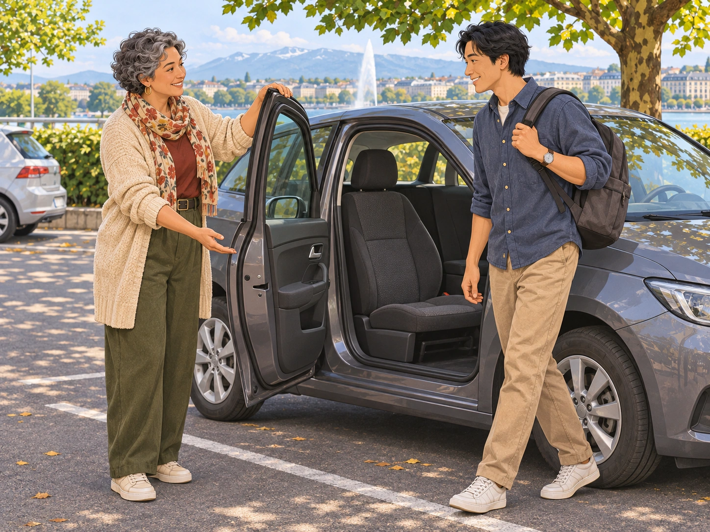

**Lire la situation**

Kenji est sur le parking. Le moment prévu est demain matin. Son objectif est d’accepter une place en voiture. Le document mentionne une voiture.

1. Qui est au centre de cette situation ?

   A. Lina · B. Paul · C. Kenji
2. Où se trouve cette personne ?

   A. devant le cinéma · B. sur le parking · C. à la cafétéria
3. Quel est le moment prévu ?

   A. demain matin · B. pendant la pause · C. samedi soir
4. Quel est son objectif ?

   A. accepter un café · B. refuser une invitation · C. accepter une place en voiture
5. Quel objet ou élément le document mentionne-t-il ?

   A. une affiche de film · B. une voiture · C. une tasse

**Écrire** — Kenji veut accepter une place en voiture : écrivez une phrase utile pour cette situation.

**Dire** — Vous êtes à la place de Kenji : dites une phrase utile pour accepter une place en voiture.

Corrigé et modèle

1. Kenji
2. sur le parking
3. demain matin
4. accepter une place en voiture
5. une voiture

Modèle de production — Oui, merci de m’emmener.

### L’aide

**Lire la situation**

Mei est à la bibliothèque. Le moment prévu est cet après-midi. Son objectif est d’accepter de l’aide pour chercher un livre. Le document mentionne un catalogue.

1. Qui est au centre de cette situation ?

   A. Lina · B. Paul · C. Mei
2. Où se trouve cette personne ?

   A. devant le cinéma · B. à la bibliothèque · C. à la cafétéria
3. Quel est le moment prévu ?

   A. cet après-midi · B. pendant la pause · C. samedi soir
4. Quel est son objectif ?

   A. accepter un café · B. refuser une invitation · C. accepter de l’aide pour chercher un livre
5. Quel objet ou élément le document mentionne-t-il ?

   A. une affiche de film · B. un catalogue · C. une tasse

**Écrire** — Mei veut accepter de l’aide pour chercher un livre : écrivez une phrase utile pour cette situation.

**Dire** — Vous êtes à la place de Mei : dites une phrase utile pour accepter de l’aide pour chercher un livre.

Corrigé et modèle

1. Mei
2. à la bibliothèque
3. cet après-midi
4. accepter de l’aide pour chercher un livre
5. un catalogue

Modèle de production — Oui, votre aide me serait utile.

### La réunion

**Lire la situation**

Karim est au bureau. Le moment prévu est vendredi. Son objectif est de refuser un nouvel horaire. Le document mentionne un calendrier.

1. Qui est au centre de cette situation ?

   A. Lina · B. Paul · C. Karim
2. Où se trouve cette personne ?

   A. devant le cinéma · B. au bureau · C. à la cafétéria
3. Quel est le moment prévu ?

   A. vendredi · B. pendant la pause · C. samedi soir
4. Quel est son objectif ?

   A. accepter un café · B. refuser une invitation · C. refuser un nouvel horaire
5. Quel objet ou élément le document mentionne-t-il ?

   A. une affiche de film · B. un calendrier · C. une tasse

**Écrire** — Karim veut refuser un nouvel horaire : écrivez une phrase utile pour cette situation.

**Dire** — Vous êtes à la place de Karim : dites une phrase utile pour refuser un nouvel horaire.

Corrigé et modèle

1. Karim
2. au bureau
3. vendredi
4. refuser un nouvel horaire
5. un calendrier

Modèle de production — Désolé, cet horaire ne me convient pas.

### La marche

**Lire la situation**

Emma est à l’entrée du parc. Le moment prévu est ce soir. Son objectif est d’accepter une promenade. Le document mentionne un plan du parc.

1. Qui est au centre de cette situation ?

   A. Lina · B. Paul · C. Emma
2. Où se trouve cette personne ?

   A. devant le cinéma · B. à l’entrée du parc · C. à la cafétéria
3. Quel est le moment prévu ?

   A. ce soir · B. pendant la pause · C. samedi soir
4. Quel est son objectif ?

   A. accepter un café · B. refuser une invitation · C. accepter une promenade
5. Quel objet ou élément le document mentionne-t-il ?

   A. une affiche de film · B. un plan du parc · C. une tasse

**Écrire** — Emma veut accepter une promenade : écrivez une phrase utile pour cette situation.

**Dire** — Vous êtes à la place de Emma : dites une phrase utile pour accepter une promenade.

Corrigé et modèle

1. Emma
2. à l’entrée du parc
3. ce soir
4. accepter une promenade
5. un plan du parc

Modèle de production — Bonne idée, je viens avec vous.

### Le gâteau

**Lire la situation**

Marco est dans la salle commune. Le moment prévu est pendant la fête. Son objectif est de refuser une part de gâteau. Le document mentionne un gâteau.

1. Qui est au centre de cette situation ?

   A. Lina · B. Paul · C. Marco
2. Où se trouve cette personne ?

   A. devant le cinéma · B. dans la salle commune · C. à la cafétéria
3. Quel est le moment prévu ?

   A. pendant la fête · B. pendant la pause · C. samedi soir
4. Quel est son objectif ?

   A. accepter un café · B. refuser une invitation · C. refuser une part de gâteau
5. Quel objet ou élément le document mentionne-t-il ?

   A. une affiche de film · B. un gâteau · C. une tasse

**Écrire** — Marco veut refuser une part de gâteau : écrivez une phrase utile pour cette situation.

**Dire** — Vous êtes à la place de Marco : dites une phrase utile pour refuser une part de gâteau.

Corrigé et modèle

1. Marco
2. dans la salle commune
3. pendant la fête
4. refuser une part de gâteau
5. un gâteau

Modèle de production — Non merci, j’en ai déjà mangé.

## Décrire pour reconnaître

### Au rendez-vous

**Lire la situation**

Lina est devant la mairie. Le moment prévu est à dix heures. Son objectif est de retrouver sa collègue. Le document mentionne une femme aux cheveux courts.

1. Qui est au centre de cette situation ?

   A. Paul · B. Nadia · C. Lina
2. Où se trouve cette personne ?

   A. à la gare · B. devant la mairie · C. devant l’école
3. Quel est le moment prévu ?

   A. à dix heures · B. à seize heures · C. ce matin
4. Quel est son objectif ?

   A. reconnaître le père de son ami · B. retrouver une voyageuse · C. retrouver sa collègue
5. Quel objet ou élément le document mentionne-t-il ?

   A. une femme avec une veste rouge · B. une femme aux cheveux courts · C. un homme avec des lunettes rondes

**Écrire** — Lina veut retrouver sa collègue : écrivez une phrase utile pour cette situation.

**Dire** — Vous êtes à la place de Lina : dites une phrase utile pour retrouver sa collègue.

Corrigé et modèle

1. Lina
2. devant la mairie
3. à dix heures
4. retrouver sa collègue
5. une femme aux cheveux courts

Modèle de production — Ma collègue a les cheveux courts.

### À la sortie

**Lire la situation**

Paul est devant l’école. Le moment prévu est à seize heures. Son objectif est de reconnaître le père de son ami. Le document mentionne un homme avec des lunettes rondes.

1. Qui est au centre de cette situation ?

   A. Lina · B. Nadia · C. Paul
2. Où se trouve cette personne ?

   A. à la gare · B. devant l’école · C. devant la mairie
3. Quel est le moment prévu ?

   A. à seize heures · B. à dix heures · C. ce matin
4. Quel est son objectif ?

   A. retrouver sa collègue · B. retrouver une voyageuse · C. reconnaître le père de son ami
5. Quel objet ou élément le document mentionne-t-il ?

   A. une femme avec une veste rouge · B. un homme avec des lunettes rondes · C. une femme aux cheveux courts

**Écrire** — Paul veut reconnaître le père de son ami : écrivez une phrase utile pour cette situation.

**Dire** — Vous êtes à la place de Paul : dites une phrase utile pour reconnaître le père de son ami.

Corrigé et modèle

1. Paul
2. devant l’école
3. à seize heures
4. reconnaître le père de son ami
5. un homme avec des lunettes rondes

Modèle de production — Le père de mon ami porte des lunettes rondes.

### Au guichet

**Lire la situation**

Nadia est à la gare. Le moment prévu est ce matin. Son objectif est de retrouver une voyageuse. Le document mentionne une femme avec une veste rouge.

1. Qui est au centre de cette situation ?

   A. Lina · B. Paul · C. Nadia
2. Où se trouve cette personne ?

   A. devant l’école · B. à la gare · C. devant la mairie
3. Quel est le moment prévu ?

   A. ce matin · B. à dix heures · C. à seize heures
4. Quel est son objectif ?

   A. retrouver sa collègue · B. reconnaître le père de son ami · C. retrouver une voyageuse
5. Quel objet ou élément le document mentionne-t-il ?

   A. un homme avec des lunettes rondes · B. une femme avec une veste rouge · C. une femme aux cheveux courts

**Écrire** — Nadia veut retrouver une voyageuse : écrivez une phrase utile pour cette situation.

**Dire** — Vous êtes à la place de Nadia : dites une phrase utile pour retrouver une voyageuse.

Corrigé et modèle

1. Nadia
2. à la gare
3. ce matin
4. retrouver une voyageuse
5. une femme avec une veste rouge

Modèle de production — La voyageuse porte une veste rouge.

### Au stade

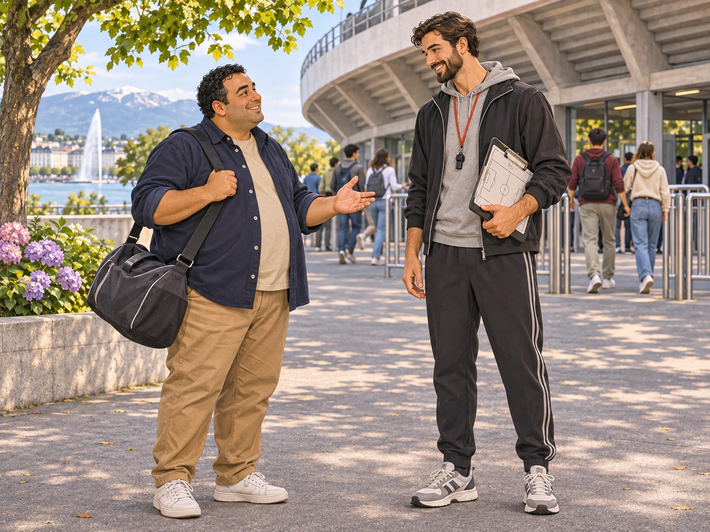

**Lire la situation**

Omar est à l’entrée du stade. Le moment prévu est samedi. Son objectif est de repérer son entraîneur. Le document mentionne un homme grand et brun.

1. Qui est au centre de cette situation ?

   A. Lina · B. Paul · C. Omar
2. Où se trouve cette personne ?

   A. devant l’école · B. à l’entrée du stade · C. devant la mairie
3. Quel est le moment prévu ?

   A. samedi · B. à dix heures · C. à seize heures
4. Quel est son objectif ?

   A. retrouver sa collègue · B. reconnaître le père de son ami · C. repérer son entraîneur
5. Quel objet ou élément le document mentionne-t-il ?

   A. un homme avec des lunettes rondes · B. un homme grand et brun · C. une femme aux cheveux courts

**Écrire** — Omar veut repérer son entraîneur : écrivez une phrase utile pour cette situation.

**Dire** — Vous êtes à la place de Omar : dites une phrase utile pour repérer son entraîneur.

Corrigé et modèle

1. Omar
2. à l’entrée du stade
3. samedi
4. repérer son entraîneur
5. un homme grand et brun

Modèle de production — Mon entraîneur est grand et brun.

### Dans le hall

**Lire la situation**

Sofia est dans le hall du centre. Le moment prévu est à midi. Son objectif est d’accueillir sa sœur. Le document mentionne une femme aux cheveux bouclés.

1. Qui est au centre de cette situation ?

   A. Lina · B. Paul · C. Sofia
2. Où se trouve cette personne ?

   A. devant l’école · B. dans le hall du centre · C. devant la mairie
3. Quel est le moment prévu ?

   A. à midi · B. à dix heures · C. à seize heures
4. Quel est son objectif ?

   A. retrouver sa collègue · B. reconnaître le père de son ami · C. accueillir sa sœur
5. Quel objet ou élément le document mentionne-t-il ?

   A. un homme avec des lunettes rondes · B. une femme aux cheveux bouclés · C. une femme aux cheveux courts

**Écrire** — Sofia veut accueillir sa sœur : écrivez une phrase utile pour cette situation.

**Dire** — Vous êtes à la place de Sofia : dites une phrase utile pour accueillir sa sœur.

Corrigé et modèle

1. Sofia
2. dans le hall du centre
3. à midi
4. accueillir sa sœur
5. une femme aux cheveux bouclés

Modèle de production — Ma sœur a les cheveux bouclés.

### Au marché

**Lire la situation**

Kenji est sur la place. Le moment prévu est mercredi. Son objectif est de retrouver son voisin. Le document mentionne un homme avec une barbe blanche.

1. Qui est au centre de cette situation ?

   A. Lina · B. Paul · C. Kenji
2. Où se trouve cette personne ?

   A. devant l’école · B. sur la place · C. devant la mairie
3. Quel est le moment prévu ?

   A. mercredi · B. à dix heures · C. à seize heures
4. Quel est son objectif ?

   A. retrouver sa collègue · B. reconnaître le père de son ami · C. retrouver son voisin
5. Quel objet ou élément le document mentionne-t-il ?

   A. un homme avec des lunettes rondes · B. un homme avec une barbe blanche · C. une femme aux cheveux courts

**Écrire** — Kenji veut retrouver son voisin : écrivez une phrase utile pour cette situation.

**Dire** — Vous êtes à la place de Kenji : dites une phrase utile pour retrouver son voisin.

Corrigé et modèle

1. Kenji
2. sur la place
3. mercredi
4. retrouver son voisin
5. un homme avec une barbe blanche

Modèle de production — Mon voisin a une barbe blanche.

### À la bibliothèque

**Lire la situation**

Mei est près du bureau d’accueil. Le moment prévu est cet après-midi. Son objectif est de reconnaître une bénévole. Le document mentionne une femme avec une écharpe bleue.

1. Qui est au centre de cette situation ?

   A. Lina · B. Paul · C. Mei
2. Où se trouve cette personne ?

   A. devant l’école · B. près du bureau d’accueil · C. devant la mairie
3. Quel est le moment prévu ?

   A. cet après-midi · B. à dix heures · C. à seize heures
4. Quel est son objectif ?

   A. retrouver sa collègue · B. reconnaître le père de son ami · C. reconnaître une bénévole
5. Quel objet ou élément le document mentionne-t-il ?

   A. un homme avec des lunettes rondes · B. une femme avec une écharpe bleue · C. une femme aux cheveux courts

**Écrire** — Mei veut reconnaître une bénévole : écrivez une phrase utile pour cette situation.

**Dire** — Vous êtes à la place de Mei : dites une phrase utile pour reconnaître une bénévole.

Corrigé et modèle

1. Mei
2. près du bureau d’accueil
3. cet après-midi
4. reconnaître une bénévole
5. une femme avec une écharpe bleue

Modèle de production — La bénévole porte une écharpe bleue.

### Au concert

**Lire la situation**

Karim est devant la salle de concert. Le moment prévu est ce soir. Son objectif est de retrouver un ami. Le document mentionne un homme avec un manteau noir.

1. Qui est au centre de cette situation ?

   A. Lina · B. Paul · C. Karim
2. Où se trouve cette personne ?

   A. devant l’école · B. devant la salle de concert · C. devant la mairie
3. Quel est le moment prévu ?

   A. ce soir · B. à dix heures · C. à seize heures
4. Quel est son objectif ?

   A. retrouver sa collègue · B. reconnaître le père de son ami · C. retrouver un ami
5. Quel objet ou élément le document mentionne-t-il ?

   A. un homme avec des lunettes rondes · B. un homme avec un manteau noir · C. une femme aux cheveux courts

**Écrire** — Karim veut retrouver un ami : écrivez une phrase utile pour cette situation.

**Dire** — Vous êtes à la place de Karim : dites une phrase utile pour retrouver un ami.

Corrigé et modèle

1. Karim
2. devant la salle de concert
3. ce soir
4. retrouver un ami
5. un homme avec un manteau noir

Modèle de production — Mon ami porte un manteau noir.

### À la piscine

**Lire la situation**

Emma est dans le hall de la piscine. Le moment prévu est dimanche. Son objectif est de retrouver sa cousine. Le document mentionne une femme aux yeux verts.

1. Qui est au centre de cette situation ?

   A. Lina · B. Paul · C. Emma
2. Où se trouve cette personne ?

   A. devant l’école · B. dans le hall de la piscine · C. devant la mairie
3. Quel est le moment prévu ?

   A. dimanche · B. à dix heures · C. à seize heures
4. Quel est son objectif ?

   A. retrouver sa collègue · B. reconnaître le père de son ami · C. retrouver sa cousine
5. Quel objet ou élément le document mentionne-t-il ?

   A. un homme avec des lunettes rondes · B. une femme aux yeux verts · C. une femme aux cheveux courts

**Écrire** — Emma veut retrouver sa cousine : écrivez une phrase utile pour cette situation.

**Dire** — Vous êtes à la place de Emma : dites une phrase utile pour retrouver sa cousine.

Corrigé et modèle

1. Emma
2. dans le hall de la piscine
3. dimanche
4. retrouver sa cousine
5. une femme aux yeux verts

Modèle de production — Ma cousine a les yeux verts.

### À l’aéroport

**Lire la situation**

Marco est dans le hall des arrivées. Le moment prévu est vendredi. Son objectif est d’accueillir son frère. Le document mentionne un homme aux cheveux roux.

1. Qui est au centre de cette situation ?

   A. Lina · B. Paul · C. Marco
2. Où se trouve cette personne ?

   A. devant l’école · B. dans le hall des arrivées · C. devant la mairie
3. Quel est le moment prévu ?

   A. vendredi · B. à dix heures · C. à seize heures
4. Quel est son objectif ?

   A. retrouver sa collègue · B. reconnaître le père de son ami · C. accueillir son frère
5. Quel objet ou élément le document mentionne-t-il ?

   A. un homme avec des lunettes rondes · B. un homme aux cheveux roux · C. une femme aux cheveux courts

**Écrire** — Marco veut accueillir son frère : écrivez une phrase utile pour cette situation.

**Dire** — Vous êtes à la place de Marco : dites une phrase utile pour accueillir son frère.

Corrigé et modèle

1. Marco
2. dans le hall des arrivées
3. vendredi
4. accueillir son frère
5. un homme aux cheveux roux

Modèle de production — Mon frère a les cheveux roux.

## Donner un conseil

### Le sommeil

**Lire la situation**

Lina est au centre de santé. Le moment prévu est lundi. Son objectif est de mieux dormir. Le document mentionne un carnet de sommeil.

1. Qui est au centre de cette situation ?

   A. Paul · B. Nadia · C. Lina
2. Où se trouve cette personne ?

   A. à la gare · B. au centre de santé · C. à la bibliothèque
3. Quel est le moment prévu ?

   A. lundi · B. mercredi · C. demain
4. Quel est son objectif ?

   A. progresser en français · B. éviter les embouteillages · C. mieux dormir
5. Quel objet ou élément le document mentionne-t-il ?

   A. un billet de train · B. un carnet de sommeil · C. un livre facile

**Écrire** — Écrivez un conseil à Lina avec devoir ou pouvoir au conditionnel.

**Dire** — Donnez un conseil à Lina avec devoir ou pouvoir au conditionnel.

Corrigé et modèle

1. Lina
2. au centre de santé
3. lundi
4. mieux dormir
5. un carnet de sommeil

Modèle de production — Vous devriez vous coucher plus tôt.

### Le français

**Lire la situation**

Paul est à la bibliothèque. Le moment prévu est mercredi. Son objectif est de progresser en français. Le document mentionne un livre facile.

1. Qui est au centre de cette situation ?

   A. Lina · B. Nadia · C. Paul
2. Où se trouve cette personne ?

   A. à la gare · B. à la bibliothèque · C. au centre de santé
3. Quel est le moment prévu ?

   A. mercredi · B. lundi · C. demain
4. Quel est son objectif ?

   A. mieux dormir · B. éviter les embouteillages · C. progresser en français
5. Quel objet ou élément le document mentionne-t-il ?

   A. un billet de train · B. un livre facile · C. un carnet de sommeil

**Écrire** — Écrivez un conseil à Paul avec devoir ou pouvoir au conditionnel.

**Dire** — Donnez un conseil à Paul avec devoir ou pouvoir au conditionnel.

Corrigé et modèle

1. Paul
2. à la bibliothèque
3. mercredi
4. progresser en français
5. un livre facile

Modèle de production — Vous pourriez lire un livre facile.

### Le trajet

**Lire la situation**

Nadia est à la gare. Le moment prévu est demain. Son objectif est d’éviter les embouteillages. Le document mentionne un billet de train.

1. Qui est au centre de cette situation ?

   A. Lina · B. Paul · C. Nadia
2. Où se trouve cette personne ?

   A. à la bibliothèque · B. à la gare · C. au centre de santé
3. Quel est le moment prévu ?

   A. demain · B. lundi · C. mercredi
4. Quel est son objectif ?

   A. mieux dormir · B. progresser en français · C. éviter les embouteillages
5. Quel objet ou élément le document mentionne-t-il ?

   A. un livre facile · B. un billet de train · C. un carnet de sommeil

**Écrire** — Écrivez un conseil à Nadia avec devoir ou pouvoir au conditionnel.

**Dire** — Donnez un conseil à Nadia avec devoir ou pouvoir au conditionnel.

Corrigé et modèle

1. Nadia
2. à la gare
3. demain
4. éviter les embouteillages
5. un billet de train

Modèle de production — Vous pourriez prendre le train.

### La chaleur

**Lire la situation**

Omar est au centre sportif. Le moment prévu est cet après-midi. Son objectif est de se protéger de la chaleur. Le document mentionne une gourde.

1. Qui est au centre de cette situation ?

   A. Lina · B. Paul · C. Omar
2. Où se trouve cette personne ?

   A. à la bibliothèque · B. au centre sportif · C. au centre de santé
3. Quel est le moment prévu ?

   A. cet après-midi · B. lundi · C. mercredi
4. Quel est son objectif ?

   A. mieux dormir · B. progresser en français · C. se protéger de la chaleur
5. Quel objet ou élément le document mentionne-t-il ?

   A. un livre facile · B. une gourde · C. un carnet de sommeil

**Écrire** — Écrivez un conseil à Omar avec devoir ou pouvoir au conditionnel.

**Dire** — Donnez un conseil à Omar avec devoir ou pouvoir au conditionnel.

Corrigé et modèle

1. Omar
2. au centre sportif
3. cet après-midi
4. se protéger de la chaleur
5. une gourde

Modèle de production — Vous devriez boire de l’eau régulièrement.

### Le logement

**Lire la situation**

Sofia est au centre social. Le moment prévu est vendredi. Son objectif est de chercher un appartement. Le document mentionne une liste d’agences.

1. Qui est au centre de cette situation ?

   A. Lina · B. Paul · C. Sofia
2. Où se trouve cette personne ?

   A. à la bibliothèque · B. au centre social · C. au centre de santé
3. Quel est le moment prévu ?

   A. vendredi · B. lundi · C. mercredi
4. Quel est son objectif ?

   A. mieux dormir · B. progresser en français · C. chercher un appartement
5. Quel objet ou élément le document mentionne-t-il ?

   A. un livre facile · B. une liste d’agences · C. un carnet de sommeil

**Écrire** — Écrivez un conseil à Sofia avec devoir ou pouvoir au conditionnel.

**Dire** — Donnez un conseil à Sofia avec devoir ou pouvoir au conditionnel.

Corrigé et modèle

1. Sofia
2. au centre social
3. vendredi
4. chercher un appartement
5. une liste d’agences

Modèle de production — Vous pourriez contacter une agence.

### L’examen

**Lire la situation**

Kenji est à l’école. Le moment prévu est mardi. Son objectif est de préparer son examen. Le document mentionne un planning de révision.

1. Qui est au centre de cette situation ?

   A. Lina · B. Paul · C. Kenji
2. Où se trouve cette personne ?

   A. à la bibliothèque · B. à l’école · C. au centre de santé
3. Quel est le moment prévu ?

   A. mardi · B. lundi · C. mercredi
4. Quel est son objectif ?

   A. mieux dormir · B. progresser en français · C. préparer son examen
5. Quel objet ou élément le document mentionne-t-il ?

   A. un livre facile · B. un planning de révision · C. un carnet de sommeil

**Écrire** — Écrivez un conseil à Kenji avec devoir ou pouvoir au conditionnel.

**Dire** — Donnez un conseil à Kenji avec devoir ou pouvoir au conditionnel.

Corrigé et modèle

1. Kenji
2. à l’école
3. mardi
4. préparer son examen
5. un planning de révision

Modèle de production — Vous devriez réviser un peu chaque jour.

### La facture

**Lire la situation**

Mei est au guichet. Le moment prévu est ce matin. Son objectif est de comprendre une facture. Le document mentionne une facture.

1. Qui est au centre de cette situation ?

   A. Lina · B. Paul · C. Mei
2. Où se trouve cette personne ?

   A. à la bibliothèque · B. au guichet · C. au centre de santé
3. Quel est le moment prévu ?

   A. ce matin · B. lundi · C. mercredi
4. Quel est son objectif ?

   A. mieux dormir · B. progresser en français · C. comprendre une facture
5. Quel objet ou élément le document mentionne-t-il ?

   A. un livre facile · B. une facture · C. un carnet de sommeil

**Écrire** — Écrivez un conseil à Mei avec devoir ou pouvoir au conditionnel.

**Dire** — Donnez un conseil à Mei avec devoir ou pouvoir au conditionnel.

Corrigé et modèle

1. Mei
2. au guichet
3. ce matin
4. comprendre une facture
5. une facture

Modèle de production — Vous pourriez demander une explication.

### Le jardin

**Lire la situation**

Karim est dans le jardin partagé. Le moment prévu est ce soir. Son objectif est de garder ses plantes en bonne santé. Le document mentionne un arrosoir.

1. Qui est au centre de cette situation ?

   A. Lina · B. Paul · C. Karim
2. Où se trouve cette personne ?

   A. à la bibliothèque · B. dans le jardin partagé · C. au centre de santé
3. Quel est le moment prévu ?

   A. ce soir · B. lundi · C. mercredi
4. Quel est son objectif ?

   A. mieux dormir · B. progresser en français · C. garder ses plantes en bonne santé
5. Quel objet ou élément le document mentionne-t-il ?

   A. un livre facile · B. un arrosoir · C. un carnet de sommeil

**Écrire** — Écrivez un conseil à Karim avec devoir ou pouvoir au conditionnel.

**Dire** — Donnez un conseil à Karim avec devoir ou pouvoir au conditionnel.

Corrigé et modèle

1. Karim
2. dans le jardin partagé
3. ce soir
4. garder ses plantes en bonne santé
5. un arrosoir

Modèle de production — Vous devriez arroser vos plantes.

### Le travail

**Lire la situation**

Emma est au bureau. Le moment prévu est jeudi. Son objectif est de faire une pause. Le document mentionne un agenda.

1. Qui est au centre de cette situation ?

   A. Lina · B. Paul · C. Emma
2. Où se trouve cette personne ?

   A. à la bibliothèque · B. au bureau · C. au centre de santé
3. Quel est le moment prévu ?

   A. jeudi · B. lundi · C. mercredi
4. Quel est son objectif ?

   A. mieux dormir · B. progresser en français · C. faire une pause
5. Quel objet ou élément le document mentionne-t-il ?

   A. un livre facile · B. un agenda · C. un carnet de sommeil

**Écrire** — Écrivez un conseil à Emma avec devoir ou pouvoir au conditionnel.

**Dire** — Donnez un conseil à Emma avec devoir ou pouvoir au conditionnel.

Corrigé et modèle

1. Emma
2. au bureau
3. jeudi
4. faire une pause
5. un agenda

Modèle de production — Vous devriez prévoir une pause.

### Le vélo

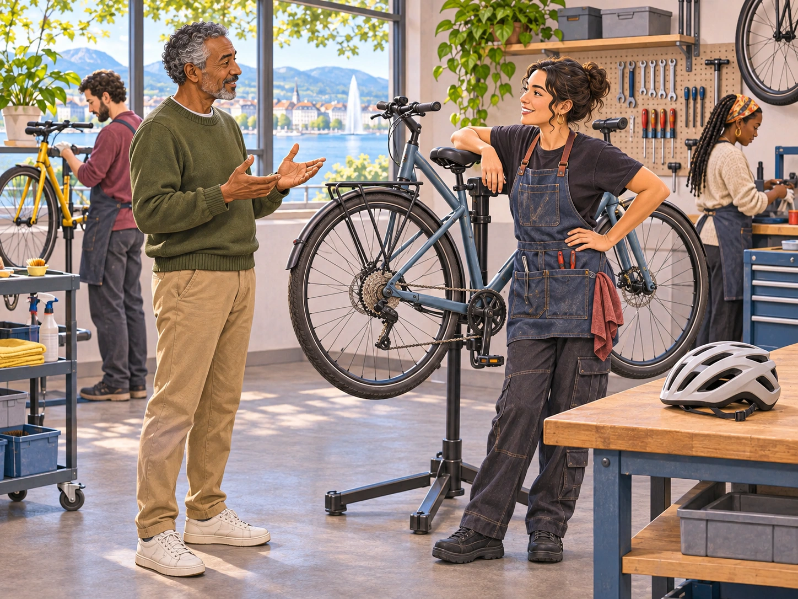

**Lire la situation**

Marco est à l’atelier. Le moment prévu est samedi. Son objectif est de rouler avec un vélo sûr. Le document mentionne un casque.

1. Qui est au centre de cette situation ?

   A. Lina · B. Paul · C. Marco
2. Où se trouve cette personne ?

   A. à la bibliothèque · B. à l’atelier · C. au centre de santé
3. Quel est le moment prévu ?

   A. samedi · B. lundi · C. mercredi
4. Quel est son objectif ?

   A. mieux dormir · B. progresser en français · C. rouler avec un vélo sûr
5. Quel objet ou élément le document mentionne-t-il ?

   A. un livre facile · B. un casque · C. un carnet de sommeil

**Écrire** — Écrivez un conseil à Marco avec devoir ou pouvoir au conditionnel.

**Dire** — Donnez un conseil à Marco avec devoir ou pouvoir au conditionnel.

Corrigé et modèle

1. Marco
2. à l’atelier
3. samedi
4. rouler avec un vélo sûr
5. un casque

Modèle de production — Vous devriez porter un casque.

## Demander une quantité

### La boulangerie

**Lire la situation**

Lina est à la boulangerie. Le moment prévu est ce matin. Son objectif est de acheter du pain. Le document mentionne deux baguettes.

1. Qui est au centre de cette situation ?

   A. Paul · B. Nadia · C. Lina
2. Où se trouve cette personne ?

   A. à la fromagerie · B. à la boulangerie · C. au marché
3. Quel est le moment prévu ?

   A. ce matin · B. mercredi · C. samedi
4. Quel est son objectif ?

   A. acheter des pommes · B. acheter du fromage · C. acheter du pain
5. Quel objet ou élément le document mentionne-t-il ?

   A. deux cents grammes de fromage · B. deux baguettes · C. un kilo de pommes

**Écrire** — Lina veut acheter du pain : écrivez une phrase utile pour cette situation.

**Dire** — Vous êtes à la place de Lina : dites une phrase utile pour acheter du pain.

Corrigé et modèle

1. Lina
2. à la boulangerie
3. ce matin
4. acheter du pain
5. deux baguettes

Modèle de production — Je voudrais deux baguettes.

### Le marché

**Lire la situation**

Paul est au marché. Le moment prévu est mercredi. Son objectif est de acheter des pommes. Le document mentionne un kilo de pommes.

1. Qui est au centre de cette situation ?

   A. Lina · B. Nadia · C. Paul
2. Où se trouve cette personne ?

   A. à la fromagerie · B. au marché · C. à la boulangerie
3. Quel est le moment prévu ?

   A. mercredi · B. ce matin · C. samedi
4. Quel est son objectif ?

   A. acheter du pain · B. acheter du fromage · C. acheter des pommes
5. Quel objet ou élément le document mentionne-t-il ?

   A. deux cents grammes de fromage · B. un kilo de pommes · C. deux baguettes

**Écrire** — Paul veut acheter des pommes : écrivez une phrase utile pour cette situation.

**Dire** — Vous êtes à la place de Paul : dites une phrase utile pour acheter des pommes.

Corrigé et modèle

1. Paul
2. au marché
3. mercredi
4. acheter des pommes
5. un kilo de pommes

Modèle de production — Je voudrais un kilo de pommes.

### La fromagerie

**Lire la situation**

Nadia est à la fromagerie. Le moment prévu est samedi. Son objectif est de acheter du fromage. Le document mentionne deux cents grammes de fromage.

1. Qui est au centre de cette situation ?

   A. Lina · B. Paul · C. Nadia
2. Où se trouve cette personne ?

   A. au marché · B. à la fromagerie · C. à la boulangerie
3. Quel est le moment prévu ?

   A. samedi · B. ce matin · C. mercredi
4. Quel est son objectif ?

   A. acheter du pain · B. acheter des pommes · C. acheter du fromage
5. Quel objet ou élément le document mentionne-t-il ?

   A. un kilo de pommes · B. deux cents grammes de fromage · C. deux baguettes

**Écrire** — Nadia veut acheter du fromage : écrivez une phrase utile pour cette situation.

**Dire** — Vous êtes à la place de Nadia : dites une phrase utile pour acheter du fromage.

Corrigé et modèle

1. Nadia
2. à la fromagerie
3. samedi
4. acheter du fromage
5. deux cents grammes de fromage

Modèle de production — Je voudrais deux cents grammes de fromage.

### Le café

**Lire la situation**

Omar est au café du quartier. Le moment prévu est à midi. Son objectif est de commander de l’eau. Le document mentionne une bouteille d’eau.

1. Qui est au centre de cette situation ?

   A. Lina · B. Paul · C. Omar
2. Où se trouve cette personne ?

   A. au marché · B. au café du quartier · C. à la boulangerie
3. Quel est le moment prévu ?

   A. à midi · B. ce matin · C. mercredi
4. Quel est son objectif ?

   A. acheter du pain · B. acheter des pommes · C. commander de l’eau
5. Quel objet ou élément le document mentionne-t-il ?

   A. un kilo de pommes · B. une bouteille d’eau · C. deux baguettes

**Écrire** — Omar veut commander de l’eau : écrivez une phrase utile pour cette situation.

**Dire** — Vous êtes à la place de Omar : dites une phrase utile pour commander de l’eau.

Corrigé et modèle

1. Omar
2. au café du quartier
3. à midi
4. commander de l’eau
5. une bouteille d’eau

Modèle de production — Je voudrais une bouteille d’eau.

### L’épicerie

**Lire la situation**

Sofia est à l’épicerie. Le moment prévu est ce soir. Son objectif est de acheter du riz. Le document mentionne un paquet de riz.

1. Qui est au centre de cette situation ?

   A. Lina · B. Paul · C. Sofia
2. Où se trouve cette personne ?

   A. au marché · B. à l’épicerie · C. à la boulangerie
3. Quel est le moment prévu ?

   A. ce soir · B. ce matin · C. mercredi
4. Quel est son objectif ?

   A. acheter du pain · B. acheter des pommes · C. acheter du riz
5. Quel objet ou élément le document mentionne-t-il ?

   A. un kilo de pommes · B. un paquet de riz · C. deux baguettes

**Écrire** — Sofia veut acheter du riz : écrivez une phrase utile pour cette situation.

**Dire** — Vous êtes à la place de Sofia : dites une phrase utile pour acheter du riz.

Corrigé et modèle

1. Sofia
2. à l’épicerie
3. ce soir
4. acheter du riz
5. un paquet de riz

Modèle de production — Je voudrais un paquet de riz.

### Le restaurant

**Lire la situation**

Kenji est au restaurant. Le moment prévu est dimanche midi. Son objectif est de commander de la soupe. Le document mentionne un bol de soupe.

1. Qui est au centre de cette situation ?

   A. Lina · B. Paul · C. Kenji
2. Où se trouve cette personne ?

   A. au marché · B. au restaurant · C. à la boulangerie
3. Quel est le moment prévu ?

   A. dimanche midi · B. ce matin · C. mercredi
4. Quel est son objectif ?

   A. acheter du pain · B. acheter des pommes · C. commander de la soupe
5. Quel objet ou élément le document mentionne-t-il ?

   A. un kilo de pommes · B. un bol de soupe · C. deux baguettes

**Écrire** — Kenji veut commander de la soupe : écrivez une phrase utile pour cette situation.

**Dire** — Vous êtes à la place de Kenji : dites une phrase utile pour commander de la soupe.

Corrigé et modèle

1. Kenji
2. au restaurant
3. dimanche midi
4. commander de la soupe
5. un bol de soupe

Modèle de production — Je voudrais un bol de soupe.

### La pâtisserie

**Lire la situation**

Mei est à la pâtisserie. Le moment prévu est vendredi. Son objectif est de acheter du gâteau. Le document mentionne une part de gâteau.

1. Qui est au centre de cette situation ?

   A. Lina · B. Paul · C. Mei
2. Où se trouve cette personne ?

   A. au marché · B. à la pâtisserie · C. à la boulangerie
3. Quel est le moment prévu ?

   A. vendredi · B. ce matin · C. mercredi
4. Quel est son objectif ?

   A. acheter du pain · B. acheter des pommes · C. acheter du gâteau
5. Quel objet ou élément le document mentionne-t-il ?

   A. un kilo de pommes · B. une part de gâteau · C. deux baguettes

**Écrire** — Mei veut acheter du gâteau : écrivez une phrase utile pour cette situation.

**Dire** — Vous êtes à la place de Mei : dites une phrase utile pour acheter du gâteau.

Corrigé et modèle

1. Mei
2. à la pâtisserie
3. vendredi
4. acheter du gâteau
5. une part de gâteau

Modèle de production — Je voudrais une part de gâteau.

### La boucherie

**Lire la situation**

Karim est à la boucherie. Le moment prévu est samedi matin. Son objectif est de acheter du poulet. Le document mentionne deux filets de poulet.

1. Qui est au centre de cette situation ?

   A. Lina · B. Paul · C. Karim
2. Où se trouve cette personne ?

   A. au marché · B. à la boucherie · C. à la boulangerie
3. Quel est le moment prévu ?

   A. samedi matin · B. ce matin · C. mercredi
4. Quel est son objectif ?

   A. acheter du pain · B. acheter des pommes · C. acheter du poulet
5. Quel objet ou élément le document mentionne-t-il ?

   A. un kilo de pommes · B. deux filets de poulet · C. deux baguettes

**Écrire** — Karim veut acheter du poulet : écrivez une phrase utile pour cette situation.

**Dire** — Vous êtes à la place de Karim : dites une phrase utile pour acheter du poulet.

Corrigé et modèle

1. Karim
2. à la boucherie
3. samedi matin
4. acheter du poulet
5. deux filets de poulet

Modèle de production — Je voudrais deux filets de poulet.

### La cantine

**Lire la situation**

Emma est à la cantine. Le moment prévu est pendant la pause. Son objectif est de demander de la salade. Le document mentionne un peu de salade.

1. Qui est au centre de cette situation ?

   A. Lina · B. Paul · C. Emma
2. Où se trouve cette personne ?

   A. au marché · B. à la cantine · C. à la boulangerie
3. Quel est le moment prévu ?

   A. pendant la pause · B. ce matin · C. mercredi
4. Quel est son objectif ?

   A. acheter du pain · B. acheter des pommes · C. demander de la salade
5. Quel objet ou élément le document mentionne-t-il ?

   A. un kilo de pommes · B. un peu de salade · C. deux baguettes

**Écrire** — Emma veut demander de la salade : écrivez une phrase utile pour cette situation.

**Dire** — Vous êtes à la place de Emma : dites une phrase utile pour demander de la salade.

Corrigé et modèle

1. Emma
2. à la cantine
3. pendant la pause
4. demander de la salade
5. un peu de salade

Modèle de production — Je voudrais un peu de salade.

### Le supermarché

**Lire la situation**

Marco est au supermarché. Le moment prévu est lundi. Son objectif est de acheter du lait. Le document mentionne une bouteille de lait.

1. Qui est au centre de cette situation ?

   A. Lina · B. Paul · C. Marco
2. Où se trouve cette personne ?

   A. au marché · B. au supermarché · C. à la boulangerie
3. Quel est le moment prévu ?

   A. lundi · B. ce matin · C. mercredi
4. Quel est son objectif ?

   A. acheter du pain · B. acheter des pommes · C. acheter du lait
5. Quel objet ou élément le document mentionne-t-il ?

   A. un kilo de pommes · B. une bouteille de lait · C. deux baguettes

**Écrire** — Marco veut acheter du lait : écrivez une phrase utile pour cette situation.

**Dire** — Vous êtes à la place de Marco : dites une phrase utile pour acheter du lait.

Corrigé et modèle

1. Marco
2. au supermarché
3. lundi
4. acheter du lait
5. une bouteille de lait

Modèle de production — Je voudrais une bouteille de lait.

## Raconter un événement

### La panne

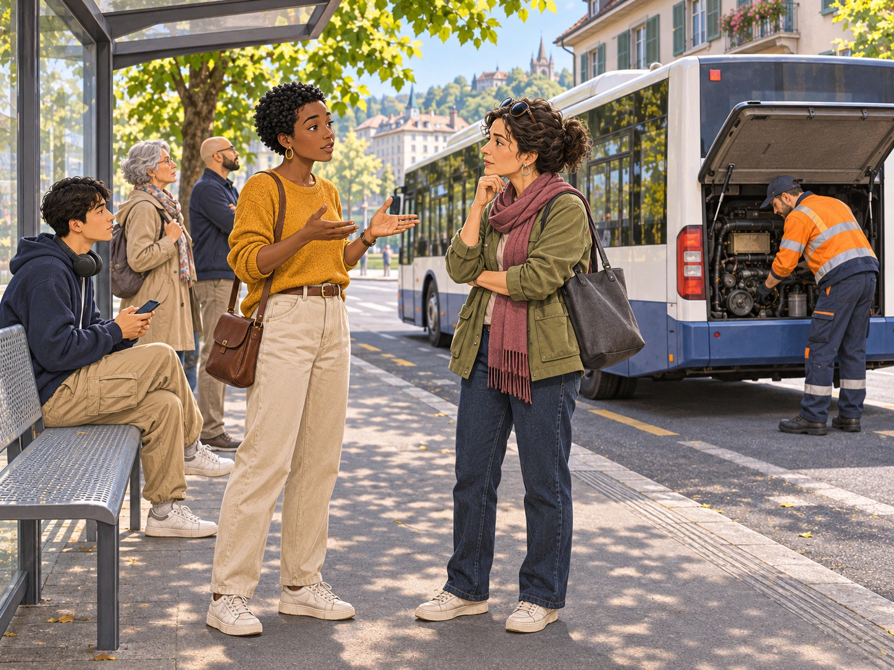

**Lire la situation**

Lina est sur la route du travail. Le moment prévu est hier matin. Son objectif est de raconter une panne. Le document mentionne un bus en panne.

1. Qui est au centre de cette situation ?

   A. Paul · B. Nadia · C. Lina
2. Où se trouve cette personne ?

   A. dans l’escalier · B. sur la route du travail · C. à la bibliothèque
3. Quel est le moment prévu ?

   A. hier matin · B. samedi · C. lundi soir
4. Quel est son objectif ?

   A. raconter une rencontre · B. raconter une chute · C. raconter une panne
5. Quel objet ou élément le document mentionne-t-il ?

   A. une marche glissante · B. un bus en panne · C. un ancien collègue

**Écrire** — Lina veut raconter une panne : écrivez une phrase utile pour cette situation.

**Dire** — Vous êtes à la place de Lina : dites une phrase utile pour raconter une panne.

Corrigé et modèle

1. Lina
2. sur la route du travail
3. hier matin
4. raconter une panne
5. un bus en panne

Modèle de production — Hier, le bus est tombé en panne.

### La rencontre

**Lire la situation**

Paul est à la bibliothèque. Le moment prévu est samedi. Son objectif est de raconter une rencontre. Le document mentionne un ancien collègue.

1. Qui est au centre de cette situation ?

   A. Lina · B. Nadia · C. Paul
2. Où se trouve cette personne ?

   A. dans l’escalier · B. à la bibliothèque · C. sur la route du travail
3. Quel est le moment prévu ?

   A. samedi · B. hier matin · C. lundi soir
4. Quel est son objectif ?

   A. raconter une panne · B. raconter une chute · C. raconter une rencontre
5. Quel objet ou élément le document mentionne-t-il ?

   A. une marche glissante · B. un ancien collègue · C. un bus en panne

**Écrire** — Paul veut raconter une rencontre : écrivez une phrase utile pour cette situation.

**Dire** — Vous êtes à la place de Paul : dites une phrase utile pour raconter une rencontre.

Corrigé et modèle

1. Paul
2. à la bibliothèque
3. samedi
4. raconter une rencontre
5. un ancien collègue

Modèle de production — Samedi, j’ai rencontré un ancien collègue.

### La chute

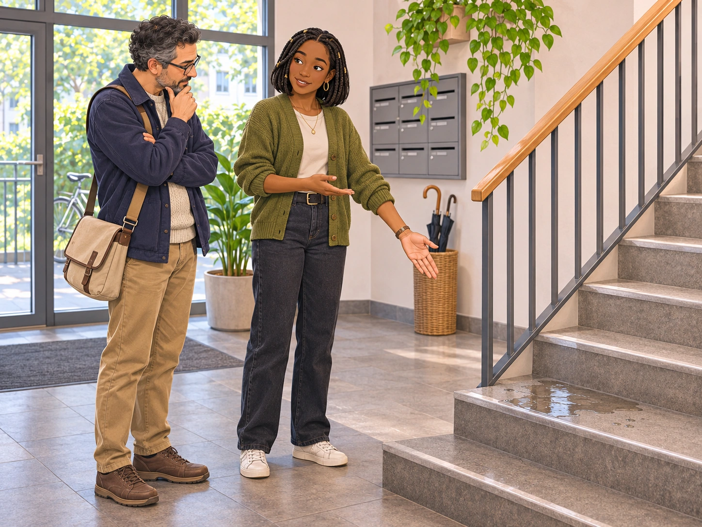

**Lire la situation**

Nadia est dans l’escalier. Le moment prévu est lundi soir. Son objectif est de raconter une chute. Le document mentionne une marche glissante.

1. Qui est au centre de cette situation ?

   A. Lina · B. Paul · C. Nadia
2. Où se trouve cette personne ?

   A. à la bibliothèque · B. dans l’escalier · C. sur la route du travail
3. Quel est le moment prévu ?

   A. lundi soir · B. hier matin · C. samedi
4. Quel est son objectif ?

   A. raconter une panne · B. raconter une rencontre · C. raconter une chute
5. Quel objet ou élément le document mentionne-t-il ?

   A. un ancien collègue · B. une marche glissante · C. un bus en panne

**Écrire** — Nadia veut raconter une chute : écrivez une phrase utile pour cette situation.

**Dire** — Vous êtes à la place de Nadia : dites une phrase utile pour raconter une chute.

Corrigé et modèle

1. Nadia
2. dans l’escalier
3. lundi soir
4. raconter une chute
5. une marche glissante

Modèle de production — Lundi soir, je suis tombée dans l’escalier.

### Le déménagement

**Lire la situation**

Omar est dans son nouvel appartement. Le moment prévu est le mois dernier. Son objectif est de raconter son déménagement. Le document mentionne des cartons.

1. Qui est au centre de cette situation ?

   A. Lina · B. Paul · C. Omar
2. Où se trouve cette personne ?

   A. à la bibliothèque · B. dans son nouvel appartement · C. sur la route du travail
3. Quel est le moment prévu ?

   A. le mois dernier · B. hier matin · C. samedi
4. Quel est son objectif ?

   A. raconter une panne · B. raconter une rencontre · C. raconter son déménagement
5. Quel objet ou élément le document mentionne-t-il ?

   A. un ancien collègue · B. des cartons · C. un bus en panne

**Écrire** — Omar veut raconter son déménagement : écrivez une phrase utile pour cette situation.

**Dire** — Vous êtes à la place de Omar : dites une phrase utile pour raconter son déménagement.

Corrigé et modèle

1. Omar
2. dans son nouvel appartement
3. le mois dernier
4. raconter son déménagement
5. des cartons

Modèle de production — Le mois dernier, j’ai déménagé.

### Le portefeuille

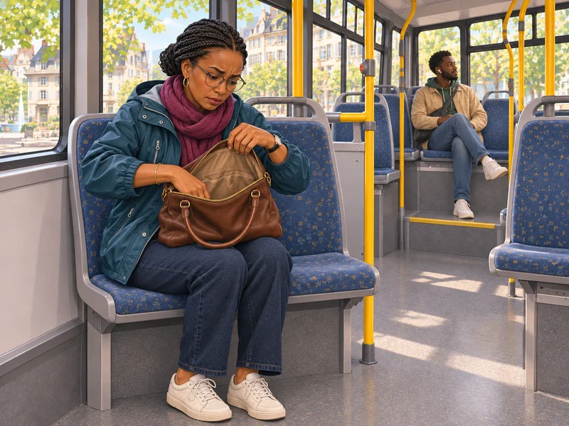

**Lire la situation**

Sofia est dans le bus. Le moment prévu est hier. Son objectif est de raconter la perte de son portefeuille. Le document mentionne un portefeuille.

1. Qui est au centre de cette situation ?

   A. Lina · B. Paul · C. Sofia
2. Où se trouve cette personne ?

   A. à la bibliothèque · B. dans le bus · C. sur la route du travail
3. Quel est le moment prévu ?

   A. hier · B. hier matin · C. samedi
4. Quel est son objectif ?

   A. raconter une panne · B. raconter une rencontre · C. raconter la perte de son portefeuille
5. Quel objet ou élément le document mentionne-t-il ?

   A. un ancien collègue · B. un portefeuille · C. un bus en panne

**Écrire** — Sofia veut raconter la perte de son portefeuille : écrivez une phrase utile pour cette situation.

**Dire** — Vous êtes à la place de Sofia : dites une phrase utile pour raconter la perte de son portefeuille.

Corrigé et modèle

1. Sofia
2. dans le bus
3. hier
4. raconter la perte de son portefeuille
5. un portefeuille

Modèle de production — Hier, j’ai perdu mon portefeuille dans le bus.

### La sortie scolaire

**Lire la situation**

Kenji est au musée. Le moment prévu est vendredi. Son objectif est de raconter une visite. Le document mentionne une exposition.

1. Qui est au centre de cette situation ?

   A. Lina · B. Paul · C. Kenji
2. Où se trouve cette personne ?

   A. à la bibliothèque · B. au musée · C. sur la route du travail
3. Quel est le moment prévu ?

   A. vendredi · B. hier matin · C. samedi
4. Quel est son objectif ?

   A. raconter une panne · B. raconter une rencontre · C. raconter une visite
5. Quel objet ou élément le document mentionne-t-il ?

   A. un ancien collègue · B. une exposition · C. un bus en panne

**Écrire** — Kenji veut raconter une visite : écrivez une phrase utile pour cette situation.

**Dire** — Vous êtes à la place de Kenji : dites une phrase utile pour raconter une visite.

Corrigé et modèle

1. Kenji
2. au musée
3. vendredi
4. raconter une visite
5. une exposition

Modèle de production — Vendredi, nous avons visité une exposition.

### La fête

**Lire la situation**

Mei est dans la salle commune. Le moment prévu est dimanche. Son objectif est de raconter une fête. Le document mentionne un gâteau partagé.

1. Qui est au centre de cette situation ?

   A. Lina · B. Paul · C. Mei
2. Où se trouve cette personne ?

   A. à la bibliothèque · B. dans la salle commune · C. sur la route du travail
3. Quel est le moment prévu ?

   A. dimanche · B. hier matin · C. samedi
4. Quel est son objectif ?

   A. raconter une panne · B. raconter une rencontre · C. raconter une fête
5. Quel objet ou élément le document mentionne-t-il ?

   A. un ancien collègue · B. un gâteau partagé · C. un bus en panne

**Écrire** — Mei veut raconter une fête : écrivez une phrase utile pour cette situation.

**Dire** — Vous êtes à la place de Mei : dites une phrase utile pour raconter une fête.

Corrigé et modèle

1. Mei
2. dans la salle commune
3. dimanche
4. raconter une fête
5. un gâteau partagé

Modèle de production — Dimanche, nous avons partagé un gâteau.

### Le retard

**Lire la situation**

Karim est à la gare. Le moment prévu est mardi. Son objectif est de raconter un retard. Le document mentionne un train retardé.

1. Qui est au centre de cette situation ?

   A. Lina · B. Paul · C. Karim
2. Où se trouve cette personne ?

   A. à la bibliothèque · B. à la gare · C. sur la route du travail
3. Quel est le moment prévu ?

   A. mardi · B. hier matin · C. samedi
4. Quel est son objectif ?

   A. raconter une panne · B. raconter une rencontre · C. raconter un retard
5. Quel objet ou élément le document mentionne-t-il ?

   A. un ancien collègue · B. un train retardé · C. un bus en panne

**Écrire** — Karim veut raconter un retard : écrivez une phrase utile pour cette situation.

**Dire** — Vous êtes à la place de Karim : dites une phrase utile pour raconter un retard.

Corrigé et modèle

1. Karim
2. à la gare
3. mardi
4. raconter un retard
5. un train retardé

Modèle de production — Mardi, mon train est arrivé en retard.

### La réparation

**Lire la situation**

Emma est à l’atelier. Le moment prévu est samedi matin. Son objectif est de raconter une réparation. Le document mentionne un frein neuf.

1. Qui est au centre de cette situation ?

   A. Lina · B. Paul · C. Emma
2. Où se trouve cette personne ?

   A. à la bibliothèque · B. à l’atelier · C. sur la route du travail
3. Quel est le moment prévu ?

   A. samedi matin · B. hier matin · C. samedi
4. Quel est son objectif ?

   A. raconter une panne · B. raconter une rencontre · C. raconter une réparation
5. Quel objet ou élément le document mentionne-t-il ?

   A. un ancien collègue · B. un frein neuf · C. un bus en panne

**Écrire** — Emma veut raconter une réparation : écrivez une phrase utile pour cette situation.

**Dire** — Vous êtes à la place de Emma : dites une phrase utile pour raconter une réparation.

Corrigé et modèle

1. Emma
2. à l’atelier
3. samedi matin
4. raconter une réparation
5. un frein neuf

Modèle de production — Samedi matin, le mécanicien a remplacé le frein.

### La promenade

**Lire la situation**

Marco est au bord du lac. Le moment prévu est hier après-midi. Son objectif est de raconter une promenade. Le document mentionne un sentier.

1. Qui est au centre de cette situation ?

   A. Lina · B. Paul · C. Marco
2. Où se trouve cette personne ?

   A. à la bibliothèque · B. au bord du lac · C. sur la route du travail
3. Quel est le moment prévu ?

   A. hier après-midi · B. hier matin · C. samedi
4. Quel est son objectif ?

   A. raconter une panne · B. raconter une rencontre · C. raconter une promenade
5. Quel objet ou élément le document mentionne-t-il ?

   A. un ancien collègue · B. un sentier · C. un bus en panne

**Écrire** — Marco veut raconter une promenade : écrivez une phrase utile pour cette situation.

**Dire** — Vous êtes à la place de Marco : dites une phrase utile pour raconter une promenade.

Corrigé et modèle

1. Marco
2. au bord du lac
3. hier après-midi
4. raconter une promenade
5. un sentier

Modèle de production — Hier après-midi, nous avons marché au bord du lac.

## Éviter une répétition

### Le dossier

**Lire la situation**

Lina est au secrétariat. Le moment prévu est lundi. Son objectif est de déposer son dossier. Le document mentionne le dossier.

1. Qui est au centre de cette situation ?

   A. Paul · B. Nadia · C. Lina
2. Où se trouve cette personne ?

   A. à la bibliothèque · B. au secrétariat · C. à l’accueil
3. Quel est le moment prévu ?

   A. lundi · B. ce matin · C. mercredi
4. Quel est son objectif ?

   A. rendre la clé · B. rapporter les livres · C. déposer son dossier
5. Quel objet ou élément le document mentionne-t-il ?

   A. les livres · B. le dossier · C. la clé

**Écrire** — Écrivez une phrase avec un pronom COD pour parler de « le dossier ».

**Dire** — Dites une phrase avec un pronom COD pour parler de « le dossier ».

Corrigé et modèle

1. Lina
2. au secrétariat
3. lundi
4. déposer son dossier
5. le dossier

Modèle de production — Je le dépose au secrétariat.

### La clé

**Lire la situation**

Paul est à l’accueil. Le moment prévu est ce matin. Son objectif est de rendre la clé. Le document mentionne la clé.

1. Qui est au centre de cette situation ?

   A. Lina · B. Nadia · C. Paul
2. Où se trouve cette personne ?

   A. à la bibliothèque · B. à l’accueil · C. au secrétariat
3. Quel est le moment prévu ?

   A. ce matin · B. lundi · C. mercredi
4. Quel est son objectif ?

   A. déposer son dossier · B. rapporter les livres · C. rendre la clé
5. Quel objet ou élément le document mentionne-t-il ?

   A. les livres · B. la clé · C. le dossier

**Écrire** — Écrivez une phrase avec un pronom COD pour parler de « la clé ».

**Dire** — Dites une phrase avec un pronom COD pour parler de « la clé ».

Corrigé et modèle

1. Paul
2. à l’accueil
3. ce matin
4. rendre la clé
5. la clé

Modèle de production — Je la rends à l’accueil.

### Les livres

**Lire la situation**

Nadia est à la bibliothèque. Le moment prévu est mercredi. Son objectif est de rapporter les livres. Le document mentionne les livres.

1. Qui est au centre de cette situation ?

   A. Lina · B. Paul · C. Nadia
2. Où se trouve cette personne ?

   A. à l’accueil · B. à la bibliothèque · C. au secrétariat
3. Quel est le moment prévu ?

   A. mercredi · B. lundi · C. ce matin
4. Quel est son objectif ?

   A. déposer son dossier · B. rendre la clé · C. rapporter les livres
5. Quel objet ou élément le document mentionne-t-il ?

   A. la clé · B. les livres · C. le dossier

**Écrire** — Écrivez une phrase avec un pronom COD pour parler de « les livres ».

**Dire** — Dites une phrase avec un pronom COD pour parler de « les livres ».

Corrigé et modèle

1. Nadia
2. à la bibliothèque
3. mercredi
4. rapporter les livres
5. les livres

Modèle de production — Je les rapporte à la bibliothèque.

### Le billet

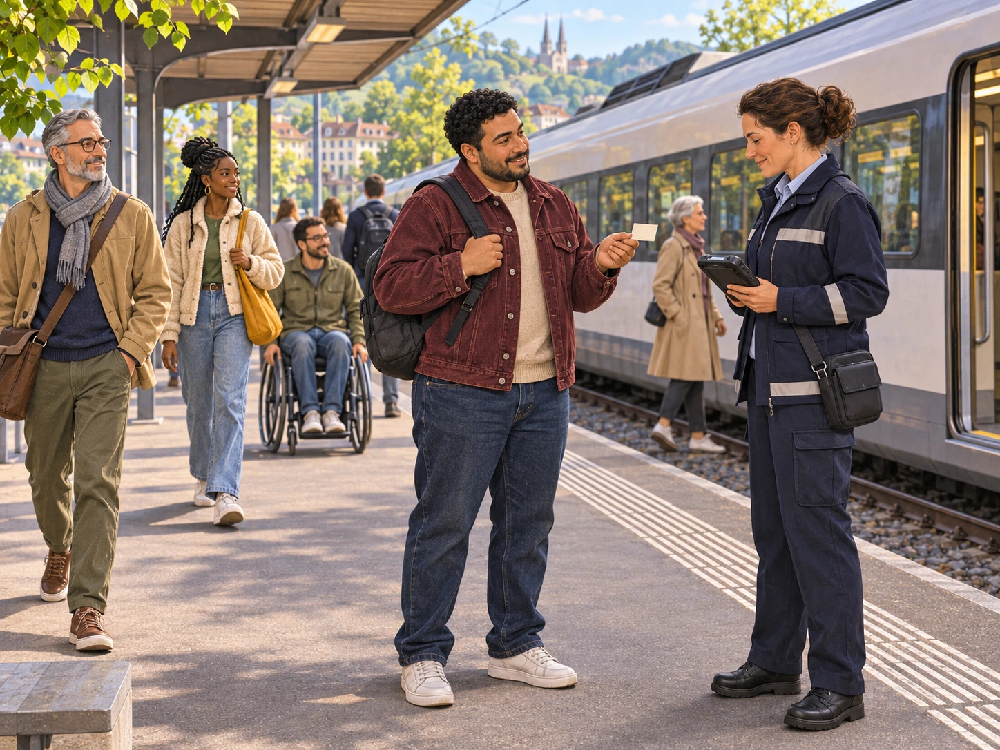

**Lire la situation**

Omar est à la gare. Le moment prévu est à neuf heures. Son objectif est de montrer son billet. Le document mentionne le billet.

1. Qui est au centre de cette situation ?

   A. Lina · B. Paul · C. Omar
2. Où se trouve cette personne ?

   A. à l’accueil · B. à la gare · C. au secrétariat
3. Quel est le moment prévu ?

   A. à neuf heures · B. lundi · C. ce matin
4. Quel est son objectif ?

   A. déposer son dossier · B. rendre la clé · C. montrer son billet
5. Quel objet ou élément le document mentionne-t-il ?

   A. la clé · B. le billet · C. le dossier

**Écrire** — Écrivez une phrase avec un pronom COD pour parler de « le billet ».

**Dire** — Dites une phrase avec un pronom COD pour parler de « le billet ».

Corrigé et modèle

1. Omar
2. à la gare
3. à neuf heures
4. montrer son billet
5. le billet

Modèle de production — Je le montre au contrôleur.

### La facture

**Lire la situation**

Sofia est au bureau. Le moment prévu est vendredi. Son objectif est de vérifier la facture. Le document mentionne la facture.

1. Qui est au centre de cette situation ?

   A. Lina · B. Paul · C. Sofia
2. Où se trouve cette personne ?

   A. à l’accueil · B. au bureau · C. au secrétariat
3. Quel est le moment prévu ?

   A. vendredi · B. lundi · C. ce matin
4. Quel est son objectif ?

   A. déposer son dossier · B. rendre la clé · C. vérifier la facture
5. Quel objet ou élément le document mentionne-t-il ?

   A. la clé · B. la facture · C. le dossier

**Écrire** — Écrivez une phrase avec un pronom COD pour parler de « la facture ».

**Dire** — Dites une phrase avec un pronom COD pour parler de « la facture ».

Corrigé et modèle

1. Sofia
2. au bureau
3. vendredi
4. vérifier la facture
5. la facture

Modèle de production — Je la vérifie avec ma collègue.

### Les légumes

**Lire la situation**

Kenji est à la cuisine collective. Le moment prévu est à midi. Son objectif est de laver les légumes. Le document mentionne les légumes.

1. Qui est au centre de cette situation ?

   A. Lina · B. Paul · C. Kenji
2. Où se trouve cette personne ?

   A. à l’accueil · B. à la cuisine collective · C. au secrétariat
3. Quel est le moment prévu ?

   A. à midi · B. lundi · C. ce matin
4. Quel est son objectif ?

   A. déposer son dossier · B. rendre la clé · C. laver les légumes
5. Quel objet ou élément le document mentionne-t-il ?

   A. la clé · B. les légumes · C. le dossier

**Écrire** — Écrivez une phrase avec un pronom COD pour parler de « les légumes ».

**Dire** — Dites une phrase avec un pronom COD pour parler de « les légumes ».

Corrigé et modèle

1. Kenji
2. à la cuisine collective
3. à midi
4. laver les légumes
5. les légumes

Modèle de production — Je les lave avant le repas.

### Le vélo

**Lire la situation**

Mei est à l’atelier. Le moment prévu est samedi. Son objectif est de réparer son vélo. Le document mentionne le vélo.

1. Qui est au centre de cette situation ?

   A. Lina · B. Paul · C. Mei
2. Où se trouve cette personne ?

   A. à l’accueil · B. à l’atelier · C. au secrétariat
3. Quel est le moment prévu ?

   A. samedi · B. lundi · C. ce matin
4. Quel est son objectif ?

   A. déposer son dossier · B. rendre la clé · C. réparer son vélo
5. Quel objet ou élément le document mentionne-t-il ?

   A. la clé · B. le vélo · C. le dossier

**Écrire** — Écrivez une phrase avec un pronom COD pour parler de « le vélo ».

**Dire** — Dites une phrase avec un pronom COD pour parler de « le vélo ».

Corrigé et modèle

1. Mei
2. à l’atelier
3. samedi
4. réparer son vélo
5. le vélo

Modèle de production — Je le répare à l’atelier.

### La photo

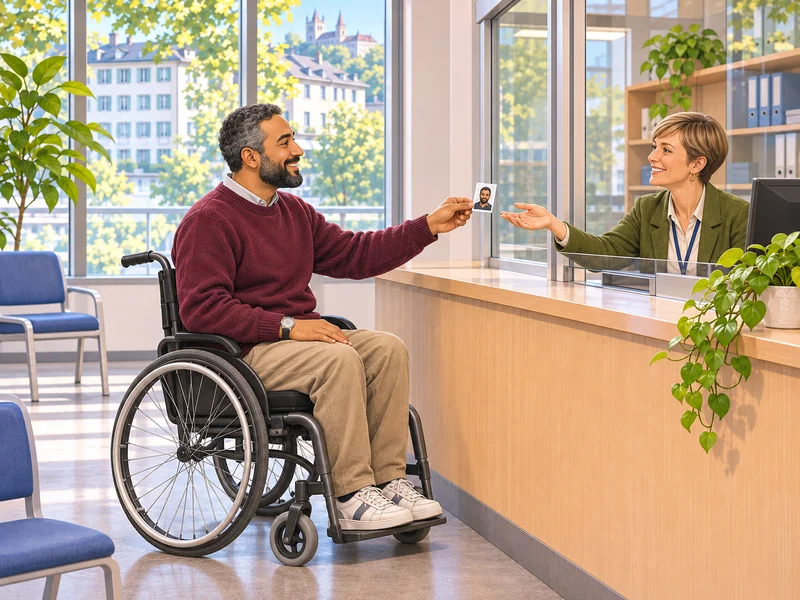

**Lire la situation**

Karim est au guichet. Le moment prévu est mardi. Son objectif est de donner la photo. Le document mentionne la photo.

1. Qui est au centre de cette situation ?

   A. Lina · B. Paul · C. Karim
2. Où se trouve cette personne ?

   A. à l’accueil · B. au guichet · C. au secrétariat
3. Quel est le moment prévu ?

   A. mardi · B. lundi · C. ce matin
4. Quel est son objectif ?

   A. déposer son dossier · B. rendre la clé · C. donner la photo
5. Quel objet ou élément le document mentionne-t-il ?

   A. la clé · B. la photo · C. le dossier

**Écrire** — Écrivez une phrase avec un pronom COD pour parler de « la photo ».

**Dire** — Dites une phrase avec un pronom COD pour parler de « la photo ».

Corrigé et modèle

1. Karim
2. au guichet
3. mardi
4. donner la photo
5. la photo

Modèle de production — Je la donne à l’employée.

### Les chaussures

**Lire la situation**

Emma est au magasin. Le moment prévu est cet après-midi. Son objectif est de essayer les chaussures. Le document mentionne les chaussures.

1. Qui est au centre de cette situation ?

   A. Lina · B. Paul · C. Emma
2. Où se trouve cette personne ?

   A. à l’accueil · B. au magasin · C. au secrétariat
3. Quel est le moment prévu ?

   A. cet après-midi · B. lundi · C. ce matin
4. Quel est son objectif ?

   A. déposer son dossier · B. rendre la clé · C. essayer les chaussures
5. Quel objet ou élément le document mentionne-t-il ?

   A. la clé · B. les chaussures · C. le dossier

**Écrire** — Écrivez une phrase avec un pronom COD pour parler de « les chaussures ».

**Dire** — Dites une phrase avec un pronom COD pour parler de « les chaussures ».

Corrigé et modèle

1. Emma
2. au magasin
3. cet après-midi
4. essayer les chaussures
5. les chaussures

Modèle de production — Je les essaie au magasin.

### Le formulaire

**Lire la situation**

Marco est à la mairie. Le moment prévu est jeudi. Son objectif est de compléter le formulaire. Le document mentionne le formulaire.

1. Qui est au centre de cette situation ?

   A. Lina · B. Paul · C. Marco
2. Où se trouve cette personne ?

   A. à l’accueil · B. à la mairie · C. au secrétariat
3. Quel est le moment prévu ?

   A. jeudi · B. lundi · C. ce matin
4. Quel est son objectif ?

   A. déposer son dossier · B. rendre la clé · C. compléter le formulaire
5. Quel objet ou élément le document mentionne-t-il ?

   A. la clé · B. le formulaire · C. le dossier

**Écrire** — Écrivez une phrase avec un pronom COD pour parler de « le formulaire ».

**Dire** — Dites une phrase avec un pronom COD pour parler de « le formulaire ».

Corrigé et modèle

1. Marco
2. à la mairie
3. jeudi
4. compléter le formulaire
5. le formulaire

Modèle de production — Je le complète à la mairie.

## Dire ce qui se passe

### La cuisine

**Lire la situation**

Lina est dans la cuisine. Le moment prévu est en ce moment. Son objectif est de préparer une soupe. Le document mentionne une casserole.

1. Qui est au centre de cette situation ?

   A. Paul · B. Nadia · C. Lina
2. Où se trouve cette personne ?

   A. dans la salle de classe · B. dans la cuisine · C. dans le jardin
3. Quel est le moment prévu ?

   A. en ce moment · B. maintenant · C. à cet instant
4. Quel est son objectif ?

   A. arroser les fleurs · B. lire une consigne · C. préparer une soupe
5. Quel objet ou élément le document mentionne-t-il ?

   A. une fiche · B. une casserole · C. un arrosoir

**Écrire** — Écrivez une phrase avec être en train de pour décrire Lina.

**Dire** — Dites une phrase avec être en train de pour décrire Lina.

Corrigé et modèle

1. Lina
2. dans la cuisine
3. en ce moment
4. préparer une soupe
5. une casserole

Modèle de production — Lina est en train de préparer une soupe.

### Le jardin

**Lire la situation**

Paul est dans le jardin. Le moment prévu est maintenant. Son objectif est d’arroser les fleurs. Le document mentionne un arrosoir.

1. Qui est au centre de cette situation ?

   A. Lina · B. Nadia · C. Paul
2. Où se trouve cette personne ?

   A. dans la salle de classe · B. dans le jardin · C. dans la cuisine
3. Quel est le moment prévu ?

   A. maintenant · B. en ce moment · C. à cet instant
4. Quel est son objectif ?

   A. préparer une soupe · B. lire une consigne · C. arroser les fleurs
5. Quel objet ou élément le document mentionne-t-il ?

   A. une fiche · B. un arrosoir · C. une casserole

**Écrire** — Écrivez une phrase avec être en train de pour décrire Paul.

**Dire** — Dites une phrase avec être en train de pour décrire Paul.

Corrigé et modèle

1. Paul
2. dans le jardin
3. maintenant
4. arroser les fleurs
5. un arrosoir

Modèle de production — Paul est en train d’arroser les fleurs.

### Le cours

**Lire la situation**

Nadia est dans la salle de classe. Le moment prévu est à cet instant. Son objectif est de lire une consigne. Le document mentionne une fiche.

1. Qui est au centre de cette situation ?

   A. Lina · B. Paul · C. Nadia
2. Où se trouve cette personne ?

   A. dans le jardin · B. dans la salle de classe · C. dans la cuisine
3. Quel est le moment prévu ?

   A. à cet instant · B. en ce moment · C. maintenant
4. Quel est son objectif ?

   A. préparer une soupe · B. arroser les fleurs · C. lire une consigne
5. Quel objet ou élément le document mentionne-t-il ?

   A. un arrosoir · B. une fiche · C. une casserole

**Écrire** — Écrivez une phrase avec être en train de pour décrire Nadia.

**Dire** — Dites une phrase avec être en train de pour décrire Nadia.

Corrigé et modèle

1. Nadia
2. dans la salle de classe
3. à cet instant
4. lire une consigne
5. une fiche

Modèle de production — Nadia est en train de lire une consigne.

### L’atelier

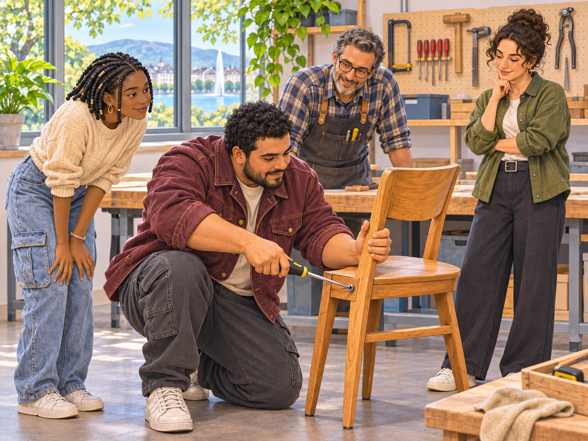

**Lire la situation**

Omar est dans l’atelier. Le moment prévu est en ce moment. Son objectif est de réparer une chaise. Le document mentionne un tournevis.

1. Qui est au centre de cette situation ?

   A. Lina · B. Paul · C. Omar
2. Où se trouve cette personne ?

   A. dans le jardin · B. dans l’atelier · C. dans la cuisine
3. Quel est le moment prévu ?

   A. en ce moment · B. maintenant · C. à cet instant
4. Quel est son objectif ?

   A. préparer une soupe · B. arroser les fleurs · C. réparer une chaise
5. Quel objet ou élément le document mentionne-t-il ?

   A. un arrosoir · B. un tournevis · C. une casserole

**Écrire** — Écrivez une phrase avec être en train de pour décrire Omar.

**Dire** — Dites une phrase avec être en train de pour décrire Omar.

Corrigé et modèle

1. Omar
2. dans l’atelier
3. en ce moment
4. réparer une chaise
5. un tournevis

Modèle de production — Omar est en train de réparer une chaise.

### Le repas

**Lire la situation**

Sofia est à la cantine. Le moment prévu est maintenant. Son objectif est de servir le repas. Le document mentionne un plateau.

1. Qui est au centre de cette situation ?

   A. Lina · B. Paul · C. Sofia
2. Où se trouve cette personne ?

   A. dans le jardin · B. à la cantine · C. dans la cuisine
3. Quel est le moment prévu ?

   A. maintenant · B. en ce moment · C. à cet instant
4. Quel est son objectif ?

   A. préparer une soupe · B. arroser les fleurs · C. servir le repas
5. Quel objet ou élément le document mentionne-t-il ?

   A. un arrosoir · B. un plateau · C. une casserole

**Écrire** — Écrivez une phrase avec être en train de pour décrire Sofia.

**Dire** — Dites une phrase avec être en train de pour décrire Sofia.

Corrigé et modèle

1. Sofia
2. à la cantine
3. maintenant
4. servir le repas
5. un plateau

Modèle de production — Sofia est en train de servir le repas.

### Le magasin

**Lire la situation**

Kenji est dans le magasin. Le moment prévu est à cet instant. Son objectif est de ranger les boîtes. Le document mentionne une étagère.

1. Qui est au centre de cette situation ?

   A. Lina · B. Paul · C. Kenji
2. Où se trouve cette personne ?

   A. dans le jardin · B. dans le magasin · C. dans la cuisine
3. Quel est le moment prévu ?

   A. à cet instant · B. en ce moment · C. maintenant
4. Quel est son objectif ?

   A. préparer une soupe · B. arroser les fleurs · C. ranger les boîtes
5. Quel objet ou élément le document mentionne-t-il ?

   A. un arrosoir · B. une étagère · C. une casserole

**Écrire** — Écrivez une phrase avec être en train de pour décrire Kenji.

**Dire** — Dites une phrase avec être en train de pour décrire Kenji.

Corrigé et modèle

1. Kenji
2. dans le magasin
3. à cet instant
4. ranger les boîtes
5. une étagère

Modèle de production — Kenji est en train de ranger les boîtes.

### Le parc

**Lire la situation**

Mei est dans le parc. Le moment prévu est en ce moment. Son objectif est de dessiner le paysage. Le document mentionne un carnet.

1. Qui est au centre de cette situation ?

   A. Lina · B. Paul · C. Mei
2. Où se trouve cette personne ?

   A. dans le jardin · B. dans le parc · C. dans la cuisine
3. Quel est le moment prévu ?

   A. en ce moment · B. maintenant · C. à cet instant
4. Quel est son objectif ?

   A. préparer une soupe · B. arroser les fleurs · C. dessiner le paysage
5. Quel objet ou élément le document mentionne-t-il ?

   A. un arrosoir · B. un carnet · C. une casserole

**Écrire** — Écrivez une phrase avec être en train de pour décrire Mei.

**Dire** — Dites une phrase avec être en train de pour décrire Mei.

Corrigé et modèle

1. Mei
2. dans le parc
3. en ce moment
4. dessiner le paysage
5. un carnet

Modèle de production — Mei est en train de dessiner le paysage.

### Le bureau

**Lire la situation**

Karim est au bureau. Le moment prévu est maintenant. Son objectif est de écrire un message. Le document mentionne un ordinateur.

1. Qui est au centre de cette situation ?

   A. Lina · B. Paul · C. Karim
2. Où se trouve cette personne ?

   A. dans le jardin · B. au bureau · C. dans la cuisine
3. Quel est le moment prévu ?

   A. maintenant · B. en ce moment · C. à cet instant
4. Quel est son objectif ?

   A. préparer une soupe · B. arroser les fleurs · C. écrire un message
5. Quel objet ou élément le document mentionne-t-il ?

   A. un arrosoir · B. un ordinateur · C. une casserole

**Écrire** — Écrivez une phrase avec être en train de pour décrire Karim.

**Dire** — Dites une phrase avec être en train de pour décrire Karim.

Corrigé et modèle

1. Karim
2. au bureau
3. maintenant
4. écrire un message
5. un ordinateur

Modèle de production — Karim est en train d’écrire un message.

### La gare

**Lire la situation**

Emma est dans le hall de la gare. Le moment prévu est à cet instant. Son objectif est de acheter un billet. Le document mentionne un distributeur.

1. Qui est au centre de cette situation ?

   A. Lina · B. Paul · C. Emma
2. Où se trouve cette personne ?

   A. dans le jardin · B. dans le hall de la gare · C. dans la cuisine
3. Quel est le moment prévu ?

   A. à cet instant · B. en ce moment · C. maintenant
4. Quel est son objectif ?

   A. préparer une soupe · B. arroser les fleurs · C. acheter un billet
5. Quel objet ou élément le document mentionne-t-il ?

   A. un arrosoir · B. un distributeur · C. une casserole

**Écrire** — Écrivez une phrase avec être en train de pour décrire Emma.

**Dire** — Dites une phrase avec être en train de pour décrire Emma.

Corrigé et modèle

1. Emma
2. dans le hall de la gare
3. à cet instant
4. acheter un billet
5. un distributeur

Modèle de production — Emma est en train d’acheter un billet.

### La maison

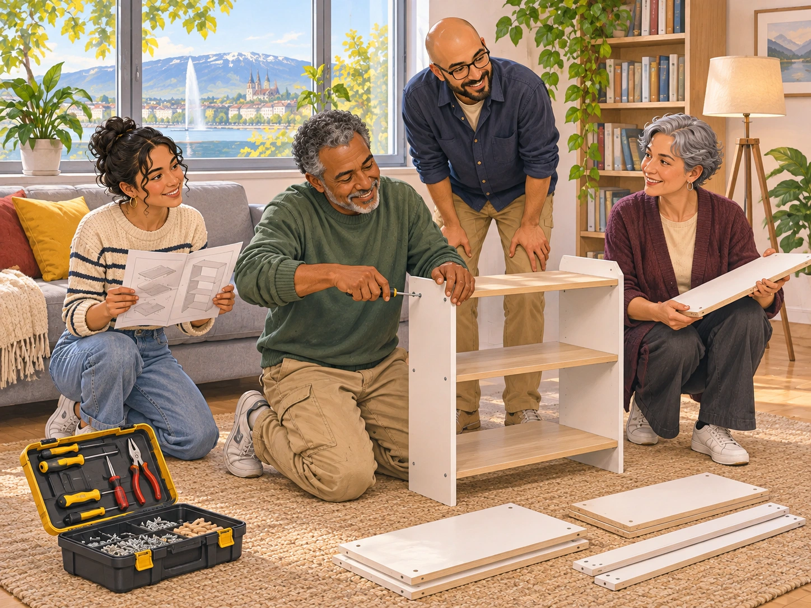

**Lire la situation**

Marco est dans le salon. Le moment prévu est en ce moment. Son objectif est de monter un meuble. Le document mentionne une boîte à outils.

1. Qui est au centre de cette situation ?

   A. Lina · B. Paul · C. Marco
2. Où se trouve cette personne ?

   A. dans le jardin · B. dans le salon · C. dans la cuisine
3. Quel est le moment prévu ?

   A. en ce moment · B. maintenant · C. à cet instant
4. Quel est son objectif ?

   A. préparer une soupe · B. arroser les fleurs · C. monter un meuble
5. Quel objet ou élément le document mentionne-t-il ?

   A. un arrosoir · B. une boîte à outils · C. une casserole

**Écrire** — Écrivez une phrase avec être en train de pour décrire Marco.

**Dire** — Dites une phrase avec être en train de pour décrire Marco.

Corrigé et modèle

1. Marco
2. dans le salon
3. en ce moment
4. monter un meuble
5. une boîte à outils

Modèle de production — Marco est en train de monter un meuble.

## Annoncer un projet

### Le déménagement

**Lire la situation**

Lina est dans son nouvel immeuble. Le moment prévu est samedi. Son objectif est de déménager. Le document mentionne des cartons.

1. Qui est au centre de cette situation ?

   A. Paul · B. Nadia · C. Lina
2. Où se trouve cette personne ?

   A. chez sa sœur · B. dans son nouvel immeuble · C. au centre de langues
3. Quel est le moment prévu ?

   A. samedi · B. lundi · C. dimanche
4. Quel est son objectif ?

   A. commencer un cours · B. préparer le déjeuner · C. déménager
5. Quel objet ou élément le document mentionne-t-il ?

   A. des légumes · B. des cartons · C. un cahier

**Écrire** — À la place de Lina, écrivez une phrase au futur proche pour annoncer le projet.

**Dire** — À la place de Lina, annoncez le projet en une phrase au futur proche.

Corrigé et modèle

1. Lina
2. dans son nouvel immeuble
3. samedi
4. déménager
5. des cartons

Modèle de production — Je vais déménager samedi.

### Le cours

**Lire la situation**

Paul est au centre de langues. Le moment prévu est lundi. Son objectif est de commencer un cours. Le document mentionne un cahier.

1. Qui est au centre de cette situation ?

   A. Lina · B. Nadia · C. Paul
2. Où se trouve cette personne ?

   A. chez sa sœur · B. au centre de langues · C. dans son nouvel immeuble
3. Quel est le moment prévu ?

   A. lundi · B. samedi · C. dimanche
4. Quel est son objectif ?

   A. déménager · B. préparer le déjeuner · C. commencer un cours
5. Quel objet ou élément le document mentionne-t-il ?

   A. des légumes · B. un cahier · C. des cartons

**Écrire** — À la place de Paul, écrivez une phrase au futur proche pour annoncer le projet.

**Dire** — À la place de Paul, annoncez le projet en une phrase au futur proche.

Corrigé et modèle

1. Paul
2. au centre de langues
3. lundi
4. commencer un cours
5. un cahier

Modèle de production — Je vais commencer un cours lundi.

### Le repas

**Lire la situation**

Nadia est chez sa sœur. Le moment prévu est dimanche. Son objectif est de préparer le déjeuner. Le document mentionne des légumes.

1. Qui est au centre de cette situation ?

   A. Lina · B. Paul · C. Nadia
2. Où se trouve cette personne ?

   A. au centre de langues · B. chez sa sœur · C. dans son nouvel immeuble
3. Quel est le moment prévu ?

   A. dimanche · B. samedi · C. lundi
4. Quel est son objectif ?

   A. déménager · B. commencer un cours · C. préparer le déjeuner
5. Quel objet ou élément le document mentionne-t-il ?

   A. un cahier · B. des légumes · C. des cartons

**Écrire** — À la place de Nadia, écrivez une phrase au futur proche pour annoncer le projet.

**Dire** — À la place de Nadia, annoncez le projet en une phrase au futur proche.

Corrigé et modèle

1. Nadia
2. chez sa sœur
3. dimanche
4. préparer le déjeuner
5. des légumes

Modèle de production — Je vais préparer le déjeuner dimanche.

### La visite

**Lire la situation**

Omar est au musée. Le moment prévu est demain. Son objectif est de visiter une exposition. Le document mentionne un billet.

1. Qui est au centre de cette situation ?

   A. Lina · B. Paul · C. Omar
2. Où se trouve cette personne ?

   A. au centre de langues · B. au musée · C. dans son nouvel immeuble
3. Quel est le moment prévu ?

   A. demain · B. samedi · C. lundi
4. Quel est son objectif ?

   A. déménager · B. commencer un cours · C. visiter une exposition
5. Quel objet ou élément le document mentionne-t-il ?

   A. un cahier · B. un billet · C. des cartons

**Écrire** — À la place de Omar, écrivez une phrase au futur proche pour annoncer le projet.

**Dire** — À la place de Omar, annoncez le projet en une phrase au futur proche.

Corrigé et modèle

1. Omar
2. au musée
3. demain
4. visiter une exposition
5. un billet

Modèle de production — Je vais visiter une exposition demain.

### La réparation

**Lire la situation**

Sofia est à l’atelier. Le moment prévu est mardi. Son objectif est de faire réparer son vélo. Le document mentionne un vélo.

1. Qui est au centre de cette situation ?

   A. Lina · B. Paul · C. Sofia
2. Où se trouve cette personne ?

   A. au centre de langues · B. à l’atelier · C. dans son nouvel immeuble
3. Quel est le moment prévu ?

   A. mardi · B. samedi · C. lundi
4. Quel est son objectif ?

   A. déménager · B. commencer un cours · C. faire réparer son vélo
5. Quel objet ou élément le document mentionne-t-il ?

   A. un cahier · B. un vélo · C. des cartons

**Écrire** — À la place de Sofia, écrivez une phrase au futur proche pour annoncer le projet.

**Dire** — À la place de Sofia, annoncez le projet en une phrase au futur proche.

Corrigé et modèle

1. Sofia
2. à l’atelier
3. mardi
4. faire réparer son vélo
5. un vélo

Modèle de production — Je vais faire réparer mon vélo mardi.

### La randonnée

**Lire la situation**

Kenji est en montagne. Le moment prévu est ce week-end. Son objectif est de faire une randonnée. Le document mentionne un sac à dos.

1. Qui est au centre de cette situation ?

   A. Lina · B. Paul · C. Kenji
2. Où se trouve cette personne ?

   A. au centre de langues · B. en montagne · C. dans son nouvel immeuble
3. Quel est le moment prévu ?

   A. ce week-end · B. samedi · C. lundi
4. Quel est son objectif ?

   A. déménager · B. commencer un cours · C. faire une randonnée
5. Quel objet ou élément le document mentionne-t-il ?

   A. un cahier · B. un sac à dos · C. des cartons

**Écrire** — À la place de Kenji, écrivez une phrase au futur proche pour annoncer le projet.

**Dire** — À la place de Kenji, annoncez le projet en une phrase au futur proche.

Corrigé et modèle

1. Kenji
2. en montagne
3. ce week-end
4. faire une randonnée
5. un sac à dos

Modèle de production — Je vais faire une randonnée ce week-end.

### Le rendez-vous

**Lire la situation**

Mei est au cabinet médical. Le moment prévu est jeudi. Son objectif est de consulter le médecin. Le document mentionne une carte d’assurance.

1. Qui est au centre de cette situation ?

   A. Lina · B. Paul · C. Mei
2. Où se trouve cette personne ?

   A. au centre de langues · B. au cabinet médical · C. dans son nouvel immeuble
3. Quel est le moment prévu ?

   A. jeudi · B. samedi · C. lundi
4. Quel est son objectif ?

   A. déménager · B. commencer un cours · C. consulter le médecin
5. Quel objet ou élément le document mentionne-t-il ?

   A. un cahier · B. une carte d’assurance · C. des cartons

**Écrire** — À la place de Mei, écrivez une phrase au futur proche pour annoncer le projet.

**Dire** — À la place de Mei, annoncez le projet en une phrase au futur proche.

Corrigé et modèle

1. Mei
2. au cabinet médical
3. jeudi
4. consulter le médecin
5. une carte d’assurance

Modèle de production — Je vais consulter le médecin jeudi.

### Le travail

**Lire la situation**

Karim est à l’entreprise. Le moment prévu est le mois prochain. Son objectif est de commencer un nouveau travail. Le document mentionne un contrat.

1. Qui est au centre de cette situation ?

   A. Lina · B. Paul · C. Karim
2. Où se trouve cette personne ?

   A. au centre de langues · B. à l’entreprise · C. dans son nouvel immeuble
3. Quel est le moment prévu ?

   A. le mois prochain · B. samedi · C. lundi
4. Quel est son objectif ?

   A. déménager · B. commencer un cours · C. commencer un nouveau travail
5. Quel objet ou élément le document mentionne-t-il ?

   A. un cahier · B. un contrat · C. des cartons

**Écrire** — À la place de Karim, écrivez une phrase au futur proche pour annoncer le projet.

**Dire** — À la place de Karim, annoncez le projet en une phrase au futur proche.

Corrigé et modèle

1. Karim
2. à l’entreprise
3. le mois prochain
4. commencer un nouveau travail
5. un contrat

Modèle de production — Je vais commencer un nouveau travail le mois prochain.

### La bibliothèque

**Lire la situation**

Emma est à la bibliothèque. Le moment prévu est mercredi. Son objectif est d’emprunter un roman. Le document mentionne une carte de lecteur.

1. Qui est au centre de cette situation ?

   A. Lina · B. Paul · C. Emma
2. Où se trouve cette personne ?

   A. au centre de langues · B. à la bibliothèque · C. dans son nouvel immeuble
3. Quel est le moment prévu ?

   A. mercredi · B. samedi · C. lundi
4. Quel est son objectif ?

   A. déménager · B. commencer un cours · C. emprunter un roman
5. Quel objet ou élément le document mentionne-t-il ?

   A. un cahier · B. une carte de lecteur · C. des cartons

**Écrire** — À la place de Emma, écrivez une phrase au futur proche pour annoncer le projet.

**Dire** — À la place de Emma, annoncez le projet en une phrase au futur proche.

Corrigé et modèle

1. Emma
2. à la bibliothèque
3. mercredi
4. emprunter un roman
5. une carte de lecteur

Modèle de production — Je vais emprunter un roman mercredi.

### Le voyage

**Lire la situation**

Marco est à la gare. Le moment prévu est vendredi. Son objectif est de prendre le train. Le document mentionne une valise.

1. Qui est au centre de cette situation ?

   A. Lina · B. Paul · C. Marco
2. Où se trouve cette personne ?

   A. au centre de langues · B. à la gare · C. dans son nouvel immeuble
3. Quel est le moment prévu ?

   A. vendredi · B. samedi · C. lundi
4. Quel est son objectif ?

   A. déménager · B. commencer un cours · C. prendre le train
5. Quel objet ou élément le document mentionne-t-il ?

   A. un cahier · B. une valise · C. des cartons

**Écrire** — À la place de Marco, écrivez une phrase au futur proche pour annoncer le projet.

**Dire** — À la place de Marco, annoncez le projet en une phrase au futur proche.

Corrigé et modèle

1. Marco
2. à la gare
3. vendredi
4. prendre le train
5. une valise

Modèle de production — Je vais prendre le train vendredi.

## Transmettre une information

### Le retard

**Lire la situation**

Lina est à l’accueil. Le moment prévu est ce matin. Son objectif est de transmettre un message de Paul. Le document mentionne un message de retard.

1. Qui est au centre de cette situation ?

   A. Paul · B. Nadia · C. Lina
2. Où se trouve cette personne ?

   A. au bureau · B. à l’accueil · C. à la mairie
3. Quel est le moment prévu ?

   A. ce matin · B. lundi · C. mardi
4. Quel est son objectif ?

   A. annoncer une fermeture · B. rapporter une demande de sa collègue · C. transmettre un message de Paul
5. Quel objet ou élément le document mentionne-t-il ?

   A. une invitation à la réunion · B. un message de retard · C. un avis de fermeture

**Écrire** — Écrivez une phrase pour transmettre un message de Paul au discours indirect.

**Dire** — Dites une phrase pour transmettre un message de Paul au discours indirect.

Corrigé et modèle

1. Lina
2. à l’accueil
3. ce matin
4. transmettre un message de Paul
5. un message de retard

Modèle de production — Paul dit qu’il arrive en retard.

### La fermeture

**Lire la situation**

Paul est à la mairie. Le moment prévu est lundi. Son objectif est d’annoncer une fermeture. Le document mentionne un avis de fermeture.

1. Qui est au centre de cette situation ?

   A. Lina · B. Nadia · C. Paul
2. Où se trouve cette personne ?

   A. au bureau · B. à la mairie · C. à l’accueil
3. Quel est le moment prévu ?

   A. lundi · B. ce matin · C. mardi
4. Quel est son objectif ?

   A. transmettre un message de Paul · B. rapporter une demande de sa collègue · C. annoncer une fermeture
5. Quel objet ou élément le document mentionne-t-il ?

   A. une invitation à la réunion · B. un avis de fermeture · C. un message de retard

**Écrire** — Écrivez une phrase pour annoncer une fermeture au discours indirect.

**Dire** — Dites une phrase pour annoncer une fermeture au discours indirect.

Corrigé et modèle

1. Paul
2. à la mairie
3. lundi
4. annoncer une fermeture
5. un avis de fermeture

Modèle de production — L’employée dit que la mairie ferme à midi.

### La réunion

**Lire la situation**

Nadia est au bureau. Le moment prévu est mardi. Son objectif est de rapporter une demande de sa collègue. Le document mentionne une invitation à la réunion.

1. Qui est au centre de cette situation ?

   A. Lina · B. Paul · C. Nadia
2. Où se trouve cette personne ?

   A. à la mairie · B. au bureau · C. à l’accueil
3. Quel est le moment prévu ?

   A. mardi · B. ce matin · C. lundi
4. Quel est son objectif ?

   A. transmettre un message de Paul · B. annoncer une fermeture · C. rapporter une demande de sa collègue
5. Quel objet ou élément le document mentionne-t-il ?

   A. un avis de fermeture · B. une invitation à la réunion · C. un message de retard

**Écrire** — Écrivez une phrase pour rapporter une demande de sa collègue au discours indirect.

**Dire** — Dites une phrase pour rapporter une demande de sa collègue au discours indirect.

Corrigé et modèle

1. Nadia
2. au bureau
3. mardi
4. rapporter une demande de sa collègue
5. une invitation à la réunion

Modèle de production — Ma collègue demande si je viens à la réunion.

### Le médecin

**Lire la situation**

Omar est au cabinet médical. Le moment prévu est mercredi. Son objectif est de transmettre une consigne du médecin. Le document mentionne une ordonnance.

1. Qui est au centre de cette situation ?

   A. Lina · B. Paul · C. Omar
2. Où se trouve cette personne ?

   A. à la mairie · B. au cabinet médical · C. à l’accueil
3. Quel est le moment prévu ?

   A. mercredi · B. ce matin · C. lundi
4. Quel est son objectif ?

   A. transmettre un message de Paul · B. annoncer une fermeture · C. transmettre une consigne du médecin
5. Quel objet ou élément le document mentionne-t-il ?

   A. un avis de fermeture · B. une ordonnance · C. un message de retard

**Écrire** — Écrivez une phrase pour transmettre une consigne du médecin au discours indirect.

**Dire** — Dites une phrase pour transmettre une consigne du médecin au discours indirect.

Corrigé et modèle

1. Omar
2. au cabinet médical
3. mercredi
4. transmettre une consigne du médecin
5. une ordonnance

Modèle de production — Le médecin dit que je dois me reposer.

### Le colis

**Lire la situation**

Sofia est à la poste. Le moment prévu est jeudi. Son objectif est de rapporter une information du facteur. Le document mentionne un avis de passage.

1. Qui est au centre de cette situation ?

   A. Lina · B. Paul · C. Sofia
2. Où se trouve cette personne ?

   A. à la mairie · B. à la poste · C. à l’accueil
3. Quel est le moment prévu ?

   A. jeudi · B. ce matin · C. lundi
4. Quel est son objectif ?

   A. transmettre un message de Paul · B. annoncer une fermeture · C. rapporter une information du facteur
5. Quel objet ou élément le document mentionne-t-il ?

   A. un avis de fermeture · B. un avis de passage · C. un message de retard

**Écrire** — Écrivez une phrase pour rapporter une information du facteur au discours indirect.

**Dire** — Dites une phrase pour rapporter une information du facteur au discours indirect.

Corrigé et modèle

1. Sofia
2. à la poste
3. jeudi
4. rapporter une information du facteur
5. un avis de passage

Modèle de production — Le facteur dit que le colis est à la poste.

### Le cours

**Lire la situation**

Kenji est au centre de formation. Le moment prévu est vendredi. Son objectif est de rapporter une annonce du professeur. Le document mentionne un nouvel horaire.

1. Qui est au centre de cette situation ?

   A. Lina · B. Paul · C. Kenji
2. Où se trouve cette personne ?

   A. à la mairie · B. au centre de formation · C. à l’accueil
3. Quel est le moment prévu ?

   A. vendredi · B. ce matin · C. lundi
4. Quel est son objectif ?

   A. transmettre un message de Paul · B. annoncer une fermeture · C. rapporter une annonce du professeur
5. Quel objet ou élément le document mentionne-t-il ?

   A. un avis de fermeture · B. un nouvel horaire · C. un message de retard

**Écrire** — Écrivez une phrase pour rapporter une annonce du professeur au discours indirect.

**Dire** — Dites une phrase pour rapporter une annonce du professeur au discours indirect.

Corrigé et modèle

1. Kenji
2. au centre de formation
3. vendredi
4. rapporter une annonce du professeur
5. un nouvel horaire

Modèle de production — Le professeur dit que le cours commence à neuf heures.

### La visite

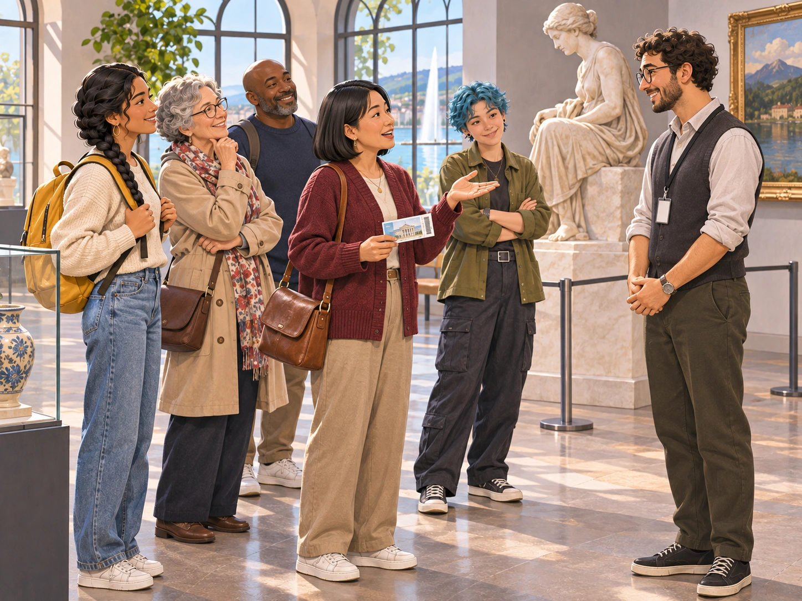

**Lire la situation**

Mei est au musée. Le moment prévu est samedi. Son objectif est de transmettre une question du guide. Le document mentionne un billet de visite.

1. Qui est au centre de cette situation ?

   A. Lina · B. Paul · C. Mei
2. Où se trouve cette personne ?

   A. à la mairie · B. au musée · C. à l’accueil
3. Quel est le moment prévu ?

   A. samedi · B. ce matin · C. lundi
4. Quel est son objectif ?

   A. transmettre un message de Paul · B. annoncer une fermeture · C. transmettre une question du guide
5. Quel objet ou élément le document mentionne-t-il ?

   A. un avis de fermeture · B. un billet de visite · C. un message de retard

**Écrire** — Écrivez une phrase pour transmettre une question du guide au discours indirect.

**Dire** — Dites une phrase pour transmettre une question du guide au discours indirect.

Corrigé et modèle

1. Mei
2. au musée
3. samedi
4. transmettre une question du guide
5. un billet de visite

Modèle de production — Le guide demande si nous comprenons.

### Le repas

**Lire la situation**

Karim est à la cantine. Le moment prévu est à midi. Son objectif est de rapporter une demande de la cuisinière. Le document mentionne un menu.

1. Qui est au centre de cette situation ?

   A. Lina · B. Paul · C. Karim
2. Où se trouve cette personne ?

   A. à la mairie · B. à la cantine · C. à l’accueil
3. Quel est le moment prévu ?

   A. à midi · B. ce matin · C. lundi
4. Quel est son objectif ?

   A. transmettre un message de Paul · B. annoncer une fermeture · C. rapporter une demande de la cuisinière
5. Quel objet ou élément le document mentionne-t-il ?

   A. un avis de fermeture · B. un menu · C. un message de retard

**Écrire** — Écrivez une phrase pour rapporter une demande de la cuisinière au discours indirect.

**Dire** — Dites une phrase pour rapporter une demande de la cuisinière au discours indirect.

Corrigé et modèle

1. Karim
2. à la cantine
3. à midi
4. rapporter une demande de la cuisinière
5. un menu

Modèle de production — La cuisinière demande si je mange de la viande.

### La sortie

**Lire la situation**

Emma est à l’école. Le moment prévu est dimanche. Son objectif est de transmettre une information de l’enseignant. Le document mentionne le programme de la sortie.

1. Qui est au centre de cette situation ?

   A. Lina · B. Paul · C. Emma
2. Où se trouve cette personne ?

   A. à la mairie · B. à l’école · C. à l’accueil
3. Quel est le moment prévu ?

   A. dimanche · B. ce matin · C. lundi
4. Quel est son objectif ?

   A. transmettre un message de Paul · B. annoncer une fermeture · C. transmettre une information de l’enseignant
5. Quel objet ou élément le document mentionne-t-il ?

   A. un avis de fermeture · B. le programme de la sortie · C. un message de retard

**Écrire** — Écrivez une phrase pour transmettre une information de l’enseignant au discours indirect.

**Dire** — Dites une phrase pour transmettre une information de l’enseignant au discours indirect.

Corrigé et modèle

1. Emma
2. à l’école
3. dimanche
4. transmettre une information de l’enseignant
5. le programme de la sortie

Modèle de production — L’enseignant dit que la sortie est annulée.

### Le rendez-vous

**Lire la situation**

Marco est au secrétariat. Le moment prévu est demain. Son objectif est de rapporter une question de l’employée. Le document mentionne une carte de rendez-vous.

1. Qui est au centre de cette situation ?

   A. Lina · B. Paul · C. Marco
2. Où se trouve cette personne ?

   A. à la mairie · B. au secrétariat · C. à l’accueil
3. Quel est le moment prévu ?

   A. demain · B. ce matin · C. lundi
4. Quel est son objectif ?

   A. transmettre un message de Paul · B. annoncer une fermeture · C. rapporter une question de l’employée
5. Quel objet ou élément le document mentionne-t-il ?

   A. un avis de fermeture · B. une carte de rendez-vous · C. un message de retard

**Écrire** — Écrivez une phrase pour rapporter une question de l’employée au discours indirect.

**Dire** — Dites une phrase pour rapporter une question de l’employée au discours indirect.

Corrigé et modèle

1. Marco
2. au secrétariat
3. demain
4. rapporter une question de l’employée
5. une carte de rendez-vous

Modèle de production — L’employée demande à quelle heure je suis disponible.

## Organiser une explication

### Le trajet

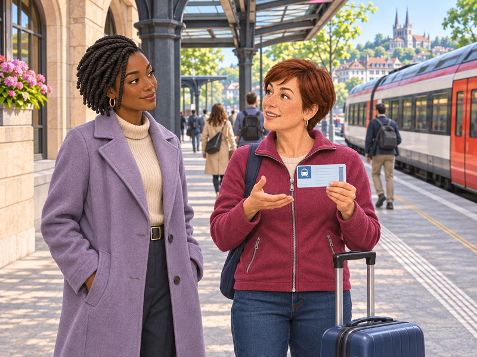

**Lire la situation**

Lina est à la gare. Le moment prévu est demain. Son objectif est d’expliquer son choix de transport. Le document mentionne un billet de train.

1. Qui est au centre de cette situation ?

   A. Paul · B. Nadia · C. Lina
2. Où se trouve cette personne ?

   A. au centre sportif · B. à la gare · C. à l’agence immobilière
3. Quel est le moment prévu ?

   A. demain · B. lundi · C. mardi soir
4. Quel est son objectif ?

   A. expliquer son choix de logement · B. expliquer son choix d’activité · C. expliquer son choix de transport
5. Quel objet ou élément le document mentionne-t-il ?

   A. le programme des cours · B. un billet de train · C. une annonce

**Écrire** — Lina veut expliquer son choix de transport : écrivez une phrase utile pour cette situation.

**Dire** — Vous êtes à la place de Lina : dites une phrase utile pour expliquer son choix de transport.

Corrigé et modèle

1. Lina
2. à la gare
3. demain
4. expliquer son choix de transport
5. un billet de train

Modèle de production — Je prends le train car le trajet est direct.

### Le logement

**Lire la situation**

Paul est à l’agence immobilière. Le moment prévu est lundi. Son objectif est d’expliquer son choix de logement. Le document mentionne une annonce.

1. Qui est au centre de cette situation ?

   A. Lina · B. Nadia · C. Paul
2. Où se trouve cette personne ?

   A. au centre sportif · B. à l’agence immobilière · C. à la gare
3. Quel est le moment prévu ?

   A. lundi · B. demain · C. mardi soir
4. Quel est son objectif ?

   A. expliquer son choix de transport · B. expliquer son choix d’activité · C. expliquer son choix de logement
5. Quel objet ou élément le document mentionne-t-il ?

   A. le programme des cours · B. une annonce · C. un billet de train

**Écrire** — Paul veut expliquer son choix de logement : écrivez une phrase utile pour cette situation.

**Dire** — Vous êtes à la place de Paul : dites une phrase utile pour expliquer son choix de logement.

Corrigé et modèle

1. Paul
2. à l’agence immobilière
3. lundi
4. expliquer son choix de logement
5. une annonce

Modèle de production — Je choisis cet appartement car il est près de mon travail.

### L’activité

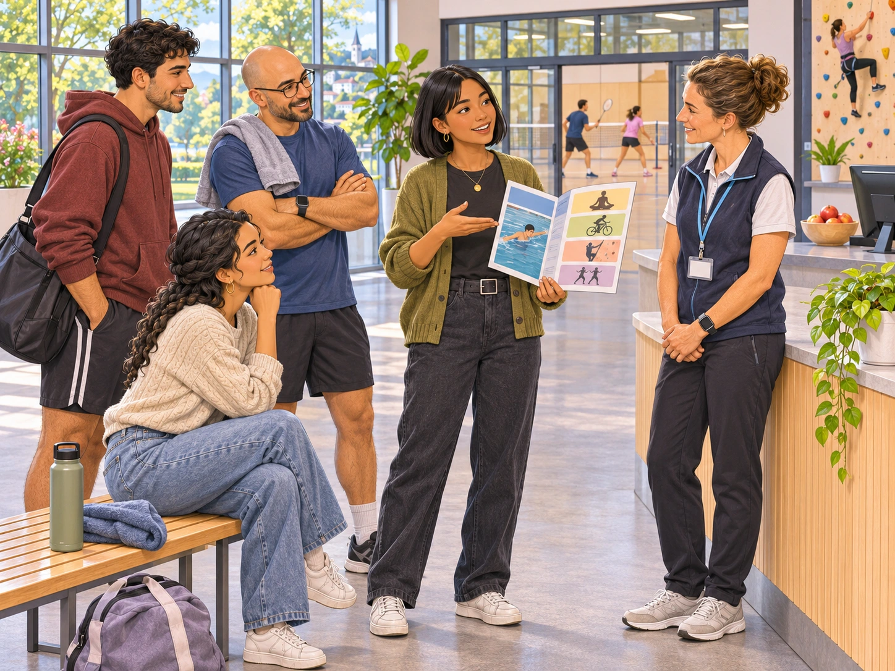

**Lire la situation**

Nadia est au centre sportif. Le moment prévu est mardi soir. Son objectif est d’expliquer son choix d’activité. Le document mentionne le programme des cours.

1. Qui est au centre de cette situation ?

   A. Lina · B. Paul · C. Nadia
2. Où se trouve cette personne ?

   A. à l’agence immobilière · B. au centre sportif · C. à la gare
3. Quel est le moment prévu ?

   A. mardi soir · B. demain · C. lundi
4. Quel est son objectif ?

   A. expliquer son choix de transport · B. expliquer son choix de logement · C. expliquer son choix d’activité
5. Quel objet ou élément le document mentionne-t-il ?

   A. une annonce · B. le programme des cours · C. un billet de train

**Écrire** — Nadia veut expliquer son choix d’activité : écrivez une phrase utile pour cette situation.

**Dire** — Vous êtes à la place de Nadia : dites une phrase utile pour expliquer son choix d’activité.

Corrigé et modèle

1. Nadia
2. au centre sportif
3. mardi soir
4. expliquer son choix d’activité
5. le programme des cours

Modèle de production — Je choisis la natation car j’aime l’eau.

### Le repas

**Lire la situation**

Omar est à la cantine. Le moment prévu est à midi. Son objectif est d’expliquer son choix de plat. Le document mentionne un menu.

1. Qui est au centre de cette situation ?

   A. Lina · B. Paul · C. Omar
2. Où se trouve cette personne ?

   A. à l’agence immobilière · B. à la cantine · C. à la gare
3. Quel est le moment prévu ?

   A. à midi · B. demain · C. lundi
4. Quel est son objectif ?

   A. expliquer son choix de transport · B. expliquer son choix de logement · C. expliquer son choix de plat
5. Quel objet ou élément le document mentionne-t-il ?

   A. une annonce · B. un menu · C. un billet de train

**Écrire** — Omar veut expliquer son choix de plat : écrivez une phrase utile pour cette situation.

**Dire** — Vous êtes à la place de Omar : dites une phrase utile pour expliquer son choix de plat.

Corrigé et modèle

1. Omar
2. à la cantine
3. à midi
4. expliquer son choix de plat
5. un menu

Modèle de production — Je prends la salade car je veux un repas léger.

### Le livre

**Lire la situation**

Sofia est à la bibliothèque. Le moment prévu est mercredi. Son objectif est d’expliquer son choix de livre. Le document mentionne un roman facile.

1. Qui est au centre de cette situation ?

   A. Lina · B. Paul · C. Sofia
2. Où se trouve cette personne ?

   A. à l’agence immobilière · B. à la bibliothèque · C. à la gare
3. Quel est le moment prévu ?

   A. mercredi · B. demain · C. lundi
4. Quel est son objectif ?

   A. expliquer son choix de transport · B. expliquer son choix de logement · C. expliquer son choix de livre
5. Quel objet ou élément le document mentionne-t-il ?

   A. une annonce · B. un roman facile · C. un billet de train

**Écrire** — Sofia veut expliquer son choix de livre : écrivez une phrase utile pour cette situation.

**Dire** — Vous êtes à la place de Sofia : dites une phrase utile pour expliquer son choix de livre.

Corrigé et modèle

1. Sofia
2. à la bibliothèque
3. mercredi
4. expliquer son choix de livre
5. un roman facile

Modèle de production — Je prends ce roman car il est facile à lire.

### Le téléphone

**Lire la situation**

Kenji est au magasin. Le moment prévu est jeudi. Son objectif est d’expliquer son choix de téléphone. Le document mentionne un modèle simple.

1. Qui est au centre de cette situation ?

   A. Lina · B. Paul · C. Kenji
2. Où se trouve cette personne ?

   A. à l’agence immobilière · B. au magasin · C. à la gare
3. Quel est le moment prévu ?

   A. jeudi · B. demain · C. lundi
4. Quel est son objectif ?

   A. expliquer son choix de transport · B. expliquer son choix de logement · C. expliquer son choix de téléphone
5. Quel objet ou élément le document mentionne-t-il ?

   A. une annonce · B. un modèle simple · C. un billet de train

**Écrire** — Kenji veut expliquer son choix de téléphone : écrivez une phrase utile pour cette situation.

**Dire** — Vous êtes à la place de Kenji : dites une phrase utile pour expliquer son choix de téléphone.

Corrigé et modèle

1. Kenji
2. au magasin
3. jeudi
4. expliquer son choix de téléphone
5. un modèle simple

Modèle de production — Je choisis ce téléphone car il est simple à utiliser.

### Le cours

**Lire la situation**

Mei est à l’école. Le moment prévu est vendredi. Son objectif est d’expliquer son choix d’horaire. Le document mentionne un planning.

1. Qui est au centre de cette situation ?

   A. Lina · B. Paul · C. Mei
2. Où se trouve cette personne ?

   A. à l’agence immobilière · B. à l’école · C. à la gare
3. Quel est le moment prévu ?

   A. vendredi · B. demain · C. lundi
4. Quel est son objectif ?

   A. expliquer son choix de transport · B. expliquer son choix de logement · C. expliquer son choix d’horaire
5. Quel objet ou élément le document mentionne-t-il ?

   A. une annonce · B. un planning · C. un billet de train

**Écrire** — Mei veut expliquer son choix d’horaire : écrivez une phrase utile pour cette situation.

**Dire** — Vous êtes à la place de Mei : dites une phrase utile pour expliquer son choix d’horaire.

Corrigé et modèle

1. Mei
2. à l’école
3. vendredi
4. expliquer son choix d’horaire
5. un planning

Modèle de production — Je choisis le cours du soir car je travaille le matin.

### La sortie

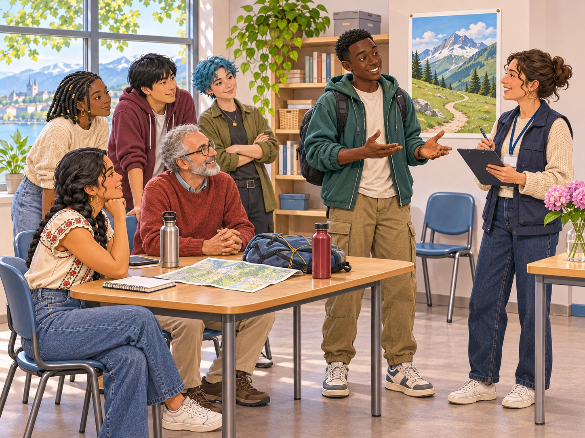

**Lire la situation**

Karim est à la maison de quartier. Le moment prévu est samedi. Son objectif est d’expliquer son choix de sortie. Le document mentionne une affiche de randonnée.

1. Qui est au centre de cette situation ?

   A. Lina · B. Paul · C. Karim
2. Où se trouve cette personne ?

   A. à l’agence immobilière · B. à la maison de quartier · C. à la gare
3. Quel est le moment prévu ?

   A. samedi · B. demain · C. lundi
4. Quel est son objectif ?

   A. expliquer son choix de transport · B. expliquer son choix de logement · C. expliquer son choix de sortie
5. Quel objet ou élément le document mentionne-t-il ?

   A. une annonce · B. une affiche de randonnée · C. un billet de train

**Écrire** — Karim veut expliquer son choix de sortie : écrivez une phrase utile pour cette situation.

**Dire** — Vous êtes à la place de Karim : dites une phrase utile pour expliquer son choix de sortie.

Corrigé et modèle

1. Karim
2. à la maison de quartier
3. samedi
4. expliquer son choix de sortie
5. une affiche de randonnée

Modèle de production — Je propose la randonnée car elle est gratuite.

### Le travail

**Lire la situation**

Emma est au centre de formation. Le moment prévu est lundi matin. Son objectif est d’expliquer son projet professionnel. Le document mentionne une brochure de formation.

1. Qui est au centre de cette situation ?

   A. Lina · B. Paul · C. Emma
2. Où se trouve cette personne ?

   A. à l’agence immobilière · B. au centre de formation · C. à la gare
3. Quel est le moment prévu ?

   A. lundi matin · B. demain · C. lundi
4. Quel est son objectif ?

   A. expliquer son choix de transport · B. expliquer son choix de logement · C. expliquer son projet professionnel
5. Quel objet ou élément le document mentionne-t-il ?

   A. une annonce · B. une brochure de formation · C. un billet de train

**Écrire** — Emma veut expliquer son projet professionnel : écrivez une phrase utile pour cette situation.

**Dire** — Vous êtes à la place de Emma : dites une phrase utile pour expliquer son projet professionnel.

Corrigé et modèle

1. Emma
2. au centre de formation
3. lundi matin
4. expliquer son projet professionnel
5. une brochure de formation

Modèle de production — Je suis cette formation car je veux travailler avec des enfants.

### Le jardin

**Lire la situation**

Marco est au jardin partagé. Le moment prévu est dimanche. Son objectif est d’expliquer son engagement. Le document mentionne une parcelle.

1. Qui est au centre de cette situation ?

   A. Lina · B. Paul · C. Marco
2. Où se trouve cette personne ?

   A. à l’agence immobilière · B. au jardin partagé · C. à la gare
3. Quel est le moment prévu ?

   A. dimanche · B. demain · C. lundi
4. Quel est son objectif ?

   A. expliquer son choix de transport · B. expliquer son choix de logement · C. expliquer son engagement
5. Quel objet ou élément le document mentionne-t-il ?

   A. une annonce · B. une parcelle · C. un billet de train

**Écrire** — Marco veut expliquer son engagement : écrivez une phrase utile pour cette situation.

**Dire** — Vous êtes à la place de Marco : dites une phrase utile pour expliquer son engagement.

Corrigé et modèle

1. Marco
2. au jardin partagé
3. dimanche
4. expliquer son engagement
5. une parcelle

Modèle de production — Je participe au jardin car j’aime cultiver des légumes.

## Expliquer une raison

### Le rendez-vous manqué

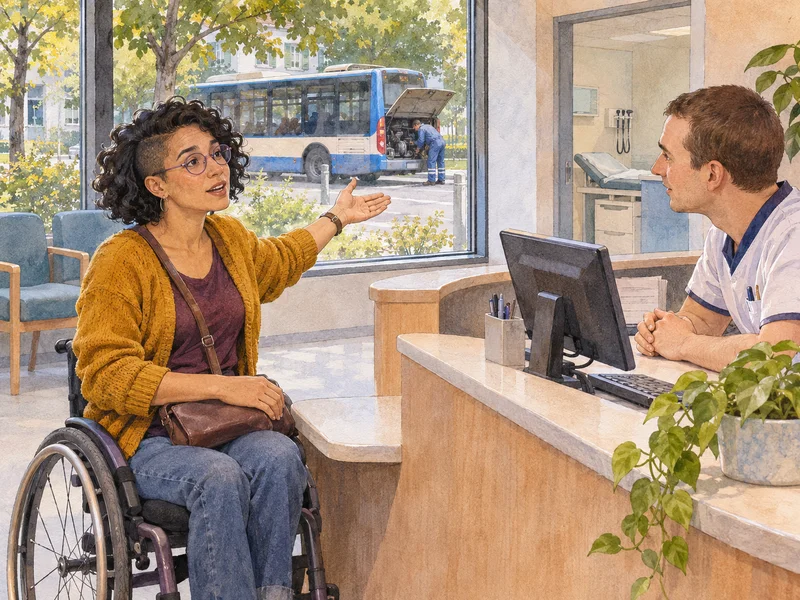

**Lire la situation**

Lina est au cabinet médical. Le moment prévu est hier. Son objectif est d’expliquer son absence. Le document mentionne un bus en panne.

1. Qui est au centre de cette situation ?

   A. Paul · B. Nadia · C. Lina
2. Où se trouve cette personne ?

   A. au centre de santé · B. au cabinet médical · C. dans son appartement
3. Quel est le moment prévu ?

   A. hier · B. ce matin · C. lundi
4. Quel est son objectif ?

   A. expliquer un geste · B. expliquer sa visite · C. expliquer son absence
5. Quel objet ou élément le document mentionne-t-il ?

   A. une ordonnance · B. un bus en panne · C. une fenêtre ouverte

**Écrire** — Lina veut expliquer son absence : écrivez une phrase utile pour cette situation.

**Dire** — Vous êtes à la place de Lina : dites une phrase utile pour expliquer son absence.

Corrigé et modèle

1. Lina
2. au cabinet médical
3. hier
4. expliquer son absence
5. un bus en panne

Modèle de production — Je suis arrivée en retard parce que le bus était en panne.

### La fenêtre

**Lire la situation**

Paul est dans son appartement. Le moment prévu est ce matin. Son objectif est d’expliquer un geste. Le document mentionne une fenêtre ouverte.

1. Qui est au centre de cette situation ?

   A. Lina · B. Nadia · C. Paul
2. Où se trouve cette personne ?

   A. au centre de santé · B. dans son appartement · C. au cabinet médical
3. Quel est le moment prévu ?

   A. ce matin · B. hier · C. lundi
4. Quel est son objectif ?

   A. expliquer son absence · B. expliquer sa visite · C. expliquer un geste
5. Quel objet ou élément le document mentionne-t-il ?

   A. une ordonnance · B. une fenêtre ouverte · C. un bus en panne

**Écrire** — Paul veut expliquer un geste : écrivez une phrase utile pour cette situation.

**Dire** — Vous êtes à la place de Paul : dites une phrase utile pour expliquer un geste.

Corrigé et modèle

1. Paul
2. dans son appartement
3. ce matin
4. expliquer un geste
5. une fenêtre ouverte

Modèle de production — J’ouvre la fenêtre parce qu’il fait chaud.

### Le médecin

**Lire la situation**

Nadia est au centre de santé. Le moment prévu est lundi. Son objectif est d’expliquer sa visite. Le document mentionne une ordonnance.

1. Qui est au centre de cette situation ?

   A. Lina · B. Paul · C. Nadia
2. Où se trouve cette personne ?

   A. dans son appartement · B. au centre de santé · C. au cabinet médical
3. Quel est le moment prévu ?

   A. lundi · B. hier · C. ce matin
4. Quel est son objectif ?

   A. expliquer son absence · B. expliquer un geste · C. expliquer sa visite
5. Quel objet ou élément le document mentionne-t-il ?

   A. une fenêtre ouverte · B. une ordonnance · C. un bus en panne

**Écrire** — Nadia veut expliquer sa visite : écrivez une phrase utile pour cette situation.

**Dire** — Vous êtes à la place de Nadia : dites une phrase utile pour expliquer sa visite.

Corrigé et modèle

1. Nadia
2. au centre de santé
3. lundi
4. expliquer sa visite
5. une ordonnance

Modèle de production — Je consulte parce que j’ai de la fièvre.

### Le trajet

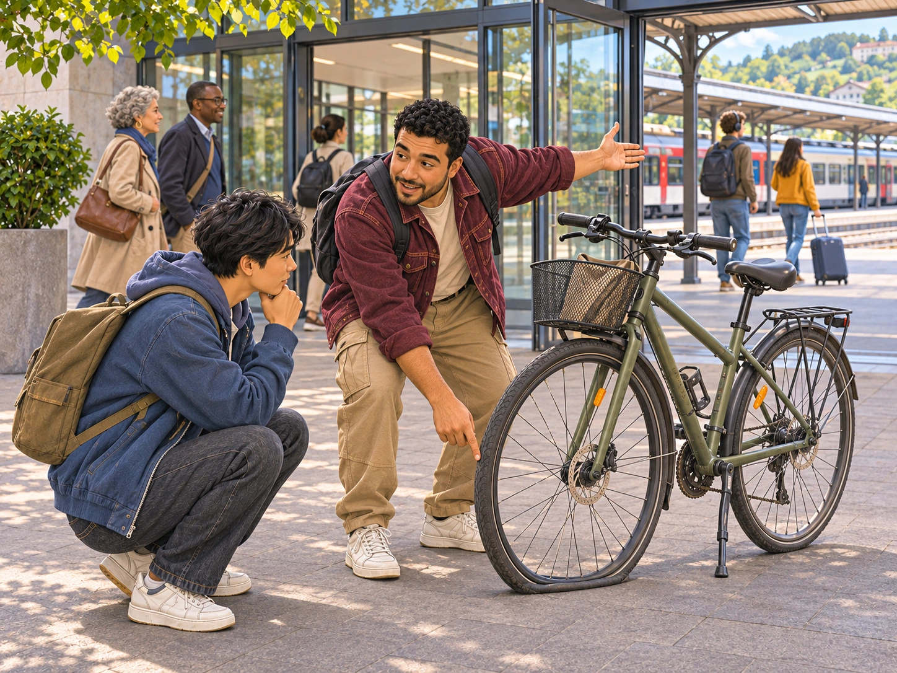

**Lire la situation**

Omar est à la gare. Le moment prévu est mardi. Son objectif est d’expliquer son choix de transport. Le document mentionne un vélo abîmé.

1. Qui est au centre de cette situation ?

   A. Lina · B. Paul · C. Omar
2. Où se trouve cette personne ?

   A. dans son appartement · B. à la gare · C. au cabinet médical
3. Quel est le moment prévu ?

   A. mardi · B. hier · C. ce matin
4. Quel est son objectif ?

   A. expliquer son absence · B. expliquer un geste · C. expliquer son choix de transport
5. Quel objet ou élément le document mentionne-t-il ?

   A. une fenêtre ouverte · B. un vélo abîmé · C. un bus en panne

**Écrire** — Omar veut expliquer son choix de transport : écrivez une phrase utile pour cette situation.

**Dire** — Vous êtes à la place de Omar : dites une phrase utile pour expliquer son choix de transport.

Corrigé et modèle

1. Omar
2. à la gare
3. mardi
4. expliquer son choix de transport
5. un vélo abîmé

Modèle de production — Je prends le train parce que mon vélo est abîmé.

### Le repas

**Lire la situation**

Sofia est au restaurant. Le moment prévu est à midi. Son objectif est d’expliquer un refus de dessert. Le document mentionne une carte de desserts.

1. Qui est au centre de cette situation ?

   A. Lina · B. Paul · C. Sofia
2. Où se trouve cette personne ?

   A. dans son appartement · B. au restaurant · C. au cabinet médical
3. Quel est le moment prévu ?

   A. à midi · B. hier · C. ce matin
4. Quel est son objectif ?

   A. expliquer son absence · B. expliquer un geste · C. expliquer un refus de dessert
5. Quel objet ou élément le document mentionne-t-il ?

   A. une fenêtre ouverte · B. une carte de desserts · C. un bus en panne

**Écrire** — Sofia veut expliquer un refus de dessert : écrivez une phrase utile pour cette situation.

**Dire** — Vous êtes à la place de Sofia : dites une phrase utile pour expliquer un refus de dessert.

Corrigé et modèle

1. Sofia
2. au restaurant
3. à midi
4. expliquer un refus de dessert
5. une carte de desserts

Modèle de production — Je ne prends pas de dessert parce que je n’ai plus faim.

### La bibliothèque

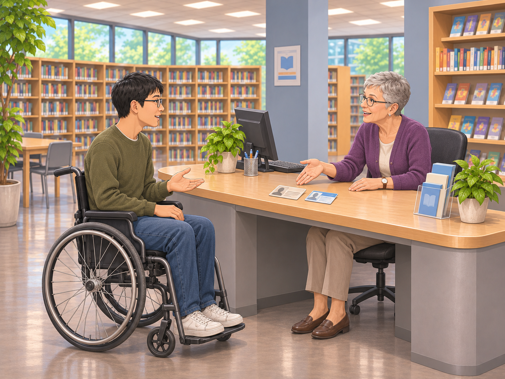

**Lire la situation**

Kenji est à la bibliothèque. Le moment prévu est mercredi. Son objectif est d’expliquer une demande d’aide. Le document mentionne un catalogue difficile.

1. Qui est au centre de cette situation ?

   A. Lina · B. Paul · C. Kenji
2. Où se trouve cette personne ?

   A. dans son appartement · B. à la bibliothèque · C. au cabinet médical
3. Quel est le moment prévu ?

   A. mercredi · B. hier · C. ce matin
4. Quel est son objectif ?

   A. expliquer son absence · B. expliquer un geste · C. expliquer une demande d’aide
5. Quel objet ou élément le document mentionne-t-il ?

   A. une fenêtre ouverte · B. un catalogue difficile · C. un bus en panne

**Écrire** — Kenji veut expliquer une demande d’aide : écrivez une phrase utile pour cette situation.

**Dire** — Vous êtes à la place de Kenji : dites une phrase utile pour expliquer une demande d’aide.

Corrigé et modèle

1. Kenji
2. à la bibliothèque
3. mercredi
4. expliquer une demande d’aide
5. un catalogue difficile

Modèle de production — Je demande de l’aide parce que je ne comprends pas le catalogue.

### La réparation

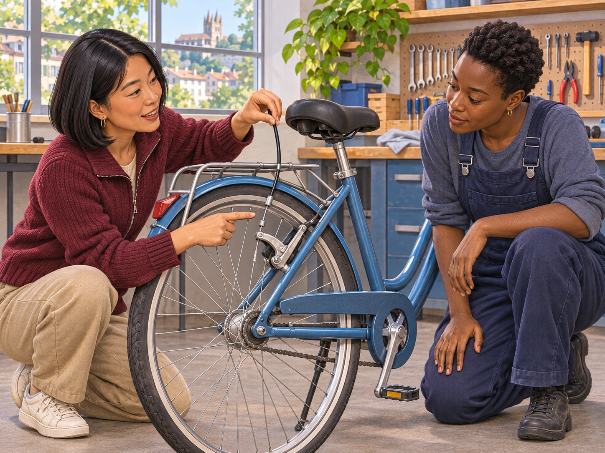

**Lire la situation**

Mei est à l’atelier. Le moment prévu est jeudi. Son objectif est d’expliquer le problème de son vélo. Le document mentionne un frein cassé.

1. Qui est au centre de cette situation ?

   A. Lina · B. Paul · C. Mei
2. Où se trouve cette personne ?

   A. dans son appartement · B. à l’atelier · C. au cabinet médical
3. Quel est le moment prévu ?

   A. jeudi · B. hier · C. ce matin
4. Quel est son objectif ?

   A. expliquer son absence · B. expliquer un geste · C. expliquer le problème de son vélo
5. Quel objet ou élément le document mentionne-t-il ?

   A. une fenêtre ouverte · B. un frein cassé · C. un bus en panne

**Écrire** — Mei veut expliquer le problème de son vélo : écrivez une phrase utile pour cette situation.

**Dire** — Vous êtes à la place de Mei : dites une phrase utile pour expliquer le problème de son vélo.

Corrigé et modèle

1. Mei
2. à l’atelier
3. jeudi
4. expliquer le problème de son vélo
5. un frein cassé

Modèle de production — Je viens à l’atelier parce que mon frein est cassé.

### Le repos

**Lire la situation**

Karim est à la maison. Le moment prévu est vendredi. Son objectif est d’expliquer son besoin de repos. Le document mentionne un agenda chargé.

1. Qui est au centre de cette situation ?

   A. Lina · B. Paul · C. Karim
2. Où se trouve cette personne ?

   A. dans son appartement · B. à la maison · C. au cabinet médical
3. Quel est le moment prévu ?

   A. vendredi · B. hier · C. ce matin
4. Quel est son objectif ?

   A. expliquer son absence · B. expliquer un geste · C. expliquer son besoin de repos
5. Quel objet ou élément le document mentionne-t-il ?

   A. une fenêtre ouverte · B. un agenda chargé · C. un bus en panne

**Écrire** — Karim veut expliquer son besoin de repos : écrivez une phrase utile pour cette situation.

**Dire** — Vous êtes à la place de Karim : dites une phrase utile pour expliquer son besoin de repos.

Corrigé et modèle

1. Karim
2. à la maison
3. vendredi
4. expliquer son besoin de repos
5. un agenda chargé

Modèle de production — Je fais une pause parce que je suis fatigué.

### Le jardin

**Lire la situation**

Emma est dans le jardin. Le moment prévu est samedi. Son objectif est d’expliquer un arrosage. Le document mentionne une terre sèche.

1. Qui est au centre de cette situation ?

   A. Lina · B. Paul · C. Emma
2. Où se trouve cette personne ?

   A. dans son appartement · B. dans le jardin · C. au cabinet médical
3. Quel est le moment prévu ?

   A. samedi · B. hier · C. ce matin
4. Quel est son objectif ?

   A. expliquer son absence · B. expliquer un geste · C. expliquer un arrosage
5. Quel objet ou élément le document mentionne-t-il ?

   A. une fenêtre ouverte · B. une terre sèche · C. un bus en panne

**Écrire** — Emma veut expliquer un arrosage : écrivez une phrase utile pour cette situation.

**Dire** — Vous êtes à la place de Emma : dites une phrase utile pour expliquer un arrosage.

Corrigé et modèle

1. Emma
2. dans le jardin
3. samedi
4. expliquer un arrosage
5. une terre sèche

Modèle de production — J’arrose les plantes parce que la terre est sèche.

### La sortie

**Lire la situation**

Marco est au centre associatif. Le moment prévu est dimanche. Son objectif est d’expliquer une annulation. Le document mentionne un avis d’orage.

1. Qui est au centre de cette situation ?

   A. Lina · B. Paul · C. Marco
2. Où se trouve cette personne ?

   A. dans son appartement · B. au centre associatif · C. au cabinet médical
3. Quel est le moment prévu ?

   A. dimanche · B. hier · C. ce matin
4. Quel est son objectif ?

   A. expliquer son absence · B. expliquer un geste · C. expliquer une annulation
5. Quel objet ou élément le document mentionne-t-il ?

   A. une fenêtre ouverte · B. un avis d’orage · C. un bus en panne

**Écrire** — Marco veut expliquer une annulation : écrivez une phrase utile pour cette situation.

**Dire** — Vous êtes à la place de Marco : dites une phrase utile pour expliquer une annulation.

Corrigé et modèle

1. Marco
2. au centre associatif
3. dimanche
4. expliquer une annulation
5. un avis d’orage

Modèle de production — Nous annulons la sortie parce qu’un orage est annoncé.

