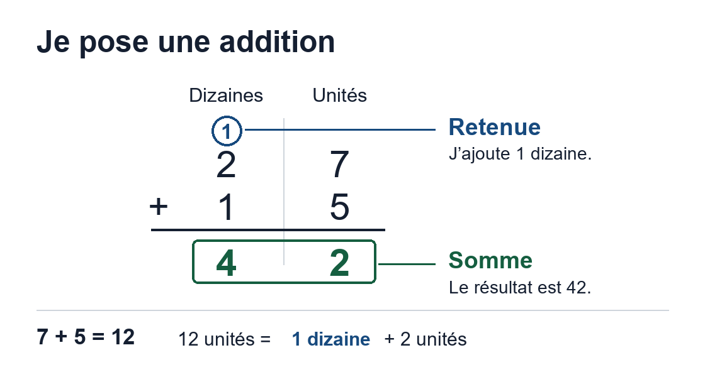
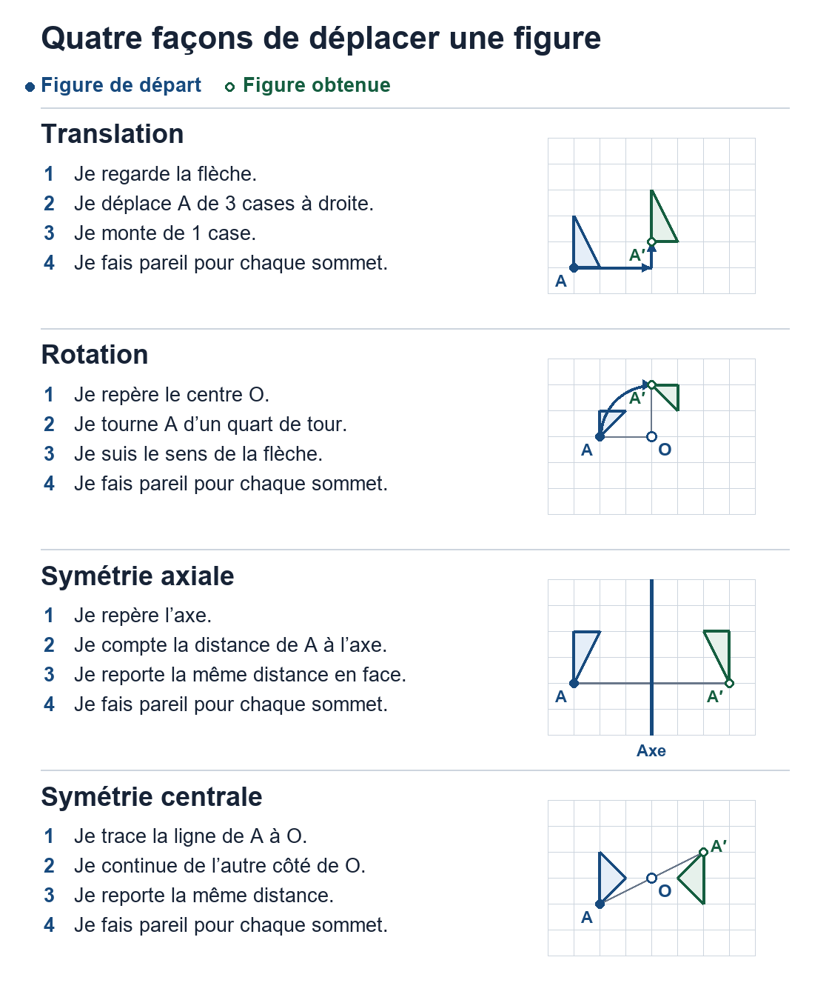

# Cahier des charges pour les exercices d’algèbre et de géométrie de DocProf

Version 1.0 · 27 novembre 2026

Référence du code · `ff45d3f829cda7f2b62c0b2d101de36a26574281`

Public · élèves des parcours CSC et CFR, y compris les élèves qui apprennent le français ou qui ont besoin d’un support de lecture simplifié.

Ajouter dans le générateur des exercices imprimables qui prolongent les supports de cours. Chaque nouvelle notion suit le même parcours. L’élève voit une situation concrète, découvre le mot mathématique, suit un exemple et essaie ensuite lui-même. La théorie suit la méthode FALC. Dans l’exemple, les mots importants sont reliés à ce qu’ils désignent dans le calcul ou la figure, avec une couleur et un repère visuel communs.

[Existant](#existant-et-sources) · [Théorie FALC](#théorie-falc-et-repères-visuels) · [Algèbre](#compléments-en-algèbre) · [Géométrie](#compléments-en-géométrie) · [Recette](#critères-de-réception) · [Suivi d’avancement](avancement.md)

La refonte de la théorie couvre les 23 thèmes, avec 31 pages illustrées. La liste des types présente **Théorie** en premier lorsqu’une leçon existe. Le contrôle de rendu couvre ces 31 pages en PDF A4 et double A5. Le suivi indique les exercices d’application intégrés et les retours à recueillir auprès des élèves. [Suivi d’avancement](avancement.md)

## Existant et sources

Les domaines Algèbre et Géométrie ont déjà 25 thèmes et 221 entrées de catalogue. Un appel de `buildPage` pour chaque entrée, avec la graine 41 et la quantité demandée de 3, a produit au moins un élément par entrée sur le commit de référence. Cette vérification porte sur la génération et sert à éviter les doublons. La couverture de l’impression, des corrigés et des variantes reste à mesurer lors de la recette.

| Domaine | Thèmes | Exercices et activités | Théories | Glossaires | Total du catalogue |
|---|---:|---:|---:|---:|---:|
| Algèbre | 17 | 107 | 16 | 1 | 124 |
| Géométrie | 8 | 89 | 7 | 1 | 97 |

La version de départ proposait une théorie illustrée pour les 23 thèmes pédagogiques hors glossaires. Dans l’addition, le chiffre de la retenue était violet. Le mot « Retenue » apparaissait dans les définitions sous le calcul et le résultat 42 avait la même couleur que les opérandes. Dans la théorie des transformations montrée dans la capture de référence, le dessin et les étapes expliquaient le miroir. La translation et la rotation y étaient définies en texte. La première reprise rapproche les mots de l’exemple et attribue à chaque transformation son propre dessin et ses étapes. [Catalogue](../../src/math/catalog.ts) · [Leçons](../../src/math/theory-lessons.ts) · [Rendu de la théorie](../../src/components/item-view/math-theory.tsx) · [Styles](../../src/App.css)

Le dossier de référence `03. Mathématiques` contient 359 fichiers Word, 278 PDF et 34 classeurs à macros. L’extraction des corps XML des 359 Word a détecté 270 corps distincts et 89 copies identiques à ce niveau. La lecture détaillée des deux livrets et d’un échantillon de fiches et de PDF a servi à établir les priorités ci-dessous. Les nombres de fichiers incluent plusieurs formats, versions et copies d’un même support. Les classeurs sont recensés par nom et fonction apparente.

| Source dans le dossier de référence | Apport pour DocProf |
|---|---|
| `09. Support de cours/LIVRE_MATH_CFR_ALGEBRE_v06.05.26.docx` | 19 chapitres allant de la numération aux équations et proportions. Prendre appui sur les intitulés, les gestes de calcul, les mots de cours et la gradation des fractions, des décimaux et des problèmes. |
| `09. Support de cours/LIVRE_MATH_CFR_GEOMETRIE_v21.03.26.docx` | 13 chapitres dont formes, angles, équerre, parallèles, perpendiculaires, reproduction, symétries, rotations, repérage, mesures, périmètres et surfaces. |
| `01. CSC - Calculs` et `03. CFR - Calculs` | Fiches d’addition, soustraction, argent, décimaux sur une graduation, relatifs, fractions et équations. Comparer les chapitres « manque eva » et « à faire » aux activités déjà présentes avant de produire de nouvelles séries. |
| `02. CSC - Logique et espace` | Plans et repérage par cases. Lecture d’un graphique dans des situations telles que la météo et le train. |
| `04. CFR - Géométrie, mesure et grandeur` | Leçon 03 sur la lecture d’une règle et la mesure de segments en cm et mm. Leçon 02 sur la reproduction et le pli de symétrie. Leçon 05 sur l’aire. Un PDF de la leçon 07 montre un agrandissement sur une trame oblique. Le nom du dossier « sans quadrillage » couvre donc aussi des exercices sur un support de construction. |
| `05. Fiche math automatique` et `06. Calcul aléatoire` | Les notes demandent notamment de comparer et combiner des mesures, de travailler les opérations décimales et de terminer certaines équations. Ces demandes ont été rapprochées des types qui existent depuis sur DocProf. |
| `07. TCM Version Van` et `08. TP Version VAN` | Supports de lecture du niveau visé et de l’organisation élève/corrigé. Les tests et barèmes existants restent la référence de leur propre parcours. |

Les visuels publiés dans DocProf sont originaux ou disposent d’une autorisation documentée. Recréer les formes, trames, cartes et jeux de données nécessaires. Utiliser les PDF tiers du dossier, dont les séries Biceps, pour comprendre la compétence travaillée et la progression.

## Théorie FALC et repères visuels

### Règles de rédaction et de mise en page

| ID | Exigence |
|---|---|
| FALC-01 | Donner un objectif concret par fiche ou partie courte. Utiliser des mots simples, une phrase par ligne lorsque possible et une action par consigne. Choisir un verbe stable, par exemple « Entourez », « Reliez » ou « Mesurez ». |
| FALC-02 | Garder le mot mathématique utile et l’expliquer à sa première apparition. Dire « La somme est le résultat de l’addition. » Utiliser le même mot dans la théorie, la consigne et le corrigé. |
| FALC-03 | Mettre le texte des leçons dans un flux de lecture unique, aligné à gauche, en police sans empattement d’au moins 14 pt dans le document imprimé. Garder les colonnes qui font partie du calcul, du repère ou du tableau. Autoriser plusieurs pages par thème et par notion lorsque les dessins et les étapes demandent plus d’espace. |
| FALC-04 | Placer l’illustration avec la phrase qu’elle explique. Montrer un détail utile, par exemple le zéro de la règle, le déplacement d’un chiffre ou le bord d’une figure. Donner un texte de remplacement qui permet de retrouver l’information. |
| FALC-05 | Garder une présentation adaptée à des adolescents ou adultes. Utiliser des situations familières comme un budget, une recette, une température ou un plan de déplacement. Les personnages, symboles et décors restent utiles à la compréhension. |
| FALC-06 | Faire relire et tester les supports avec des élèves du public visé. Associer des personnes en situation de handicap intellectuel à la rédaction, à l’adaptation ou à la relecture pour la validation FALC. Suivre la grille de relecture et conserver les corrections avant toute apposition du pictogramme FALC. |
| FALC-07 | Dans la liste « Type d’exercice », afficher **Théorie** en première position pour chaque thème d’algèbre ou de géométrie qui dispose d’une leçon. Le glossaire conserve son entrée propre. La première position concerne l’ordre de la liste. |

La méthode, l’illustration utile, la taille de police et la participation du public suivent les règles d’Inclusion Europe et de l’Unapei. [Les règles du FALC](https://falc.unapei.org/quest-ce-que-le-falc/les-regles-du-falc/) · [Le FALC et son pictogramme](https://falc.unapei.org/quest-ce-que-le-falc/le-falc-cest-quoi/)

### Même couleur dans le mot et dans le calcul

Employer des couleurs stables par rôle à l’intérieur d’une leçon et les reprendre dans ses exercices guidés. Associer chaque couleur à un libellé et à un repère visible sans couleur. Dans l’exemple d’addition, le bleu foncé relie le mot **Retenue**, le chiffre **1** entouré au-dessus des dizaines et l’expression **1 dizaine**. Le vert foncé relie le mot **Somme** et le **42** encadré. Les formes, flèches, repères et libellés conservent la relation à l’écran, en PDF et en noir et blanc.

| Rôle | Couleur de départ | Repère imprimable | Applications |
|---|---|---|---|
| Étape ou échange | Bleu foncé `#174A7E` | Cercle, flèche ou trait de liaison légendé | Retenue, échange d’une dizaine, passage vers une autre unité. |
| Résultat | Vert foncé `#155E40` | Cadre et mot associé | Somme, différence, produit ou résultat avec unité. |
| Objet à distinguer | Bleu foncé pour le contour et vert foncé pour la surface dans la fiche périmètre/aire | Libellé proche, trait épais pour le contour et hachures pour la surface | Périmètre et aire. Définir le repère propre à la fraction ou à l’axe dans sa leçon. |

Dans une soustraction, le repère de l’**échange** relie le changement de la colonne des dizaines à celui de la colonne des unités. Dans une fraction, le numérateur et le dénominateur sont reliés respectivement aux parts prises et à toutes les parts égales. Dans la division, nommer la quantité de départ, le nombre de parts, la quantité par part et le reste sur le même exemple. En géométrie, associer **périmètre** au contour épaissi et **aire** à la surface hachurée. Les repères restent sobres afin que l’élève sache quoi regarder.

### Exemple de théorie sur la retenue

1. J’écris les unités sous les unités.
2. J’additionne les unités. 7 + 5 = 12.
3. Je garde 2 unités. Je mets 1 dizaine dans la colonne des dizaines. Cette dizaine est la **retenue**.
4. J’additionne les dizaines. 2 + 1 + 1 = 4.
5. Je lis le résultat. La **somme** est 42.

Le premier exercice guidé donne les noms des colonnes et laisse la retenue à écrire. Le suivant propose un calcul analogue à poser. En autonomie et en évaluation, les zones de réponse et les nombres de l’énoncé restent visibles. Les valeurs à trouver, les couleurs qui les révéleraient et les étapes du corrigé apparaissent uniquement dans le corrigé. Une addition sans retenue constitue un cas de comparaison.

## Compléments en algèbre

La priorité est de transformer les exercices existants en parcours compréhensibles. Les propositions marquées « compléter » réutilisent le type, la génération et le corrigé déjà présents chaque fois que c’est possible. Chaque ajout répond à un besoin repéré dans les supports de cours.

| Priorité | Notion et public | Déjà disponible | Complément à réaliser | Source de besoin |
|---|---|---|---|---|
| 1 | Numération et comparaison · CSC | Groupements, position, décomposition, ordre et droite des nombres naturels. | Donner le passage objet → paquets → tableau unités/dizaines/centaines → nombre. Ajouter des questions sur la valeur de position et les zéros intercalés dans le parcours guidé. | Livret Algèbre, numération et comparaison. |
| 1 | Addition et soustraction en colonnes · CSC/CFR | Types en ligne, posés et à poser, avec versions décimales distinctes. | Théorie avec mots pointés dans le calcul. Retenue ou échange visible dans l’exemple, en plusieurs rangs pour les cas avancés. Ajouter une progression « sans changement de colonne → un échange → échanges successifs et zéro ». | Livret Algèbre et fiches CSC d’addition et de soustraction. |
| 1 | Décimaux et graduation · CSC/CFR | Comparaison et opérations sur les décimaux. Droite graduée sous les nombres naturels. | Ajouter « Lire / placer un décimal sur une droite » avec pas lisible, dixièmes puis centièmes. Enchaîner avec la comparaison de 3,8 et 3,75 et l’alignement des virgules. Une graduation peut être globale ou locale selon la difficulté. | `MATH_EX_13.03_Graduation_01.docx` et livret, nombres à virgule. |
| 1 | Lire un énoncé et répondre · CSC/CFR | Problèmes calculés, choix des données, menu et monnaie en CHF. | Progression guidée avec question séparée, données utiles, calcul et phrase de réponse. Étendre les banques aux journées, horaires, prix, menus et distances, avec une seule difficulté nouvelle par série. Prévoir des cas de comparaison de deux solutions. | Compréhension CSC P1 à P3 et CFR P4. |
| 2 | Multiplication et division · CFR | Calculs entiers et décimaux en ligne ou en colonne, quotient et reste. | Montrer les groupes puis l’écriture. Dans les exercices guidés, l’élève nomme facteurs et produit ou dividende, diviseur, quotient et reste. En division euclidienne par un entier positif, vérifier `diviseur × quotient + reste = dividende` et `0 ≤ reste < diviseur`. Pour les décimaux, indiquer si la réponse est exacte ou arrondie, avec la précision attendue. | Livret Algèbre et dossiers CFR multiplication/division. |
| 2 | Fractions · CSC/CFR | Figures à colorier ou à lire, équivalences, comparaison, calculs, conversion décimale. | Ajouter la tâche « trouver une fraction d’une quantité » avec groupes égaux et résultats entiers au niveau guidé. Introduire ensuite fractions supérieures à 1 et problèmes courts. Réserver les conversions exactes à des fractions dont l’écriture décimale est finie. | Livret Algèbre, fractions parties 1 et 2 et dossier CFR Fractions. |
| 2 | Relatifs et ordre des opérations · CSC/CFR | Comparaison et opérations sur relatifs. Puissances, racines et priorité des opérations. | Ajouter « lire / placer / se déplacer sur une droite avec zéro », dans les contextes de température ou d’étage. Séparer le signe d’un nombre et le signe de l’opération. Dans le corrigé, marquer l’opération à faire à chaque ligne et laisser les autres éléments inchangés. | Fiches CSC/CFR sur les relatifs et livret Algèbre. |
| 2 | Proportionnalité et graphiques · CFR avec préparation CSC | Pourcentages, problèmes de proportion, règle de calcul, passage tableau-graphique et tarif avec frais fixes. | Ajouter lecture de graphiques contextualisés avec axes, unités et légende. Introduire une courbe de température ou de précipitations et un tableau d’horaires original. Travailler la proportionnalité d’abord avec une situation au prix unitaire, puis avec un tarif à frais fixes dans un exercice séparé. | Word du dossier Lecture de graphiques et chapitre Proportionnalités. |
| 2 | Équation à une inconnue · CFR | Équations simples, inconnue des deux côtés, fractions et systèmes. | Illustrer `x + 3 = 8` avec deux plateaux ou deux lignes d’égalité. Montrer le retrait de 3 des deux côtés, puis la vérification `5 + 3 = 8`. Décliner avec nombre caché, opération à compléter, puis résolution courte. | `MATH_EX_22.01_TechniqueEquation.docx` et livret. |
| 3 | Automatismes et évaluations thématiques · CSC/CFR | Génération à partir de banques et parcours de test distincts. | Pour les chapitres marqués « manque eva », préparer des mini-évaluations après les activités guidées. Prévoir des séries A/B de difficulté comparable, avec critères et unités attendus. Tenir les contenus CFR avancés derrière la progression prévue. | Observations des dossiers CSC/CFR et exemples TCM. |

## Compléments en géométrie

| Priorité | Notion et public | Déjà disponible | Complément à réaliser | Source de besoin |
|---|---|---|---|---|
| 1 | Règle et unités · CSC/CFR | Segments à taille réelle, lecture d’instruments, comparaisons de grandeurs, conversions. | Ajouter une règle dessinée avec un segment qui commence au zéro, puis un segment qui commence à une autre graduation. Enseigner la différence entre une position et une longueur. Expliquer sur un exemple que 3 cm et 4 mm font 34 mm. | Leçon 03, `CFR_MATH_LECON-03_01.01_Longueur-1.docx` et PDF. |
| 1 | Grandeurs et calculs avec unités · CFR | Comparer masse, capacité et durée et convertir des mesures. | Ajouter les tâches « additionner » et « soustraire » avec une conversion préalable. Pour la durée, distinguer la base 60 de la conversion décimale. Pour les longueurs, ajouter une comparaison après mise dans la même unité. | Notes du classeur Unité et cours Mesures. |
| 1 | Périmètre et aire d’une même figure · CSC/CFR | Périmètres, aires, cotes manquantes et aires composées. | Ajouter une fiche comparée sur le même dessin. Sur un rectangle de 5 cm par 3 cm, suivre le bord pour obtenir 16 cm, puis compter ou multiplier les carrés pour obtenir 15 cm². Alterner les données et les longueurs demandées. | Livret, chapitres Périmètres et Surfaces, et fiches des leçons 04 et 05. |
| 1 | Formes, côtés, sommets et angles · CSC/CFR | Noms, propriétés, classement d’angles et construction à l’équerre. | Ajouter une mini-leçon qui relie les mots à une figure annotée. Commencer par repérer, passer à une figure tournée, puis utiliser l’équerre. Identifier et tracer une parallèle ou une perpendiculaire sur une figure ou un plan simple. | Livret Géométrie, leçons Formes et Propriétés. |
| 2 | Reproduction et agrandissement · CFR | Reproduction sur quadrillage et agrandissement par doublement. | Ajouter une réduction par deux avec sommets compatibles avec la trame et un point de départ marqué. Réaliser une série originale sur trame oblique. Étudier ensuite la construction avec points de repère sans trame si la compétence est confirmée. | Dossier Isométrie, Word Reproduction et PDF de la leçon 07. |
| 1 | Transformations · CFR | Axes, miroir quadrillé, symétries axiale et centrale, translation et quart de tour. | Illustrer et expliquer séparément chaque transformation. Faire suivre la figure source, le déplacement d’un point et la figure obtenue. Reprendre les dessins sources adaptés ou les reproduire dans le moteur existant. | Livret Géométrie, fiches de reproduction, de symétrie et de rotation. |
| 1 | Repérage sur un plan · CSC/CFR | Fonds illustrés, quadrillage superposé, étiquettes par case, directions, trajets courts et repères cartésiens. | Utiliser une image d’ensemble réaliste avec lieux nommés et points ancrés. Faire une progression « lire un lieu → tracer un trajet → repérer un point ». Distinguer le code de case B3 du point écrit `(x ; y)`. | CSC Logique et espace, fiches Quadrillage et SurLePlan. |
| 3 | Mesures d’angles et espace · CFR | Angles classés, angles droits, patrons de cube, plans de piles, vues et volumes. | Après les premiers lots, évaluer l’intérêt d’une série de mesures au rapporteur et d’une série sur les patrons du pavé. Garder ces extensions conditionnées au niveau enseigné et à la lisibilité sur papier. | Équerre et angles du livret. Les extensions demandent une confirmation pédagogique à partir des essais. |

### Une fiche de théorie par transformation

Le type **Théorie** du thème Transformations ouvre une suite de fiches. Chaque transformation a son titre, son propre dessin de départ, des étapes illustrées, son dessin final et un exercice d’essai. Les fiches occupent autant de pages que nécessaire. Garder le mot, la consigne et le dessin de l’étape sur la même page. Une synthèse peut comparer les méthodes après leur découverte.

| Fiche | Étapes à montrer dans le dessin | Vérification guidée |
|---|---|---|
| Translation | Montrer la figure de départ, puis une flèche indiquant par exemple « 3 cases à droite et 1 case vers le haut ». Appliquer ce déplacement au point A. Refaire ce geste pour les autres sommets. Relier les points obtenus. | Chaque sommet suit le même trajet. Les côtés conservent leur position relative et la figure garde son orientation. |
| Rotation | Entourer le centre O. Dessiner l’arc, indiquer « 1 quart de tour » et montrer le sens avec une flèche. Suivre le trajet du point A jusqu’à A′, puis tourner les autres sommets et relier. | A et A′ sont à la même distance de O. L’arc correspond au sens et à l’angle demandés. |
| Symétrie axiale | Marquer l’axe. Tracer un segment perpendiculaire de A à l’axe. Reporter la même distance de l’autre côté pour placer A′. Refaire pour les autres sommets et relier. | A et A′ sont de part et d’autre de l’axe, sur la perpendiculaire. Un point sur l’axe garde sa place. |
| Symétrie centrale | Entourer O. Tracer la droite qui passe par A et O. Reporter la distance OA au-delà de O. Tracer le deuxième point puis l’image de toute la figure. | O est le milieu de chaque paire A/A′. Montrer le lien avec le demi-tour après l’exemple. |
| Reproduction, agrandissement et réduction | Montrer la figure modèle, fixer un point de départ et montrer comment reporter au moins deux longueurs. Pour une copie, garder les distances. Pour un agrandissement ou une réduction, appliquer le même facteur dans les deux directions. | Les angles sont conservés. Le facteur est le même pour toutes les longueurs mesurées. Présenter le changement de taille sur une fiche distincte des isométries. |

Pour chaque figure, inscrire la provenance (document, leçon, page ou activité DocProf). Reprendre les dessins autorisés des supports quand ils illustrent le bon geste. Reproduire les autres en conservant les repères pédagogiques utiles, comme le quadrillage, le point de départ, la position de l’axe ou l’orientation du drapeau. Par exemple, la page 2 de `CFR_MATH_LECON-02_03.01_Rotation-1.pdf` montre un modèle de drapeau et des grilles tournées. Un exercice DocProf peut en reprendre la logique en dessinant le centre, la flèche et le passage de A à A′. Le modèle et le corrigé de chaque figure doivent correspondre exactement. [Transformations actuelles](../../src/math/coord-transformations.ts)

### Plans sur image réelle et repères

Prendre comme fond une seule image cohérente montrant un lieu dans son ensemble, par exemple une photo aérienne, un plan de quartier ou une vue en plan telle qu’on la verrait sur un panneau. L’image montre les bâtiments, routes et espaces utiles au repérage. Donner des noms lisibles aux lieux, par exemple « Gare », « École » et « Pont du Rhône ». Une carte reconstituée garde cette continuité visuelle. Présenter le quartier comme fictif si ses lieux sont inventés.

Le quadrillage forme un calque visible par-dessus l’image. Poser des lignes fines ou translucides et placer les lettres, chiffres et flèche du nord sur des zones lisibles. Placer les points d’intérêt à leur position exacte dans l’image, par exemple un point « Entrée de l’école » sur l’entrée et un point « Arrêt du bus » au bord de la route. L’image, le quadrillage et les points partagent le même cadrage à l’aperçu et à l’impression. Les lieux occupent leur surface réelle sur le plan et peuvent traverser plusieurs cases. Les illustrations actuelles à pictogrammes par case servent de référence fonctionnelle pour les exercices existants. [Données des plans](../../src/math/spatial-practice.ts) · [Rendu des plans](../../src/components/item-view/spatial-practice.tsx)

Proposer trois images pour un même lieu. La photo aérienne montre le lieu réel. Une deuxième version surligne les routes principales et les chemins à pied sur la photo. Le plan en noir et blanc simplifie les bâtiments en blocs et conserve les tracés essentiels. Utiliser la même emprise pour que le quadrillage, les points et les réponses gardent leur position. Le plan de Sion sert de premier exemple. [Suivi d’avancement](avancement.md)

Dans une question de case, indiquer le point précis qui doit être repéré. Une question avec une réponse unique vise un point à l’intérieur d’une case. Lorsque deux points occupent la même case, les distinguer par leur nom ou demander toutes les réponses. Pour un trajet par cases, expliciter les déplacements autorisés. Pour un trajet qui suit les rues, utiliser les rues et croisements visibles dans l’image. Le trajet de solution se superpose au fond dans le corrigé.

## Mise en œuvre dans le générateur

- Réutiliser les domaines, thèmes, formulaires et gabarits des fiches. Partir du contrat `MathTheoryLesson`, du rendu `MathTheoryView` et des composants de calcul et de géométrie. Conserver les identifiants existants et documenter les nouvelles entrées.
- Retirer le domaine autonome **Vocabulaire** des menus de création et des nouvelles attributions de domaines. Garder les banques de mots, illustrations et audios partagés disponibles aux domaines qui les utilisent. Conserver la lecture des fiches historiques pour les comptes qui y ont déjà accès.
- Rendre l’exemple et ses repères à partir des mêmes données métier que le calcul ou la figure. Décrire les éléments à relier, par exemple le rôle de la retenue et sa colonne, et laisser le rendu choisir couleur et forme selon le thème. Les mots, valeurs, unités et étapes restent du texte lisible en plus du visuel. La maquette ci-dessus illustre le résultat attendu.
- Pour chaque notion pilote, associer une théorie courte, un exemple entièrement résolu, un exercice guidé où une seule aide est retirée, un exercice autonome et un corrigé explicatif. La quantité, la difficulté et le barème restent réglables là où les profils les prennent déjà en charge.
- Placer le contenu et sa solution dans les données du cas généré. À graine et réglages égaux, reproduire le cas. À graine différente, vérifier la variété attendue. Lorsqu’un profil accepte l’édition, recalculer les résultats et les repères dès qu’une valeur change. Suivre les contrats d’édition et de recette définis pour le mode Libre. [Cahier des charges Mode Libre](../mode-libre/cahier-des-charges.md)
- Réutiliser les calculs posés, les fractions exactes, les comparaisons, les mesures et leurs tests existants. Les règles, segments et figures mesurables conservent leurs dimensions physiques dans le PDF. Les chiffres décimaux suivent l’usage du cours, avec virgule et unité explicite. [Calcul posé](../../src/math/column-arith.ts) · [Mesures géométriques](../../docs/interactive/adr-0029-mesures-geometriques.md)

## Ordre de réalisation

| Lot | Contenu | Condition de sortie |
|---|---|---|
| M0 · Inventaire | Pour les familles prioritaires, associer support source, objectif CSC/CFR, type existant, aide présente, apport et exemple. Classer les versions et les annexes. | Une activité existante réutilisable est rattachée à chaque proposition de complément. Les créations justifient l’écart à couvrir. |
| M1 · Pilotes FALC | Addition avec retenue et soustraction avec échange. Mesure d’un segment et comparaison entre périmètre et aire. Première théorie illustrée d’une transformation et premier plan sur image réelle. | Théorie, exemple, exercice guidé, autonome et corrigé revus en classe. Preuve en couleur et en noir et blanc. |
| M2 · Fondamentaux | Numération, droite des décimaux, problèmes accessibles, formes et calculs de mesures. | Chaque nouveau type a une place dans la progression, un contrôle de génération et une preuve de rendu. |
| M3 · Progression CFR | Multiplication/division, fractions d’une quantité, relatifs, graphiques en contexte, équations guidées et généralisation des leçons de transformations. | Tests de calcul, de choix d’unités et de lecture visuelle. Couverture de chaque méthode de transformation et revue des anciennes fiches. |
| M4 · Évaluations et extensions | Mini-évaluations par notion et ajouts qui répondent aux retours des élèves et formateurs. | Séries comparables, corrigés et barèmes vérifiés. Les extensions facultatives sont retenues selon les retours. |

## Critères de réception

| ID | Vérification attendue |
|---|---|
| REC-01 | Un élève retrouve sur le calcul le chiffre de la retenue et le résultat de l’addition, puis explique où écrire la retenue sur un nouvel exemple. Refaire le test en noir et blanc. |
| REC-02 | Relire avec le public visé au moins un pilote d’algèbre et un pilote de géométrie. Lui faire montrer ou reformuler ce que signifie un mot, dire l’action demandée et tenter l’exercice suivant. Revoir les mots, consignes ou figures qui bloquent. |
| REC-03 | En addition et soustraction, vérifier plusieurs graines et cas limites, dont absence de retenue, deux retenues et échange avec un zéro. Contrôler les regroupements, l’alignement et la réponse à chaque étape. |
| REC-04 | Générer puis imprimer une fiche élève et son corrigé avec les mêmes données. Vérifier que la version élève révèle uniquement les éléments prévus par le niveau d’aide et que le corrigé montre calcul, unité et étapes utiles. |
| REC-05 | Sur une règle dessinée, mesurer de 2 cm à 7 cm et obtenir 5 cm. Sur une fiche « mesurer à la règle », imprimer à 100 % et contrôler la cote au millimètre. Vérifier le PDF A4 et le double A5 lorsque le format l’autorise. |
| REC-06 | Sur la même figure, distinguer le contour et la surface à l’aide des repères, puis lire une réponse en cm et une en cm². Pour l’équerre et les transformations, vérifier des orientations variées et la géométrie de la correction. |
| REC-07 | Vérifier les lettres, chiffres, signes et repères dans l’aperçu, le PDF couleur et le PDF noir et blanc. Contrôler le contraste, le flux de lecture, les libellés et l’absence de rognage. |
| REC-08 | Rouvrir les anciennes recettes de chacun des types réutilisés. Vérifier la stabilité du contenu et du corrigé. Si l’édition est prise en charge, changer une donnée et vérifier que le repère et la réponse suivent. |
| REC-09 | Pour une paire de séries A/B, vérifier la même compétence, le même nombre d’étapes, les mêmes aides, des valeurs de difficulté comparable et le même barème. |
| REC-10 | Afficher la liste « Type d’exercice » pour chacun des thèmes de mathématiques avec une leçon. Vérifier que **Théorie** est le premier choix dans le panneau normal et le mode Libre. |
| REC-11 | Ouvrir la théorie des transformations. Pour chaque méthode, vérifier que le dessin initial, le premier geste, les autres étapes et le résultat sont illustrés et reliés aux bons mots. Les pages de suite conservent le titre de la notion et un ordre de lecture clair. |
| REC-12 | Ouvrir les trois fonds à deux tailles d’aperçu puis dans le PDF. Vérifier que chaque point reste ancré à son lieu, que les noms et le quadrillage restent lisibles et que la case correcte correspond au point. Le corrigé utilise le fond choisi pour la fiche. |
| REC-13 | Vérifier le retrait du domaine autonome Vocabulaire des menus de création. Ouvrir une fiche historique autorisée et un exercice d’un autre domaine utilisant la bibliothèque lexicale. |

Chaque lot consigne les types touchés, leurs sources pédagogiques, les captures ou PDF vérifiés et les décisions de relecture. Les exemples élèves restent courts et lisibles. Les détails de génération, de contrôle et de barème restent dans la documentation destinée au formateur.
